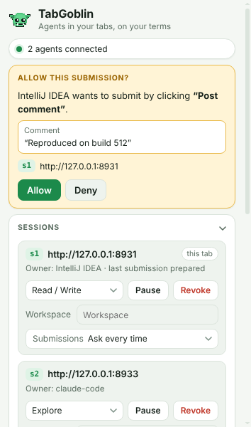

# TabGoblin

[](https://github.com/LaughingManCommits/TabGoblin/actions/workflows/ci.yml)


**Extend your coding agent beyond the IDE.**

TabGoblin is a user-controlled browser bridge for AI agents. It lets a coding agent
work in the web applications you are signed in to, in the browser tabs you authorize and at
the access level you choose. It needs no integration per application and no extra API
credentials.

<br clear="left">

## What is TabGoblin?

Much of what a coding agent needs is not in the repository: review comments, pipeline logs,
tickets, acceptance criteria. They live in web applications behind your sign-in. The usual
alternatives are an integration and an API token per application, or browser automation that
hands the agent your whole browser profile. TabGoblin takes a narrower path:

- **Your existing sign-ins.** The agent reads the page you have open, signed in as you are.
- **Generic tools, no per-site code.** Fourteen tools to read, search, navigate, click, fill and
  submit, on any website, within the [limits](#status-and-limits) below.
- **Access per tab.** Nothing is reachable until you authorize a tab, for its exact website.
- **You stay in control.** By default every submission is shown to you first, and you can pause
  or revoke at any time.
- **Local.** A server and a Chrome extension on your machine, talking over `127.0.0.1`. There is
  no hosted service.
- **CLI or MCP.** Two equal interfaces to the same tools: the agent runs `tabgoblin` commands in
  a terminal, or calls `browser_*` tools over MCP. Both go through the same server and the same
  checks.

## How it works


1. **You authorize a tab.** Click the TabGoblin icon on the tab, choose an agent and an access
   level, and press **Authorize**.
2. **The agent uses a tool,** as a command (`tabgoblin extract`) or an MCP call
   (`browser_extract`). It gets text back: the page's structure with numbered elements, its
   content, or what an action did.
3. **The server checks the call and passes it on, once.** Nothing is retried.
4. **The extension checks what you allowed, then acts:** the tab is authorized for this agent,
   the page is still on that website, and the access level covers the action.

 

The [architecture](docs/architecture.md) has the components, the flows and the trust boundaries.

## Security


Each control is one of three kinds. **Enforced** holds whatever an agent or a page does.
**Configurable** is a setting you or your organisation choose, enforced once set. **Best effort**
is a heuristic with known gaps: it reduces a risk and is not a boundary.

| Control | Kind |
|---|---|
| A tab is reachable only after you click its icon and authorize it; the extension has no host permissions | Enforced |
| A session is confined to its tab, its exact websites and one agent, checked before every command and again before each step | Enforced |
| Access levels: **Read**, **Explore** (also moves around the site), **Read / Write** (also clicks, fills and submits) | Enforced |
| No tool reads cookies, request headers or website storage, evaluates script, uses the debugger or makes a request of its own; password fields are neither read nor filled | Enforced |
| Pause, revoke and disconnect stop a running command before its next step; a step already done is not undone | Enforced |
| The same checks for the CLI and MCP | Enforced |
| A submission is shown to you before it is sent: by default every time; you can relax it per tab; always under the strict profile | Configurable |
| What counts as a submission: a form's submit control and Enter in a form are always recognised; outside forms, a control is recognised by English words in its label, and an unrecognised one is an ordinary Read / Write click | Best effort |
| Your settings file: blocked and allowed sites, highest access level, screenshots, session time, the strict profile, which interfaces are on, an audit record | Configurable |
| Buttons that delete, pay or publish always ask, whatever the setting; they are recognised by English words in their labels | Best effort |
| Credential fields other than passwords are recognised by their `autocomplete` value, name or id; text that looks like a key or token is taken out of what a page says | Best effort |

**Where it stops:**

- It governs what an agent does in your browser through TabGoblin, not the agent's other
  capabilities, such as its shell or its file access.
- It keeps agents apart that use it as intended. It is not isolation between programs: anything
  that runs under your operating-system account can read the pairing token and the agents' keys.
- Whatever an authorized tab shows goes to your agent and its model provider, and a page can
  try to mislead an agent within the access you gave it.
- When a command's outcome cannot be known (it was sent and no answer came), it is reported as
  unknown, and the agent should look at the page before trying again.

The [security model](docs/security-model.md) has the threat model, where each control is
enforced and where it stops, and the residual risks. The
[corporate assessment](docs/corporate-assessment.md) collects what an organisation needs to
assess it.

## Quick start

You need Google Chrome 120 or newer.

**1. Install.** Download the file for your system from the
[latest release](https://github.com/LaughingManCommits/TabGoblin/releases/latest) and unpack it
where it can stay. It is one folder, `tabgoblin`, with its own Java runtime; put it on your
`PATH` (on Linux and macOS the command is `./tabgoblin` inside it). To build it from source
instead, see the [installation guide](docs/installation.md#from-source).

**2. Load the extension.** At `chrome://extensions`, switch on **Developer mode**, press
**Load unpacked** and choose the folder's `extension` folder.

**3. Set up your agent,** with `claude-code`, `codex` or `copilot`:

```sh
tabgoblin --setup claude-code --mode cli     # the agent runs tabgoblin commands
tabgoblin --setup claude-code                # the agent uses MCP: run the one line it prints
```

Setup installs a [skill](skills/README.md) that teaches the agent the tools, and prints what is
left with your own paths. Any other agent works too: see
[the installation guide](docs/installation.md#5-connect-your-agent) for MCP and the
[CLI guide](docs/cli.md#agents-and-ides-without-mcp) for commands.

**4. Pair once.** `tabgoblin --panel` opens the server's window: press **Copy** next to
*Pairing token*, and paste it into the TabGoblin popup in Chrome.

**5. Authorize a tab and ask.** Start your agent anew and ask it for the browser status; from
then on the popup lists it. Click the TabGoblin icon on a tab, choose the agent and a level,
press **Authorize**, and ask, for example: *"Read the unresolved review comments in this pull
request and list the changes they ask for."*

The [installation guide](docs/installation.md) has each step with what you should see, how to
verify a download, and what to do when something goes wrong. More prompts are in the
[developer guide](docs/developer-guide.md#example-prompts).

## Documentation

| Document | Purpose |
|---|---|
| [Installation](docs/installation.md) | From a download or from source, for the CLI or MCP; verifying a download; problems during setup |
| [Developer guide](docs/developer-guide.md) | Everyday use: tabs, access levels, sessions, approvals, pausing and revoking, policy, troubleshooting |
| [CLI guide](docs/cli.md) | Commands, arguments, JSON output, exit codes, identity |
| [Tool reference](docs/tool-reference.md) | Every tool, for both interfaces: access, input, output, limits, errors |
| [Architecture](docs/architecture.md) | Components, flows, session lifecycle, trust boundaries |
| [Security model](docs/security-model.md) | Threat model, each control and where it stops, residual risks |
| [Corporate assessment](docs/corporate-assessment.md) | Deployment, data flow, permissions, policy, audit and release integrity |
| [Editors](docs/editors.md) | Which rich-text and code editors can be filled |
| [Skills](skills/README.md) | The instructions that teach Claude Code, Codex and GitHub Copilot the tools, for the CLI and for MCP |
| [Contributing](CONTRIBUTING.md) | Build, test and change TabGoblin |
| [Security policy](SECURITY.md) | How to report a vulnerability |

## Status and limits

- The extension is loaded unpacked, with Chrome's developer mode on. It is not in the Chrome
  Web Store, and the downloads are not code-signed.
- Chrome is the only browser it has been run in.
- The setup lines for Codex and GitHub Copilot follow those agents' documentation; regular use
  so far has been with Claude Code.
- When a tab moves to another website, Chrome withdraws the extension's access. A session that
  spans two websites needs one click from you per move.
- Frames from another website and closed shadow roots are not read. Editors that draw to a
  canvas cannot be filled ([which editors work](docs/editors.md#results)).
- Hovering sends the events a page's script listens for. What a page shows through a hover
  style alone does not appear.

## Licence

[MIT](LICENSE).
