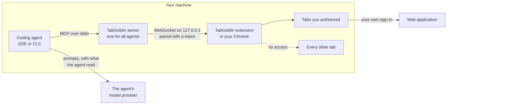

# TabGoblin

[](https://github.com/LaughingManCommits/TabGoblin/actions/workflows/ci.yml)


**Extend your coding agent beyond the IDE.**

TabGoblin gives coding agents controlled access to the web applications you are signed in to,
through a local MCP server and a Chrome extension. The agent works in the browser tabs you
authorize, at the access level you choose. It needs no application-specific integration and no
additional API credentials, and it never receives your cookies or tokens.

<br clear="left">

## The problem

Much of what a coding agent needs is not in the repository. Review comments, pipeline logs,
tickets, acceptance criteria and architecture decisions live in web applications behind your
sign-in. Without access to them, you copy text into the agent by hand.

The usual alternatives each cost something: an integration and an API token for every
application, or browser automation that hands the agent your whole browser profile.

TabGoblin takes a narrower path. The agent uses the session you already have, in the tabs you
select, through fourteen generic tools, and anything that sends data waits for your approval.

## What you get

- **Your existing sign-ins.** The agent reads the page as you see it. No tokens to issue, no
  API scopes to request.
- **Any web application.** The tools are generic: read, search, navigate, click, fill, submit.
  There is no website-specific code in TabGoblin; the agent supplies the understanding.
- **Access per tab.** A tab is available to an agent only after you authorize it, for its exact
  website, at one of three levels: Read, Explore or Read / Write.
- **Approval before anything is sent.** A submission is declared by the agent, shown to you with
  its content, sent once, and checked against what the page does afterwards.
- **Control while it runs.** Pause or revoke a tab, or disconnect an agent, at any moment.
- **Local.** The server and the extension run on your machine and talk over `127.0.0.1`.
  TabGoblin has no hosted service and sends nothing anywhere. What your agent reads is sent to
  the agent's model provider, as with any other context you give it.
- **Any MCP client** that starts a server over stdio. Several agents can share one browser,
  each with its own tabs.
- **Or no MCP at all.** An agent that only runs commands in a terminal uses the same tools as
  `tabgoblin` commands, through the same server and under the same rules
  ([the command line](docs/mcp-reference.md#the-command-line)).

## Example workflows

These are examples of the generic tools at work. None is a dedicated integration: the same
tools do the same on any website.

| Workflow | What the agent does |
|---|---|
| Process review comments on a pull request | Reads the discussion, also where it loads as you scroll or runs over pages; groups the comments; changes your local code |
| Investigate a failed pipeline | Searches a long log for errors with the lines around them, without reading the whole log; finds the cause in your source |
| Retrieve requirements and acceptance criteria | Reads a ticket by its outline and sections; follows links to related pages of the same site |
| Explore documentation and architecture decisions | Navigates a documentation site and reads the relevant sections |
| Investigate code quality findings | Reads the tables of findings and opens the details |
| Respond to review comments | Writes a reply and submits it after you approved it in the popup |

## How it works



1. **You authorize a tab.** Click the TabGoblin icon on the tab, choose an access level and
   press **Authorize**. That tab, on that website, is now a session your agent can use.
2. **The agent calls a tool,** such as `browser_extract` or `browser_click`. It gets text back:
   the page's structure with numbered elements, its content, or what an action did.
3. **The server checks the call and passes it on, once.** Nothing is retried.
4. **The extension checks what you allowed, then acts.** Is the tab authorized for this agent?
   Is the page still on that website? Does the access level cover the action? A submission is
   put to you first.

 

The [architecture](docs/architecture.md) has the components, the flows and the trust boundaries.

## How it differs from unrestricted browser automation

Automation through a browser's debugging interface or a test driver controls the whole browser.
TabGoblin is built to offer less:

| | Unrestricted browser automation | TabGoblin |
|---|---|---|
| Reach | Every tab of the profile it drives | Only the tabs you authorized, each on its exact website |
| Credentials | Cookies, storage and request headers can be read | No tool reads them, and the extension holds no permission for them |
| Code | Arbitrary script can run in a page | A fixed set of operations; no tool evaluates script |
| Network | Arbitrary requests | None. A tab can be navigated within its authorized website |
| Writes | Performed like any other action | Declared, shown to you, sent once, and verified |
| Control | The script decides | You pause, revoke and set the access level, per tab |

## Security principles

- **Least privilege.** The extension's permissions are `activeTab`, `scripting`, `storage` and
  `alarms`. It has no host permissions: it cannot touch a tab until you click its icon there.
- **Exact scope.** A session is one tab on the websites you gave it, checked before every
  command and again before each step that touches the page.
- **No credentials.** No cookies, headers, storage or tokens. Password fields are neither read
  nor filled.
- **Untrusted content.** Page content is returned as data and marked as such. A page cannot
  change a session, a permission or a setting.
- **The user decides.** Access is granted in the extension's popup and nowhere else.
- **Local policy.** A settings file can restrict every agent: blocked sites, allowed sites, a
  maximum access level, no screenshots, session time limits, a strict profile.

No access control makes an agent safe by itself. Whatever an authorized tab shows goes to your
agent and its model provider, and a page can try to mislead an agent within the access you gave
it. The [security model](docs/security-model.md) says what is enforced, what is configurable,
what is best effort, and [what remains your risk](docs/security-model.md#residual-risks).

## Quick start

You need Google Chrome 120 or newer and an agent that speaks MCP over stdio. Downloads exist
for Windows (x64), Linux (x64) and macOS (Apple silicon); the Java runtime the server needs is
inside.

1. **Download** the file for your system from the
   [latest release](https://github.com/LaughingManCommits/TabGoblin/releases/latest) and unpack
   it where it can stay.
2. **Run setup** in that folder: `tabgoblin --setup claude-code` (or `codex`, or `copilot`). It
   installs a skill for the agent and prints the next three steps with your own paths.
3. **Register the server with your agent:** run the line that setup printed.
4. **Load the extension:** at `chrome://extensions`, switch on Developer mode, press **Load
   unpacked** and choose the download's `extension` folder.
5. **Pair, once:** `tabgoblin --panel` opens the server's window. Press **Copy** next to
   *Pairing token* and paste the token into the TabGoblin popup in Chrome.

Then open a website, click the TabGoblin icon on that tab, press **Authorize**, and ask your
agent for the browser status.

The [installation guide](docs/installation.md) has each step with what you should see, how to
verify a download, and how to build from source.

## MCP client configuration

The server is a command your agent starts. `--agent` gives the agent a stable identity, so its
tabs are its own again after a restart.

Claude Code:

```sh
claude mcp add --scope user tabgoblin -- "<folder>/tabgoblin/runtime/bin/java" -jar "<folder>/tabgoblin/browser-context-mcp.jar" --agent claude-code
```

Clients that take JSON:

```json
{
  "mcpServers": {
    "tabgoblin": {
      "command": "<folder>/tabgoblin/runtime/bin/java",
      "args": ["-jar", "<folder>/tabgoblin/browser-context-mcp.jar", "--agent", "my-ide"]
    }
  }
}
```

`<folder>` is where you unpacked the download; on Windows the command is
`<folder>\tabgoblin\runtime\bin\java.exe`. `tabgoblin --setup` prints these lines with your
paths filled in. Use a different `--agent` name for each agent.

## Example prompts

With the relevant tab authorized:

> Read the unresolved review comments in this pull request, group them by priority and identify
> the changes required in my local codebase.

> Investigate the failed pipeline, extract the relevant errors and determine the root cause
> using the local source code.

> Explore the authorized documentation and identify requirements relevant to the feature I am
> implementing.

> Read the acceptance criteria of this ticket and check my current branch against each of them.

> Draft a reply to the second review comment that explains the fix, and submit it when I have
> approved it.

More, with the access level each needs, are in the
[developer guide](docs/developer-guide.md#example-prompts).

## Documentation

| Document | Purpose |
|---|---|
| [Installation](docs/installation.md) | Set it up from a download or from source; verify a download; problems during setup |
| [Developer guide](docs/developer-guide.md) | Everyday use: authorize tabs, access levels, sessions and workspaces, approvals, pausing and revoking, policy, troubleshooting |
| [MCP tool reference](docs/mcp-reference.md) | Every tool: required access, input, output, limits, errors |
| [Architecture](docs/architecture.md) | Components, flows, session lifecycle, trust boundaries |
| [Security model](docs/security-model.md) | Threat model, each control with where it is enforced and where it stops, residual risks |
| [Corporate assessment](docs/corporate-assessment.md) | The facts an organisation needs to assess TabGoblin: deployment, data flow, permissions, listeners, policy, audit, release integrity |
| [Editors](docs/editors.md) | Which rich-text and code editors can be filled, and what was measured |
| [Skills](skills/README.md) | Instructions that teach an agent the tools, for Claude Code, Codex and GitHub Copilot |
| [Contributing](CONTRIBUTING.md) | Build, test and change TabGoblin |
| [Security policy](SECURITY.md) | How to report a vulnerability |

## Status and limits

- The extension is loaded unpacked, with Chrome's developer mode on. It is not in the Chrome
  Web Store, and the downloads are not code-signed.
- Chrome is the only browser it has been run in.
- It has been used with Claude Code and with a scripted MCP client. The setup lines for Codex
  and GitHub Copilot follow their documentation and have not been run.
- When a tab moves to another website, Chrome withdraws the extension's access. A session that
  spans two websites needs one click from you per move.
- Frames from another website and closed shadow roots are not read. Editors that draw to a
  canvas cannot be filled; thirteen editor libraries are tested
  ([results](docs/editors.md#results)).
- Hovering sends the events a page's script listens for. What a page shows through a hover
  style alone does not appear.
- Buttons that submit, or that do something drastic, are recognised outside forms by English
  labels.

Some technical names, such as `browser-context-mcp` and `BCMCP_*`, predate the product name and
are kept for compatibility: [which, and why](docs/development.md#names).

## Licence

[MIT](LICENSE).
