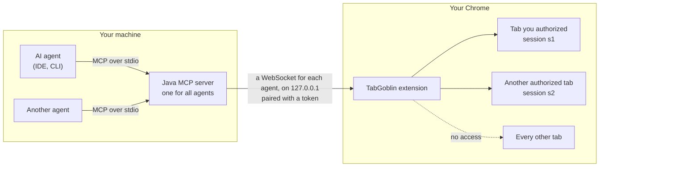
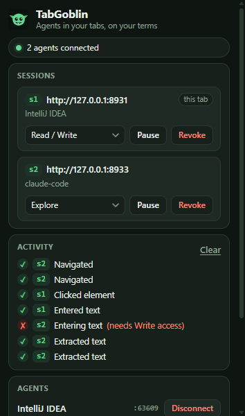

# TabGoblin

Lets AI agents on your machine read and operate **the browser tabs you authorize**, in your own
Chrome with your own logins. Agents get fourteen generic browser tools over MCP; they never get your
cookies, tokens or the ability to run code, and they reach only the tabs and websites you chose.

 

<!-- The same picture is in docs/README.md, under "The idea in one picture": change both. -->

 

## How it works

1. **You authorize a tab.** Click the goblin on the tab, pick an access level and press
   **Authorize**. That tab, on that website, is now a session your agent can use.
2. **Your agent calls a tool,** for example "take a snapshot" or "click element 14". It gets
   plain text back: the page's structure with numbered elements, its text, or what the click did.
3. **The server passes the call on, once.** It runs on your machine and talks to the extension
   over a local connection that the two set up with a shared token.
4. **The extension checks, then acts.** Is the tab authorized for this agent? Is the page still
   on that website? Does the access level allow it? Only then does it work in the page, and
   anything that sends data asks you first.

The agent never gets cookies, tokens, passwords or raw page code, and it cannot reach a tab you
did not authorize.

## What it does

- **Sessions.** Each authorized tab is a session: one website, one access level, one agent.
  Agents and tabs cannot reach each other.
- **Access levels.** Read looks. Explore also navigates and expands. Read / Write also clicks,
  types and submits.
- **Reading.** A snapshot with numbered elements, or the page's text with an outline. Both say
  how complete they are.
- **Acting.** Click, fill, type, press keys, scroll, navigate, wait, take screenshots.
- **Submitting.** The agent declares it, you confirm it, it is sent once, and the result is
  checked against the page.
- **Control.** Pause or revoke a session, disconnect an agent, and watch what happens, in the
  popup or in the [server's window](docs/user-guide.md#9-the-servers-panel). A tab that leaves
  its website is suspended until you resume it.
- **Blocked sites.** Name the sites no agent may work on, whatever a tab is authorized for
  ([user guide](docs/user-guide.md#blocked-sites)).
- **Any website.** There is no site-specific code anywhere; the agent supplies the understanding.

## Quick start

Nothing has to be installed first: the Java the server runs on is in the download.

1. **Download** the file for your system from the [latest release](https://github.com/LaughingManCommits/TabGoblin/releases/latest),
   and unpack it where it can stay.
2. **Run setup** in that folder: `tabgoblin --setup claude-code` (or `codex`, or `copilot`).
   It prints the next three steps with your own paths.
3. **Tell your agent about the server:** run the one line that setup printed.
4. **Load the extension:** at `chrome://extensions`, switch Developer mode on, press Load
   unpacked and choose the download's `extension` folder.
5. **Pair:** `tabgoblin --panel` opens the server's window. Press **Copy** next to *Pairing
   token* and paste it into the goblin's popup in Chrome.

Then open a website, click the goblin on that tab, press **Authorize**, and ask your agent for
the browser status.

The [installation guide](docs/installation.md) has every step with what you should see, and how
to build from source instead.

## Documentation

To use it:

| | |
|---|---|
| [Installation](docs/installation.md) | Get it running: from a download, or built from source |
| [User guide](docs/user-guide.md) | Authorize tabs, the popup, submissions, the server's window, troubleshooting |
| [Cheat sheet](docs/cheatsheet.md) | The commands at a glance |
| [Skills](skills/README.md) | A skill that teaches your agent the tools: Claude Code, Codex, GitHub Copilot |

To understand it:

| | |
|---|---|
| [Tool reference](docs/tools.md) | Every tool with real outputs and every error code |
| [Security model](docs/security.md) | What an agent can reach, how that is enforced, what remains your risk |
| [Architecture](docs/architecture.md) | How the parts fit: processes, protocol, sessions |
| [Editors](docs/editors.md) | Which rich-text and code editors can be filled, and what was measured |

To work on it:

| | |
|---|---|
| [Development](docs/development.md) | Build, run the tests, conventions, releases |
| [MCP conformance](docs/mcp-conformance.md) | Which revision of the protocol the server speaks, and how that is checked |

## Limits worth knowing

- Whatever is visible in an authorized tab goes to your agent and its model provider.
- A page can try to steer an agent within the access you gave it. Keep "Ask me every time"
  where a wrong submission would hurt.
- When a tab moves to another website, Chrome withdraws the extension's access: a session that
  spans two websites needs one click from you per move.
- Frames from another website and closed shadow roots are not read.
- Rich-text and code editors are filled without real keystrokes. Thirteen editor libraries are
  tested ([results](docs/editors.md#results)); editors that draw to a canvas, such as Google
  Docs, are out of reach.
- There is no hover. What a page shows only while the mouse is over something cannot be
  brought up; menus that also open on a click or with the keyboard work.
- Buttons that submit, or that do something drastic, are recognised outside forms by English
  labels.
- The extension is loaded unpacked, with Chrome's developer mode on. It is not in the Chrome
  Web Store.
- Tried with a generic MCP client and with Claude Code; not yet with IntelliJ's own agent.

What of this is a risk to you, and what else is, stands with its reasons in the security model
under [what remains your risk](docs/security.md#what-remains-your-risk).

Some technical names, such as `browser-context-mcp` and `BCMCP_*`, predate the product name and
are kept for compatibility: [which, and why](docs/development.md#names).

## Licence

[MIT](LICENSE).
