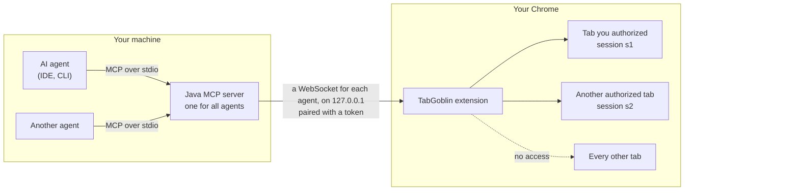

# TabGoblin documentation

TabGoblin lets AI agents on your machine read and operate the browser tabs you authorize, in your
own Chrome with your own logins, without handing them cookies, tokens or the ability to run code.

To use it:

| Document | Read it when you want to… |
|---|---|
| [Installation](installation.md) | get it running: from a download, or built from source |
| [User guide](user-guide.md) | authorize a tab, and understand what the popup and the server's window show and do |
| [Cheat sheet](cheatsheet.md) | find a command |
| [Skills](../skills/README.md) | give your agent a skill for the tools: one each for Claude Code, Codex and GitHub Copilot |

To understand it:

| Document | Read it when you want to… |
|---|---|
| [Tool reference](tools.md) | know what each tool takes and returns, with real outputs and every error code |
| [Security model](security.md) | know exactly what an agent can and cannot reach, and what is still your risk |
| [Architecture](architecture.md) | understand how the pieces fit: processes, protocol, sessions, refs, submissions |
| [Editors](editors.md) | know which rich-text and code editors an agent can fill, and how that works |

To work on it:

| Document | Read it when you want to… |
|---|---|
| [Development](development.md) | build it, run the tests, change it, make a release |
| [MCP conformance](mcp-conformance.md) | know which revision of the protocol the server speaks, and how that is checked |

## The idea in one picture

<!-- The same picture is in the root README.md: change both. -->

- The **agent** understands the website and decides what to do.
- The **server** offers eleven generic tools and passes them on. It knows nothing about any site.
- The **extension** does the work in the page and enforces what you allowed.
- **You** log in, choose the tabs, choose the access level, and can pause or revoke at any time.

## What happens to one tool call

1. **Your agent calls a tool,** for example `browser_snapshot`, or `browser_click` with the
   number of an element. All it ever gets back is text.
2. **A small process that your agent started passes the call on** to the one TabGoblin server,
   and starts that server first if none is running.
3. **The server checks the call** and your list of blocked sites, and sends one command to the
   extension. A command is sent once and never repeated.
4. **The extension checks what you allowed:** the tab is authorized for this agent, the page
   is still on the authorized website, and the access level covers the action. A submission is
   put to you in the popup first.
5. **The extension does the work in that tab** and sends the result back, which the server
   turns into text for the agent.

The agent never gets cookies, tokens, passwords, scripts or raw page code. The same, with
every message that passes, is in the [architecture](architecture.md#a-command-end-to-end).

## Vocabulary

| Term | Meaning |
|---|---|
| Agent | One MCP client (an IDE's assistant, a CLI). All agents are served by one server process, which the first of them starts. |
| Session | One authorized tab, bound to one agent: `s1`, `s2`, … |
| Origin | Scheme + host + port, e.g. `https://app.example.com`. A session covers the origins you gave it and nothing else. |
| Access level | Read (look), Explore (also navigate and expand), Read / Write (also operate and submit). |
| Ref | The number in front of an element in a snapshot, e.g. `[12]`. Tools act on refs. |
| Suspended | The tab left the session's origins. Nothing is readable until you resume it on that tab. |
| Panel | The server's small window: its sessions, its log, the pairing token to copy, and a button to stop it. It shows when the server is started with `--panel`, and comes up by itself when the browser has to be paired. See the [user guide](user-guide.md#9-the-servers-panel). |
