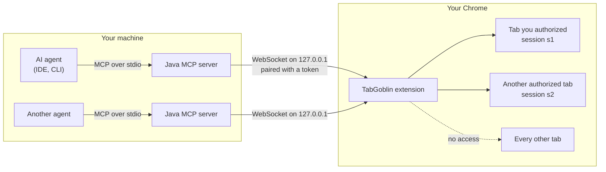

# TabGoblin documentation

TabGoblin lets AI agents on your machine read and operate the browser tabs you authorize, in your
own Chrome with your own logins, without handing them cookies, tokens or the ability to run code.

| Document | Read it when you want to… |
|---|---|
| [Installation](installation.md) | build it and get it into Chrome, step by step |
| [User guide](user-guide.md) | authorize a tab, and understand what the popup shows and does |
| [Tool reference](tools.md) | know what each tool takes and returns, with real outputs and every error code |
| [Architecture](architecture.md) | understand how the pieces fit: processes, protocol, sessions, refs, submissions |
| [Security model](security.md) | know exactly what an agent can and cannot reach, and what is still your risk |
| [Development](development.md) | build it, run the tests, change it, regenerate the screenshots |

## The idea in one picture

- The **agent** understands the website and decides what to do.
- The **server** offers eleven generic tools and passes them on. It knows nothing about any site.
- The **extension** does the work in the page and enforces what you allowed.
- **You** log in, choose the tabs, choose the access level, and can pause or revoke at any time.

## Vocabulary

| Term | Meaning |
|---|---|
| Agent | One MCP client (an IDE's assistant, a CLI). Each starts its own server process. |
| Session | One authorized tab, bound to one agent: `s1`, `s2`, … |
| Origin | Scheme + host + port, e.g. `https://app.example.com`. A session covers the origins you gave it and nothing else. |
| Access level | Read (look), Explore (also navigate and expand), Read / Write (also operate and submit). |
| Ref | The number in front of an element in a snapshot, e.g. `[12]`. Tools act on refs. |
| Suspended | The tab left the session's origins. Nothing is readable until you resume it on that tab. |
