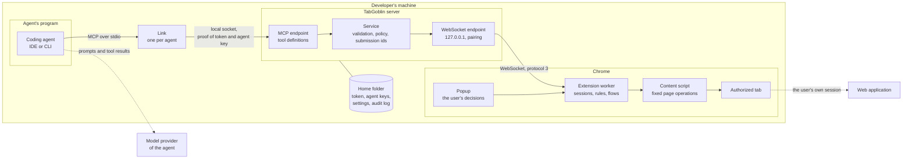
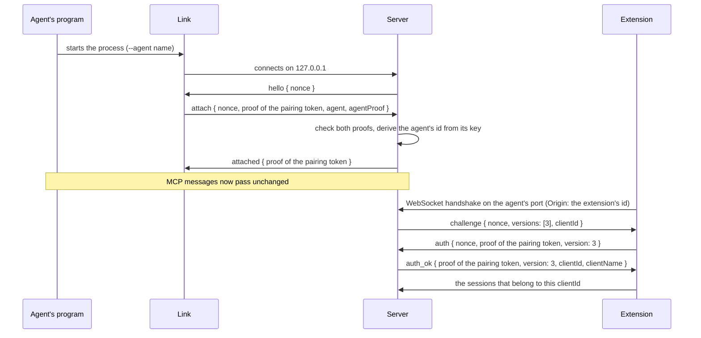
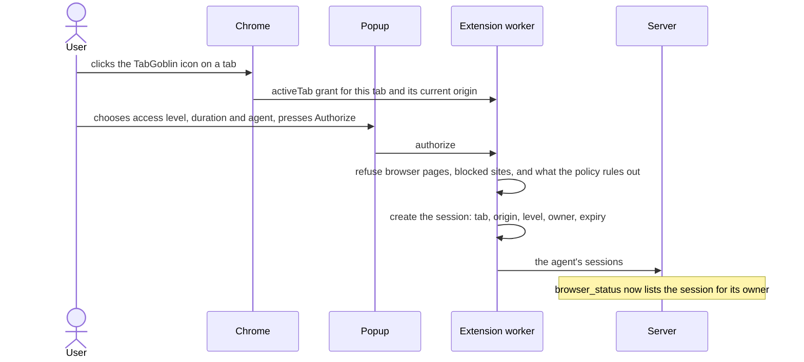
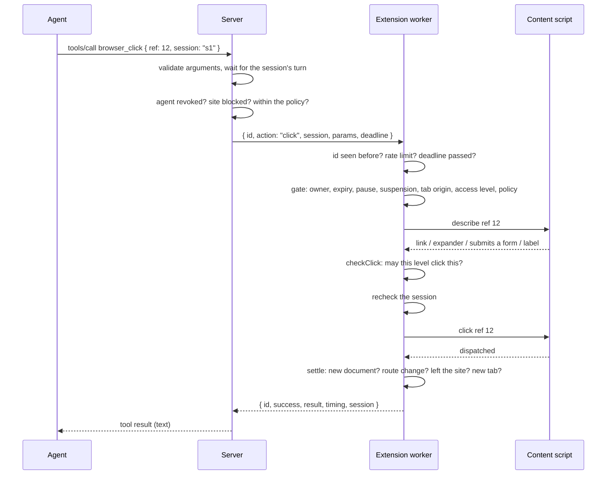
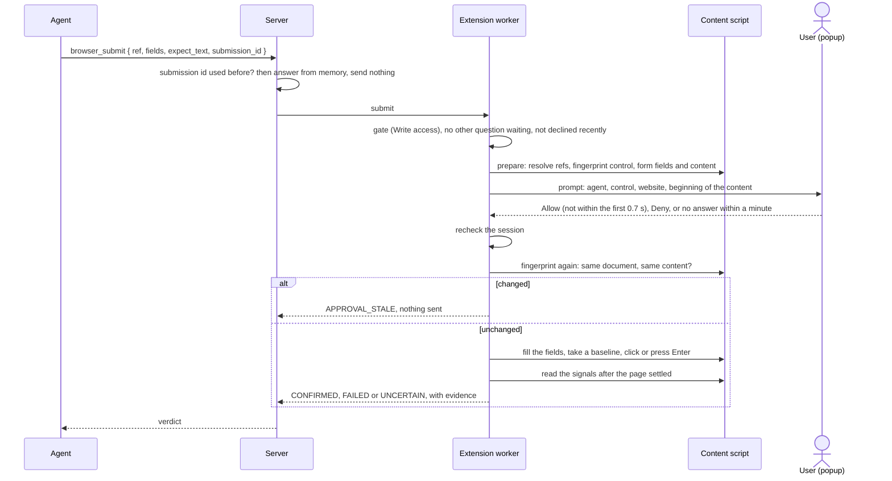
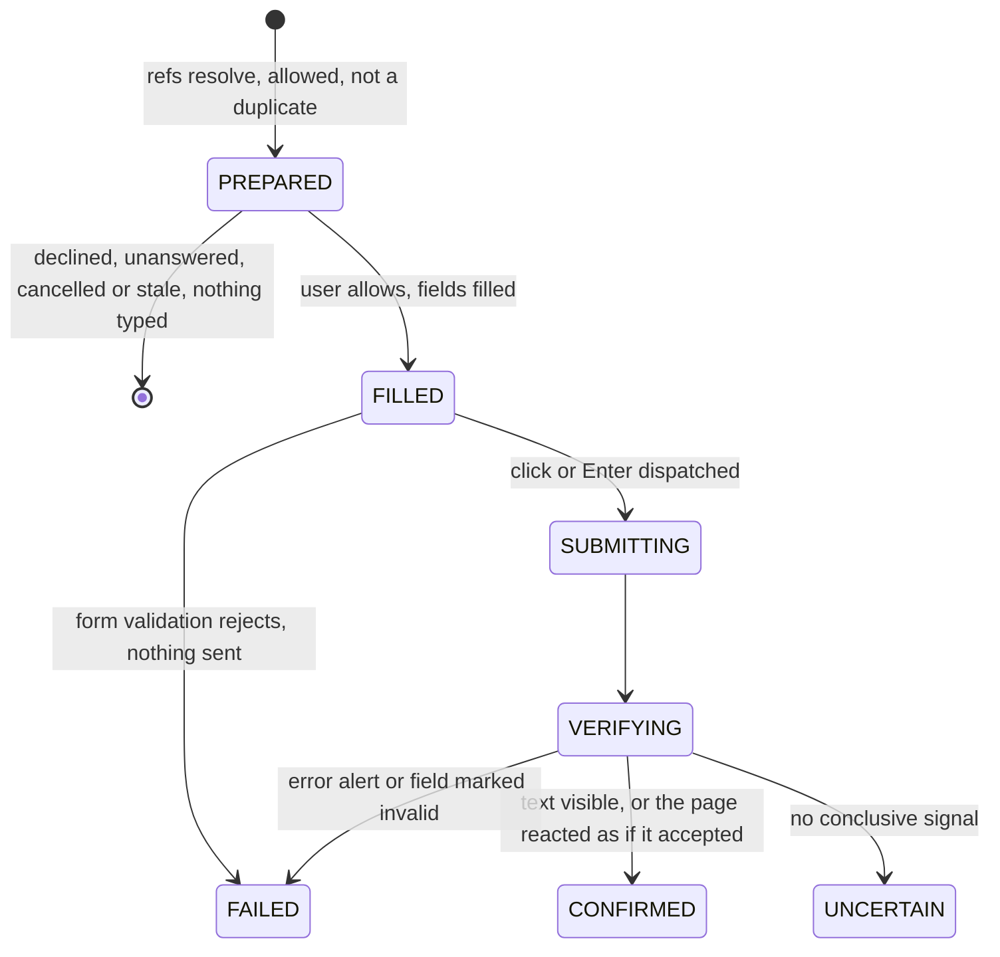
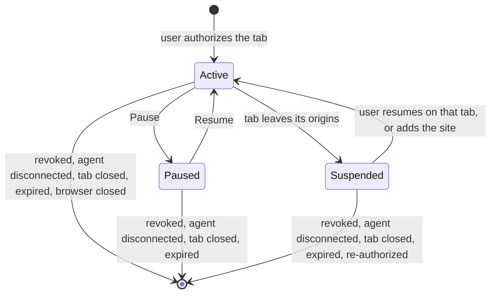

# Architecture

TabGoblin has two parts that run on the developer's machine: a local MCP server and a Chrome
extension. One rule shapes both: **the agent understands websites; TabGoblin provides generic
browser operations and enforces what the user allowed.** There is no website-specific code,
selector, parser or workflow in either part.

This page describes the components, how they connect and authenticate, how a tab is authorized,
how an operation runs, how a submission is approved, and where the trust boundaries are. The
rules themselves, with where each is enforced and where it stops, are in the
[security model](security-model.md).

## Components



| Component | Responsibility | Does not |
|---|---|---|
| Coding agent | Understand the website, plan, decide which tool to call | Touch the browser except through the tools |
| Link (`Link.java`) | Pass its agent's MCP messages to the server and the answers back; start the server if none runs; prove the pairing token and the agent's key | Read or change a message; send one twice |
| Server (`Hub`, `Agent`, `McpMain`, `BrowserService`, `WebSocketBridge`) | Serve every connected agent: define the tools, validate arguments, apply the settings file's policy, bind calls to sessions, time out, cancel, remember submission ids, log | Know any website; hold page content; tell one agent about another |
| Extension worker (`background.ts`, rules in `policy.ts`) | Hold the sessions; check every command against what the user allowed; drive navigation and submissions; keep the activity list | Trust the page; run code supplied by an agent |
| Content script (`content.ts`) | Read the rendered page into allowlisted text; perform one fixed operation per request | Keep anything; talk to anyone but the worker |
| Popup | Show state; take the user's decisions: pair, authorize, set a level, approve, pause, revoke | Decide anything itself |

## Trust boundaries

| Boundary | What crosses it | What protects it |
|---|---|---|
| Agent → server | Tool calls and results (text, and a JPEG for a screenshot) | The link proves the pairing token and, for a named agent, that agent's key |
| Server → extension | One command per call; results; the policy | Loopback only; the extension's origin; mutual proof of the pairing token; protocol version |
| Extension → page | Fixed operations on a document of an authorized origin | Chrome's `activeTab` grant; the extension's own checks before each step |
| Page → agent | Allowlisted text of the rendered page, marked as untrusted | No scripts, hidden content or password values; redaction by shape |
| User → extension | Every grant and approval | Given in the popup only, which a page cannot reach |

**Local:** the agent's program, the link, the server, Chrome with the extension, and the files
in the home folder. TabGoblin opens no connection other than between these, on `127.0.0.1`.

**External:** the web application, which the tab talks to with the user's own session, exactly
as when the user browses; and the agent's model provider, which receives whatever the agent
puts into its prompts, including what it read through TabGoblin. TabGoblin controls neither.

## Vocabulary

| Term | Meaning |
|---|---|
| Agent | One MCP client: an IDE's assistant or a CLI. Up to eight are served at once |
| Session | One authorized tab, bound to one agent: `s1`, `s2`, … |
| Origin | Scheme, host and port, such as `https://app.example.com`. A session covers the origins the user gave it |
| Access level | Read, Explore, or Read / Write ([developer guide](developer-guide.md#access-levels)) |
| Ref | The number of an element in a snapshot, such as `[12]`. Tools act on refs |
| Suspended | The tab left the session's origins. Nothing is readable until the user resumes it on that tab |
| Policy | Restrictions from the local settings file that apply to every agent |

## Processes and ports

An MCP client starts its server as a child process and talks to it over stdio. So that all
agents share one server, that child is only a *link*: it connects to the one server on
`127.0.0.1` and passes its agent's messages on, line by line. If no server is listening, the
link starts one as an independent process, which then also serves the agents that come later.

Inside the server each agent has its own id, its own WebSocket port for the extension, its own
sessions and its own tools. The ports:

| Port | Default | Used for |
|---|---|---|
| Agents' ports | 47821 to 47828 | One WebSocket endpoint per agent, the first free port counting up from `--port`. The extension connects to each |
| Server's port | 47829 | Links connect here: the port after the agents' eight |

Both listen on `127.0.0.1` only. Agents share the process and nothing else: no tool tells one
agent anything about another.

Where the one server cannot be reached or started, for example because another program holds
its port, the process an agent started serves that agent alone and says so in its log.

## Agent connection and authentication



Two secrets are involved, both files in the user's home folder:

- **The pairing token** links the browser with the server. The server and the extension each
  prove knowledge of it with HMAC-SHA256 over nonces of both sides; the token itself is never
  sent. The link proves the same token to the server, with a different prefix in the proof, so
  a proof made for one purpose is not valid for another.
- **An agent's key** says which agent a link speaks for. A program that names its agent with
  `--agent <name>` gets a key file of its own, created at first use. The link proves the key
  in the same message as the token, and the server gives the agent the id that follows from
  the key (`a-` and twelve hexadecimal digits). The extension never holds the key; it learns
  the id in the server's proven answer and binds sessions to it.

An agent started without `--agent` gets an id for that start only. A key has one agent at a
time: a second process with the same key gets an id of its own.

Failure handling: a server that offers no common protocol version is refused (close code
4406); ten failed pairings lock a port for a minute; ten wrong link proofs in a minute and the
server accepts no link for the rest of it; a rotated token ends every pairing before its next
command. The extension sends a heartbeat every 20 seconds, and a server that leaves two in a
row unanswered is treated as gone. The messages and close codes are in the
[protocol reference](development.md#protocol-reference).

## Browser session authorization



A session exists only through this path. No tool creates one, raises its level or adds a site
to it. An agent can *ask* for a higher level or for a tab on another site
(`browser_request_access`); the request is shown in the popup and grants nothing by itself.

| Session field | Meaning |
|---|---|
| `sessionId` | `s1`, `s2`, …: the handle agents use |
| `clientId`, `clientName` | The owning agent's id and display name; empty until claimed, for a tab authorized for *Any agent* |
| `tabId` | The tab |
| `origins` | Every origin the user authorized for it |
| `mode` | `read`, `explore` or `write` |
| `documentId`, `generation` | The current document and its snapshot count |
| `paused`, `suspended`, `expiresAt` | Lifecycle |
| `workspace` | An optional name the user files the tab under. It groups tabs in the popup and grants nothing |

**Ownership.** A session belongs to the agent chosen at authorization, or to the first agent
that uses an unclaimed one. Every command is checked against the owner's id, and a session
never passes to another id (`canUse` in `policy.ts`). An agent with a key has the same id after
a restart of its program or of the server, so its sessions are its own again; the extension
tells the server its sessions when it pairs. A server cannot claim a session.

## Permission enforcement

Checks happen in four places, each independent of the others:

| Where | When | What |
|---|---|---|
| Server (`BrowserService.refuseIfBlocked`) | Before a command is sent | Arguments are valid; the agent is not revoked; the session's sites and the address to go to are not blocked and are within the policy; the policy allows the access level and screenshots |
| Extension worker (`gate` and `recheck` in `background.ts`, rules in `policy.ts`) | When a command arrives, and again before each step that touches the page | The session exists and belongs to this agent; it is not paused, suspended or expired; the tab is on one of its origins at that moment; the access level covers the action; the site is not blocked; the policy allows it |
| Content script (`content.ts`) | Before each operation | Its document's origin is one of the session's |
| Chrome | Always | The `activeTab` grant covers only the tab the user clicked on, and ends when that tab changes origin |

Every rule that decides whether something is allowed is a pure function in `policy.ts`, tested
without a browser. An unknown tab address, a message that cannot be parsed and a missing owner
all mean no.

## A command, end to end



The server sends one command per session at a time, and the extension queues per tab as well,
at most twenty. Different sessions run in parallel. **Nothing is retried, anywhere:** a
command is sent once, a timed-out command is cancelled so that it cannot run later, and an
unknown outcome is reported as unknown.

### Reading a page

The content script walks what is rendered, in document order, and emits allowlisted
information only: roles, names, a few states and visible text. Scripts, styles, hidden inputs
and hidden content are not visited. Frames of the same origin are read as part of the page;
frames of another origin are reported as blocked.

- **Snapshot** (`snapshot.ts`) answers "what is here and what can I act on": an indented
  hierarchy with refs.
- **Extract** (`extract.ts`, `search.ts`) answers "what does it say": structured text with an
  outline, sections, matching lines and regions of one kind.
- **Collect** (`collect.ts`) reads over several scrolls or pages in one call, within limits;
  each step is checked like a command of its own.
- **Completeness** is computed for every result: `COMPLETE`, `PARTIAL`, `TRUNCATED`, `BLOCKED`
  or `UNKNOWN` ([tool reference](mcp-reference.md#completeness)).

### Element refs

A snapshot gives listed elements a number. Three properties make refs safe to act on:

1. **Identity.** A ref is tied to one DOM element. The same element keeps its ref across
   snapshots; a replacement gets a new one.
2. **Staleness.** Before acting, the element must still be connected, visible, and carry the
   role and name it had when listed. Otherwise the command fails with `STALE_REF`.
3. **No reuse.** A number is handed out once in a browser run, and every session draws from
   its own block, so a ref from another document or tab resolves to nothing.

### Navigation

| Kind | How | Outcome reported |
|---|---|---|
| URL | The destination is resolved and checked against the session's origins, then `tabs.update` | `new-document`, `same-document`, `no-change`, `timeout`, `needs-user`; `redirected` where the site sent the tab elsewhere |
| Back, forward | In the page, to a specific entry of the Navigation API, which lists only this origin's entries | As above, or `NAVIGATION_BLOCKED` when there is none |
| Reload | `tabs.reload` | `new-document` |
| Click, key | After dispatch the tab is watched until it settles | `none`, `same-document`, `new-document`, `left-origin`, and `openedNewTab` |

The browser's own back button is not used: it skips history entries opened without a user
gesture, which is every page an agent opened, and can leave the site.

## Submission approval and revocation

Anything that sends or changes data is a submission. The agent must declare it; by default the
user approves each one.





- **Replay protection.** The server remembers every `submission_id` and never sends one twice.
  A fingerprint of the content, computed in the page, lets the extension refuse identical
  content within two minutes unless the agent sets `repeat`. A timeout or a lost connection is
  recorded as `UNCERTAIN` and not resent.
- **Verification** compares a baseline taken just before the click with the page afterwards:
  the expected and submitted text outside the fields it was typed into, new alerts and status
  messages, fields marked invalid, cleared fields, and a change of address or document. The
  verdict is a pure function of those signals (`judgeSubmission` in `submit.ts`).
- **Revocation and cancellation.** When the user pauses or revokes a session, lowers its level
  or disconnects its agent, running and queued operations of that session stop at their next
  safe point: any moment before something is dispatched to the page. For a submission the last
  one is immediately before the click. What was dispatched is not undone.

| Trigger | Effect |
|---|---|
| User pauses, revokes or lowers access | Operations of that session stop at their next safe point |
| User disconnects an agent | Its operations are cancelled, a question it put to the user is withdrawn, its sessions end |
| MCP client sends `notifications/cancelled` | The tool call is interrupted; the server sends `cancel` to the extension and no answer for that call |
| Server times out waiting | The server sends `cancel`, so the command cannot run later |
| Tab closes or leaves its origins | The session ends or is suspended; its operations stop |

A call that waits for the user can take a minute and a half. A client that sent a progress
token is told every three seconds that the call is still running.

## Session lifecycle



- **Expiry.** The user chooses a duration at authorization. The policy can add a maximum
  lifetime and an idle limit; the extension applies both at the command that finds the session
  expired, and by a periodic check.
- **Suspension.** Chrome withdraws the `activeTab` grant whenever a tab changes origin, and
  only a click on the extension's icon gives it back. After a cross-origin move the extension
  cannot read the tab whatever its own rules say. The session keeps its owner, level and
  history, and needs one click to resume.
- **Persistence.** Sessions live in `chrome.storage.session`: they survive a restart of the
  extension's worker and end when the browser closes. The token, the settings and the ids of
  agents the user disconnected are in `chrome.storage.local`.
- **The worker can stop at any time.** Manifest V3 stops an idle worker. All durable state is
  in storage; while an agent is connected the heartbeat keeps the worker alive; otherwise an
  alarm every 30 seconds, the popup or a tab switch wakes it to look for servers. After a
  restart, operations that were in flight are gone and submissions that had been dispatched
  are marked `UNCERTAIN`.

### How a server ends

A link ends when its agent's program closes the input, on Ctrl+C or on a signal to stop. The
server then closes that agent's MCP conversation and its WebSocket; the extension gets the
close code for "going away" (1001) and drops that agent at once. Other agents are not touched.

The server itself ends when its last agent has gone and none has come for three seconds, or
when the user stops it in its window. A server the user started with `--panel` in a terminal
stays until it is stopped.

When the server's process is gone and nobody stopped it, each link that still has its agent
starts the server again or connects to the one another link started. Three things keep that
from sending anything twice: the link itself answers every request its agent was waiting for
(a tool call gets [`CONNECTION_LOST`](mcp-reference.md#errors): outcome unknown, nothing
retried); it proves its agent's key to the new server and replays only the agent's opening
message; and a message that had not reached the old server goes to the new one once. When the
user stopped the server, links are told first and do not start it again.

A command line that is not understood starts nothing: the reason and the usage text go to
standard error, and the exit code is 2.

## The notice in the page

While an agent works in a tab, a small bar in the corner of the page says so. It is drawn
inside the web page, in a closed shadow root, so what it is given and what it can do are kept
minimal. The worker sends the page two things (`setNotice` in `background.ts`):

| Sent | When | Carries |
|---|---|---|
| A state | A command starts (`working`); the user is asked about a submission or a higher level in that tab's session (`asking`); a session is paused or resumed (`paused`, `idle`) | For `working`, the fixed words of the activity list for the running action |
| A line | A command ends | The activity list's words for it, and for a failure the short note of its error code |
| `off` | The session ends or is suspended, a screenshot is about to be taken, or the setting is switched off | Nothing |

Nothing of a page, of entered text, of a control's name, of a site or of an agent goes to the
page this way. The notice has two buttons, and both react only to a click the browser marks as
the user's: **Pause**, which can only restrict, and, while a question waits, **Answer**, which
sends the worker one fixed message. The worker then opens the popup if a question waits for
that tab's session, and does nothing otherwise. The answer is given in the popup. The notice
is taken out of the page before a screenshot and is in no snapshot or extract. How it is drawn
and timed is in [development](development.md#the-notice-in-the-page).

## The server's panel

The server has an optional window (`--panel`), drawn with JavaFX from a plain data model
(`PanelModel.java`) that is built from what the status tool also reads. It shows every agent
with its sessions (site, level and state; no page title or address), where the time of recent
tool calls went, and the last 300 log lines. Its controls stop the server, switch the
connection to the browser off, copy the pairing token to the clipboard, and open the settings
file. It authorizes no tab and changes no access level, and it opens no port: it is a window
of the server's process. What a user does with it is in the
[developer guide](developer-guide.md#the-servers-panel), its rules in the
[security model](security-model.md#the-servers-panel), and how it is built in
[development](development.md#the-servers-panel).

## Where things are

```text
java-server/src/main/java/browsercontext/
  McpMain.java             entry point, command line, tool definitions
  Link.java                the process an agent starts: passes messages to the one server
  Hub.java                 the one server: accepts links, identifies agents
  Agent.java               one agent inside the server: its port, sessions, tools
  StdinTap.java            end of input, client-side cancellation
  Progress.java            tells a client that asked for it that a call is still running
  BrowserService.java      tool arguments → commands → results, submission ids, policy checks
  BlockedSites.java        the settings file: blocked sites and the security policy (Limits)
  AgentKeys.java           an agent's key file, the id that follows from it, its proof, revoking
  Audit.java               the optional record on disk, one JSON line per command
  WebSocketBridge.java     localhost endpoint, origin check, pairing, lockout, limits
  ExtensionConnection.java correlation, deadlines, cancellation, per-session ordering
  Protocol.java            typed messages, error categories
  BrowserException.java    an error for the agent: a stable code and a message
  Pairing.java             token file, rotation, HMAC proofs
  Timings.java             where the time of the last tool calls went
  Log.java                 diagnostics without content; the last lines, kept for the panel
  PanelModel.java          what the server's panel shows at a moment, without a window
  Panel.java               the panel's window (JavaFX)
  Setup.java, Skills.java  --setup and --install-skill
chrome-extension/src/
  background.ts            connections, sessions, gate, navigation, submissions, activity
  policy.ts                every rule, as pure functions
  protocol.ts              typed messages and their validation
  pairing.ts               HMAC proofs for the pairing, the mirror of Pairing.java
  content.ts               fixed set of page operations; holds the notice in the page
  snapshot.ts              rendered-DOM walk, roles, names, refs, hierarchy, completeness
  extract.ts               structured text, outline, sections, matching lines, regions
  search.ts                searching lines: a literal, or a regular expression in bounded time
  collect.ts               what of a further reading is new, after a scroll or on a next page
  redact.ts                what looks like a credential, taken out of text and addresses
  interact.ts              click, hover, fill, type, keys, scroll, wait
  editor.ts                text entry into rich-text and code editors
  submit.ts                baseline and signals around a submission
  notice.ts                the notice in the page
  popup.html / .ts / .css  the user's controls
  panels.ts                which panels of the popup fold, and what a folded one says
```
