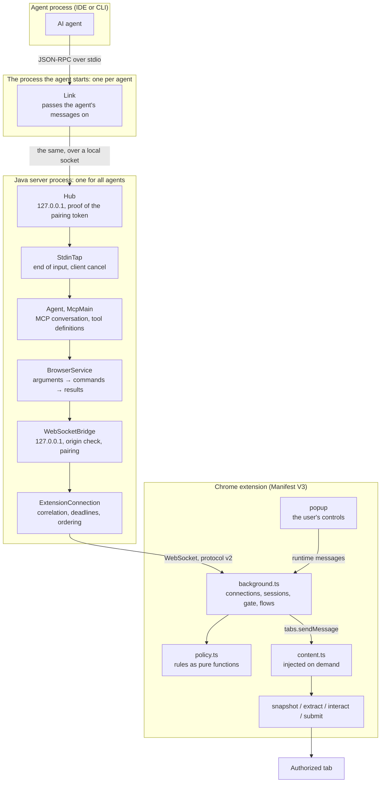
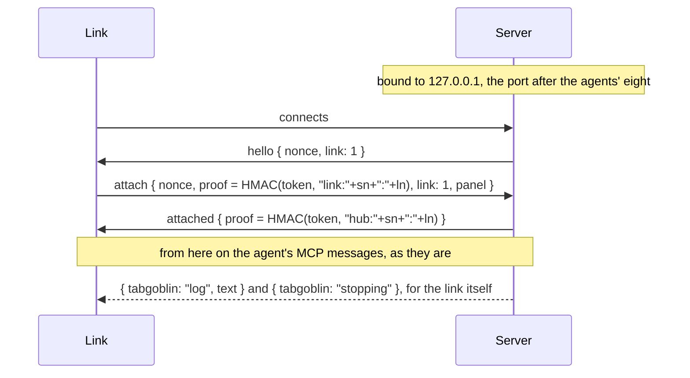
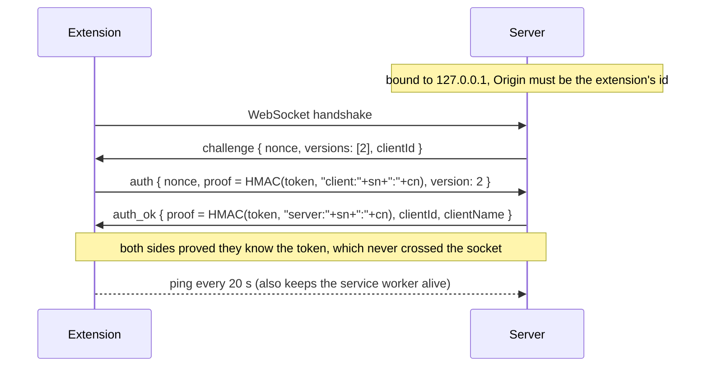
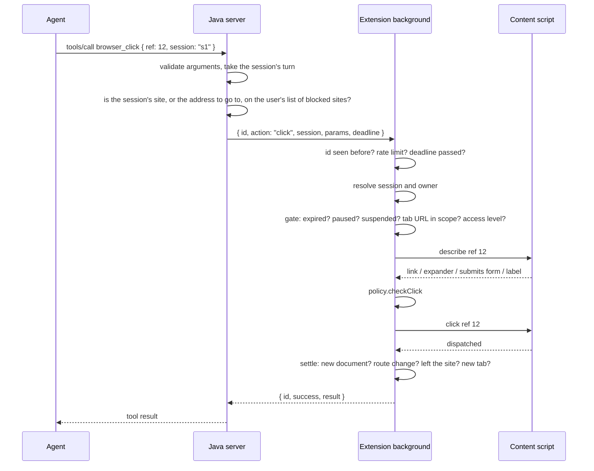
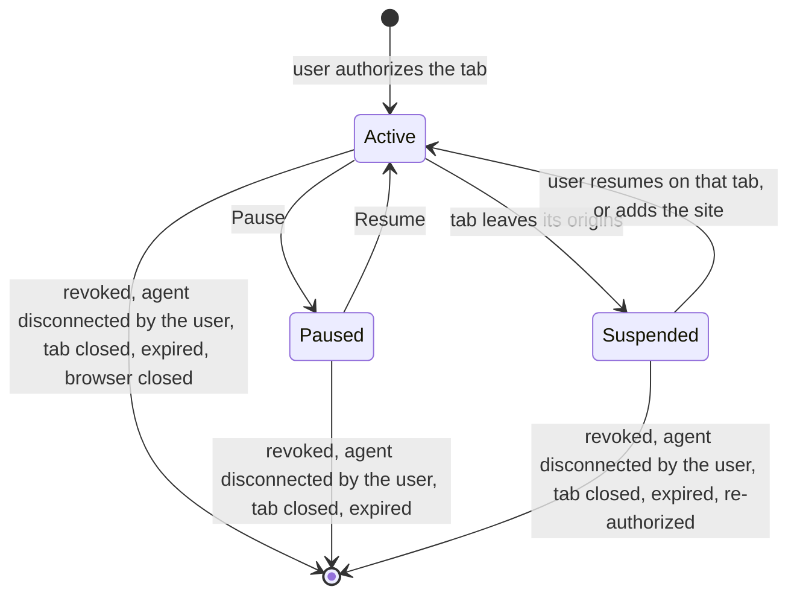
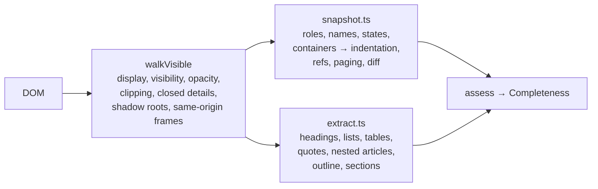
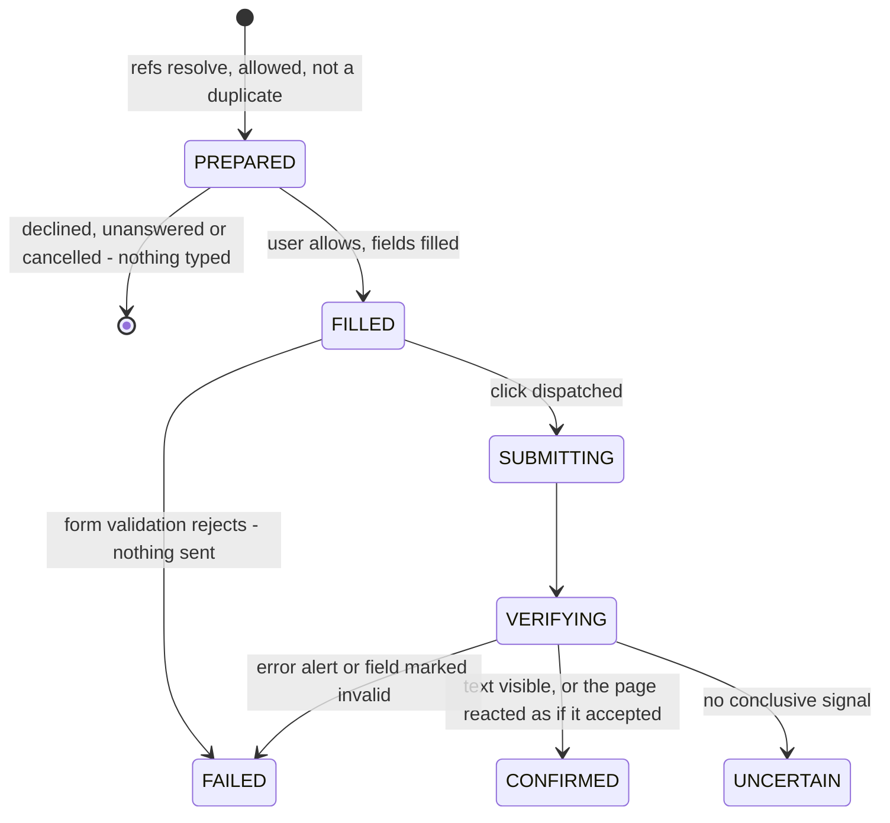

# Architecture

TabGoblin has three parts, and one rule that shapes all of them: **the agent understands websites;
TabGoblin only provides generic browser primitives and enforces what the user allowed.** There is
no site-specific code, selector, parser or workflow anywhere.

## Components



| Part | Responsibility | Does not |
|---|---|---|
| Agent | Understand the site, plan, summarise | Touch the browser except through tools |
| Link | Pass its agent's MCP messages to the server and the answers back; start the server if none runs; tell the agent what it was waiting for when the server is gone | Read or change a message, send one twice |
| Java server | Serve every agent that is connected: expose tools, validate arguments, bind calls to sessions, time out, cancel, remember submission ids, log | Know any website, summarise, hold page content, tell one agent of another |
| Extension background | Connect to all servers, own sessions, check every command, drive navigation and submissions, keep the activity feed | Trust the page, run agent code |
| Content script | Read the DOM into allowlisted text, perform one fixed operation per request | Persist anything, talk to anyone but the background |
| Popup | Show state, take the user's decisions | Decide anything itself |

## Processes and ports

There is one server process for all agents. An agent's program starts the jar as a child of its
own and talks to it over stdio, and that cannot be changed from here: so the child stays, and is
a *link* (`Link.java`). It connects to the server on `127.0.0.1`, on the port after the agents'
eight (47829 by default), and passes its agent's messages on, line by line. If no server listens
there, the link starts one as a process of its own (`McpMain.startServer`), which is not the
link's to end and serves the agents that come after.

Inside the server (`Hub.java`) each agent is what a server was while there was one for each
agent (`Agent.java`): an id, its own port to the extension, its sessions, its times, its tools.
An agent's port is the first free one of eight, counting up from `--port` (default 47821), on
`127.0.0.1` only. The extension tries every port of that range that has no live connection, so
each agent is one WebSocket, and the extension needs to know nothing of the one server. Agents
share the process and nothing else: no tool tells one agent anything of another.

Before a message passes, a link and the server each prove that they know the pairing token:



The words in the proofs differ from those of the extension's pairing, so a proof made for the
one is no proof for the other. Ten wrong proofs within a minute and the server takes no link for
the rest of it. A link that asks with `show` in the place of `attach` wants the server's window
and becomes no agent. What the server writes to its log for one agent it passes to that agent's
link, which writes it to its own standard error: an agent's program keeps the log of the
process it started, and that is where the agent's lines are looked for. A line of the server
itself goes to every link.

Where the one server cannot be had, because another program holds its port or it cannot be
started, the process an agent started serves that agent alone, as every such process did
before, and says so in its log.

The extension pairs with each agent's port as before:



A server that offers no common protocol version is refused (close code 4406). Ten failed pairings
lock a server's port for a minute. A rotated token is checked at every heartbeat and before every
command, so stale pairings end at once.

A connection can stay open to a server that no longer answers: one that hangs. So the extension
counts the answers to its heartbeat. A server that leaves two in a row unanswered is taken for
gone (`serverGone` in `policy.ts`): its connection is closed with code 4408 and dropped as if
the server had closed it, its commands are cancelled, and its port is looked at again. That is
within a minute of the server falling silent; a server that answers again is found by the next
look.

## A command, end to end



Ordering: the server sends one command per session at a time; the extension queues per session as
well. Different sessions run in parallel. Nothing is retried, anywhere.

## Sessions

A session is one authorized tab bound to one agent.

| Field | Meaning |
|---|---|
| `sessionId` | `s1`, `s2`, … the handle agents use |
| `authorizationId` | Identity of the user's grant |
| `clientId`, `clientName` | The owning agent; empty until claimed |
| `tabId`, `frameId` | The tab, top frame |
| `origins` | Every origin the user authorized for it |
| `mode` | `read`, `explore`, `write` |
| `documentId`, `generation` | Identity of the current document and its snapshot count |
| `paused`, `suspended`, `expiresAt` | Lifecycle |



**Ownership.** A session belongs to the agent chosen at authorization, or to the first agent that
uses an unclaimed one. Every command is checked against the owner. If the owner's server is gone
and an agent with the same name connects, it inherits the session (an IDE restarting its server);
no other agent ever does.

**A server that is started again.** A server makes a new id each time it starts and remembers
nothing, so its sessions come back to it by its agent's name alone, and it is the extension
that says so: a session is the user's grant and is kept there, and a server cannot claim one.
Two things make that happen at once. The server takes the agent's name from the message with
which the agent opens its connection (`StdinTap`), not from its first tool call. And the
extension makes what the server's former self left the new server's own the moment it pairs,
or the moment its name arrives, and tells it so (`takeUp` in `background.ts`). So the server's
panel lists the tabs, and the popup names the server that is there as their agent, before any
tool is called. An agent that has given no name is given nothing.

**Disconnect.** When the user disconnects an agent in the popup, the sessions that are that
agent's end with it: those it owns, and those a former self of the same name left behind, which
it could have taken up with its next command (`sessionsOfAgent` in `policy.ts`). A session no
agent has taken up yet stays. So nothing waits for *Allow again*, and nothing is left for an
agent of the same name to inherit. An agent that goes away by itself keeps its sessions, as
above.

The server of a disconnected agent keeps running, and the extension cannot know whose server
holds a port without connecting to it. So it connects each time it looks at the ports, and the
server says who it is in its first message (`clientId` in `challenge`). On that the extension
closes the connection again, before it has proven anything: the server never counts it as
connected, its status stays *disconnected in the extension's popup*, and its log says nothing.
What a server says there turns it away and gives it nothing; a server from before this is
turned away after the pairing, on the id in its proven answer.

**Why "suspended" exists.** Chrome withdraws the `activeTab` grant whenever a tab changes origin,
and only a user click on the extension's icon gives it back. So after any cross-origin move the
extension cannot read the tab, whatever its own rules say. Keeping the session (owner, access
level, submission history) and requiring one click to resume is the most a session can survive.

**Persistence.** Sessions live in `chrome.storage.session`: they survive the service worker being
stopped and restarted, and are gone when the browser closes.

## Element refs

A snapshot gives listed elements a number. Three properties make refs safe to act on:

1. **Identity.** A ref is tied to one DOM element. The same element keeps its ref across
   snapshots; a replacement gets a new one.
2. **Staleness.** Before acting, the element must still be connected, visible, and carry the same
   role and name it had when listed. Otherwise the command fails with `STALE_REF`.
3. **No reuse.** Numbers are never handed out twice in a browser run, and every live session draws
   from its own block, so a ref from another document or another tab resolves to nothing.

## Reading a page

The content script walks what is actually rendered, in document order, and emits allowlisted
information only. Scripts, styles, hidden inputs and hidden content are never visited.



- **Snapshot** answers "what is here and what can I act on": an indented hierarchy with refs.
- **Extract** answers "what does it say": structured text, bounded, with an outline.
- **Completeness** is computed for every result: `TRUNCATED` (cut at the size limit), `BLOCKED`
  (a cross-origin frame), `PARTIAL` (one section, the viewport, or collapsed controls), `UNKNOWN`
  (not scrolled to the end), `COMPLETE`.

Frames of the same origin are read through `contentDocument` as part of the page. Frames of another
origin have no readable document from the page's origin and are reported as blocked.

## Navigation

| Kind | How | Outcome reported |
|---|---|---|
| URL | Destination resolved and checked against the session's origins, then `tabs.update` | `new-document`, `same-document`, `timeout`, `redirected` |
| Back / forward | In the page, to a specific entry of the Navigation API, which lists only this origin's entries | as above, or `NAVIGATION_BLOCKED` when there is none |
| Reload | `tabs.reload` | `new-document` |
| Click, key | After dispatch the tab is watched until it settles | `none`, `same-document`, `new-document`, `left-origin`, `openedNewTab` |

The browser's own back button is deliberately not used: it skips history entries that were opened
without a user gesture, which is every page an agent opened, and can jump straight out of the site.

## Submissions



Verification compares a baseline taken just before the click with what the page shows afterwards:
occurrences of the expected and submitted text outside the fields it was typed into, new
`role="alert"` messages, fields with `aria-invalid`, new `role="status"` messages, whether the
fields were cleared or the form is gone, and whether the URL or document changed. The verdict is a
pure function (`judgeSubmission`) of those signals.

A fingerprint of the content (a hash, computed in the page) recognises an identical repeat. The
server remembers every `submission_id` and never sends one twice; a timeout or lost connection is
recorded as `UNCERTAIN`.

## Cancellation

| Trigger | Effect |
|---|---|
| User pauses, revokes or lowers access | Running and queued operations of that session stop at their next safe point |
| MCP client sends `notifications/cancelled` | `StdinTap` interrupts the tool call; the server sends `cancel` to the extension, and sends no answer for that call |
| Server times out waiting | The server sends `cancel`, so the command cannot run later |
| Agent's server disconnects | Its operations are cancelled |
| User disconnects an agent | Its operations are cancelled, a question it has put to the user is withdrawn, and its sessions end |
| Tab closes or leaves its site | The session ends or is suspended; its operations stop |

A safe point is any moment before something is dispatched to the page. For a submission the last
one is immediately before the click. What was dispatched is never undone.

## A call that takes long

A submission can wait up to a minute and a half, most of it for the user's answer in the popup.
A client that sent a progress token with the call is told every three seconds that it is still
running, and for a submission that it may be waiting for the user. The server does not know how
far the call is: what it reports is the time the call has run.

## How a server ends

A link ends when its agent's program closes the input, on Ctrl+C, or on a signal to stop. The
server then ends that agent's part, in this order:

1. The agent's MCP conversation is closed, so that nothing new is taken on.
2. The agent's socket is stopped. The extension gets the close code for "going away" (1001) and
   drops that agent at once, instead of finding the connection gone.

The other agents are not touched. The server itself ends when its last agent has gone and none
has come for three seconds, or when the user stops it in its window; one that the user started
with `--panel` in a terminal, or whose window the user opened that way, stays until it is
stopped. At a stop every
link is told so first, and ends with exit code 0, as a server did when the user stopped it.

**When the server's process is gone and nobody stopped it,** each link that still has its agent
starts the server anew, or connects to the one that another link has started meanwhile. Three
things keep that from being a second sending of anything. The link answers every request its
agent was waiting for, itself: a tool call gets the result of a failed call,
[`CONNECTION_LOST`](tools.md#errors), which says that the outcome is unknown and that nothing
was retried. It sends the new server the agent's opening message again, so that the server knows
the agent by its name and gives it its sessions back, and does not pass the answer on, which the
agent has already. And a message of the agent's that had not reached the old server goes to the
new one once. The agent's connection stays what it was; its server has a new id, as after any
restart ([sessions](#sessions)).

A command line that is not understood starts nothing: the reason and the usage text go to
standard error, and the exit code is 2.

## The server's panel

The server shows a window when an agent's settings ask for it with `--panel` (or
`BCMCP_PANEL=1`), or when the user asks for it by running the jar with `--panel` in a terminal;
without that nothing of the window's code is loaded. There is one window, as there is one
server: it shows every agent. What the user sees and can do there is in the
[user guide](user-guide.md#9-the-servers-panel); what the window may and may not do, in the
[security model](security.md#the-servers-panel). How it is built:

- **A model, a window, four commands.** Once a second the window asks for a `PanelModel`: a
  record made from what the status tool also reads of each agent (`WebSocketBridge`, `Timings`)
  and from the lines `Log` has kept. With one agent it is that agent, as the panel always
  showed it; with several, each has a heading over its tabs; with none, it says that the server
  waits for one. It is plain data and is tested without a display. `Panel` draws it and
  sends back one of four commands, a sealed type: the connection on or off, stop, kill, and
  copy the pairing token. `McpMain` carries them out (`carryOut`).
- **The pairing token goes to the clipboard and nowhere else.** It is read when the button is
  pressed and handed to the clipboard. It is not in `PanelModel`, so the window has nothing of
  it to show, and the log says only that it was copied. `Panel.Secret` takes it off the
  clipboard again after a minute, and at Stop, if it is still what the clipboard holds.
- **The controls are always in view.** The header above and the controls below are fixed; the
  sessions, the time and the log lie in one part between them that scrolls where a screen is
  too low. The window is as high as the screen allows, up to 760 pixels. Every session is in
  the list, three show at a time, and the list scrolls (`Panel.TABS_IN_VIEW`). A list as long
  as the tabs once pushed the controls out of the window.
- **One tab's or one agent's metrics and log, on a click.** A session's row is a button, and so
  is an agent's heading where there are several. What is chosen is the window's own affair
  (`Panel.View.choose`): it is in no model and reaches the server by no command. The model has
  the metrics and the log for everything, for each agent and for each tab alone, and the window
  shows the part that is chosen. A line of the log carries the agent it belongs to
  (`Log.Scope`). For that a call's times and a
  command's log line carry the session the command ran in (`Timings.Call`, `Log.Line`). A
  command may name none and be given the agent's only session, so the extension says in each
  answer which session it was ([protocol](development.md#protocol-reference)). The report the
  agent gets has no session in it, as before.
- **Stop and Kill.** Stop runs the steps under "How a server ends". Kill halts the process with
  exit code 1 and runs none of them: the extension finds the connection gone instead of being
  told.
- **The switch holds the connection off.** The server closes the extension's connection with
  the code for "going away" and refuses every handshake after it, before any pairing proof is
  looked at, until it is switched on. A refused handshake is not a failed pairing and counts
  nothing towards the lockout. The extension is not told why. It goes on looking for servers
  every half minute, as for any server it cannot reach, so switching on needs nothing in the
  popup. Meanwhile a tool call is answered [`NOT_CONNECTED`](tools.md#errors), with words that
  say where the connection was switched off.
- **The log is kept only when the panel is asked for:** the last 300 lines, in memory, from the
  server's first line on. They are the lines written to standard error at the level `BCMCP_LOG`
  sets, with two additions: info and warning lines are kept even where `BCMCP_LOG` silences
  them, and so is the line of each tool call that went through, which standard error has only
  at the level `debug`. Without that the window's log has the calls that failed and none that
  worked, and it is where the user looks for what the agent did (`Log.command`). In
  the window the log follows its last line unless the user reads in it. Where the last line
  is, is known only after new lines were laid out, so the view is brought down each time their
  height changes.
- **No display, no panel.** Where there is no display, or JavaFX cannot start, the server logs
  `panel not shown reason=…` and runs as it does without the option. A JavaFX that cannot
  start prints a trace of its own to standard error first.
- **Two kinds of window.** On Windows the window has no frame of the system's: a rounded body
  with its own shadow, see-through around it, moved by its header. Everywhere else the same
  body fills a window with the system's frame, because on Linux the see-through window was
  there for the system and drew nothing (`Panel.floats`, held by a test). In both kinds a
  request to close the window puts it away: the server ends by its button, or by its agent.
- **The window's icon is drawn, not loaded.** The goblin comes from the shapes of
  `chrome-extension/icons/goblin.svg`, written out in `Panel.java`. A window takes an icon only
  as a picture that holds its pixels as bytes; a drawing comes as one number per pixel and is
  passed over without a word, which leaves Java's icon on the taskbar. So the icons are copied
  into the kind that is taken, and a test holds that.
- **JavaFX 21 is in the jar,** with its native part for Windows on x64, Linux on x64 and macOS
  on Apple silicon; that took the jar from 7.1 MB to 17.6 MB when it was added. A jar holds one
  set of native files per system, because those for Intel and for ARM have the same names.
  JavaFX unpacks them into
  `.openjfx` in the home folder, and writes to standard error: one warning at the start, that
  it was loaded from the class path, and on Java 26 four lines of Java's own, that a method
  JavaFX draws with is to be removed. The 21 line of JavaFX is the one that runs on Java 21.

A drawing of the panel can be right where the window is not: how to look at the window after a
change is in the [runbook](agents/runbook.md#look-at-the-servers-panel), and what was run on
which system in the [validation log](agents/validation-log.md).

## The service worker

Manifest V3 stops an idle background worker. TabGoblin is built for that:

- All durable state is in `chrome.storage.session` (sessions, activity) and `chrome.storage.local`
  (token, settings); the worker can be killed at any time.
- While any agent is connected, the 20-second heartbeat keeps it alive.
- The badge on the toolbar is set from the state as it is, whenever a session, a command or a
  connection changes (`badgeFor` in `policy.ts`). It says `ON` only while a connected agent may
  use a session that is neither paused nor suspended, and `OFF` for sessions nobody is there to
  use. After a restart of the worker no server is connected yet, and the badge says so.
- With no connection it sleeps; an alarm every 30 seconds, the popup, or switching tabs wakes it to
  look for servers.
- After a restart, operations that were mid-flight are gone, and submissions that had been
  dispatched are marked `UNCERTAIN`.

## The notice in the page

In the bottom corner of an authorized tab a bar says what the agent does there, and above it a
pill for each thing it just did. The worker tells the page two things and nothing else
(`setNotice` in `background.ts`):

| Sent | When | Carries |
|---|---|---|
| A state | A command starts (`working`), the user is asked (`asking`), a session is paused or resumed (`paused`, `idle`) | For `working`, what runs, in the words of the activity list |
| A line | A command ends | The activity list's words for it, and for one that did not run through the short note for its error code (`endedLine` in `policy.ts`) |
| `off` | The session ends or is suspended, a screenshot is about to be taken, or the setting is switched off | Nothing |

The page keeps the time (`notice.ts`): a line stays four seconds and fades for one, three lines
at most, and the notice leaves the page with its last line when nothing runs. The worker sets
no timer for it, since it may be asleep by the time a line has to go. Sending is best effort:
it never injects the content script and never holds up a command. The notice is drawn in a
closed shadow root, and only its Pause button takes the pointer; a click on Pause counts only
when the browser marks it as the user's.

It is two panes. The bar holds the goblin, the words and Pause; it is one row high whatever
happens, and it is what stays in the corner. The pills float above it, each as wide as its
words, with nothing drawn around the two. So what stays is small, and what passes covers no
more of the page than its own text.

The look is the popup's: its colours, its round marks, and the goblin of its header, drawn from
the shapes of `icons/goblin.svg` with nothing fetched. The goblin stands bare on the bar, with no
tile and no edge of its own. It shows the state through one class alone (its outline glows green
while working and amber when the user is asked, and its eyes are closed when paused); it learns
nothing about what the agent does beyond that. What each action looks like is not shown; that
is WP-12.

## Where things are

```text
java-server/src/main/java/browsercontext/
  McpMain.java             entry point, tool definitions, port selection
  StdinTap.java            end of input, client-side cancellation
  Progress.java            tells a client that asked for it that a call is still running
  Timings.java             where the time of the last tool calls went
  PanelModel.java          what the server's panel shows at a moment, without a window
  Panel.java               the panel's window (JavaFX); panel.css in the resources is its look
  BrowserService.java      tool arguments → commands → results, submission ids
  BlockedSites.java        the user's list of blocked sites: the settings file, what an entry blocks
  WebSocketBridge.java     localhost endpoint, origin check, pairing, lockout, limits
  ExtensionConnection.java correlation, deadlines, cancellation, per-session ordering
  Protocol.java            typed messages, error categories
  BrowserException.java    an error for the agent: a stable code and a message
  Pairing.java             token file, rotation, HMAC proofs
  Log.java                 diagnostics without content; the last lines, kept for the panel
chrome-extension/src/
  background.ts            connections, sessions, gate, navigation, submissions, activity
  policy.ts                every rule, as pure functions
  protocol.ts              typed messages and their validation
  pairing.ts               HMAC proofs for the pairing, the mirror of Pairing.java
  content.ts               fixed set of page operations; holds the notice in the page
  notice.ts                the notice in the page: what it shows at a moment, and how it is drawn
  snapshot.ts              rendered-DOM walk, roles, names, refs, hierarchy, completeness
  extract.ts               structured text, outline, sections
  interact.ts              click, fill, type, keys, scroll, wait
  editor.ts                text entry into rich-text and code editors
  submit.ts                baseline and signals around a submission
  popup.html / .ts / .css  the user's controls
  panels.ts                which panels of the popup fold, and what a folded one says
```
