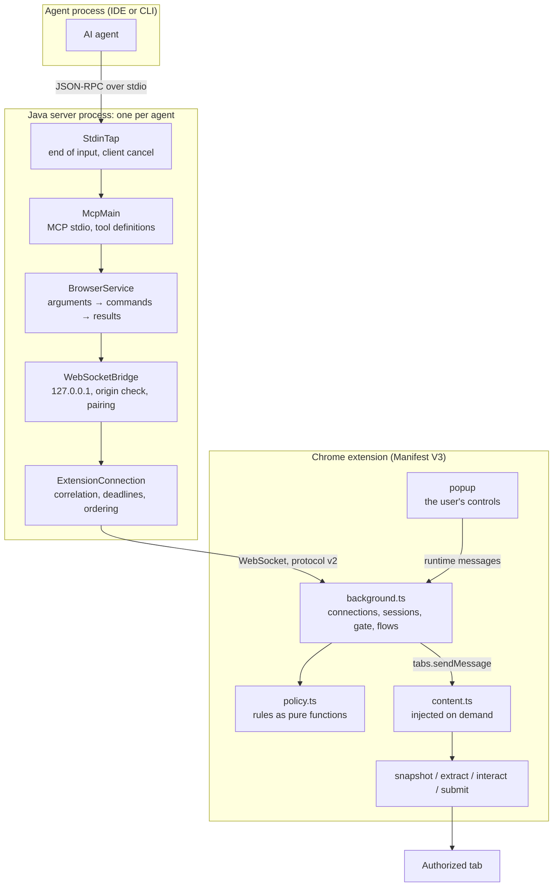
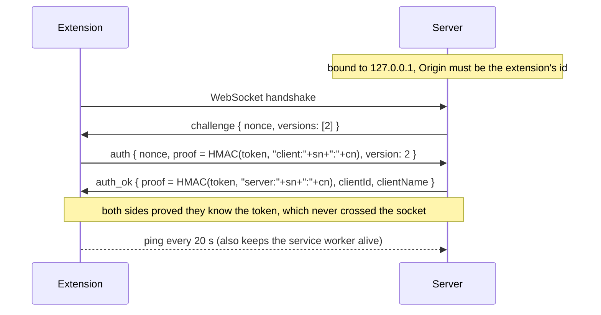
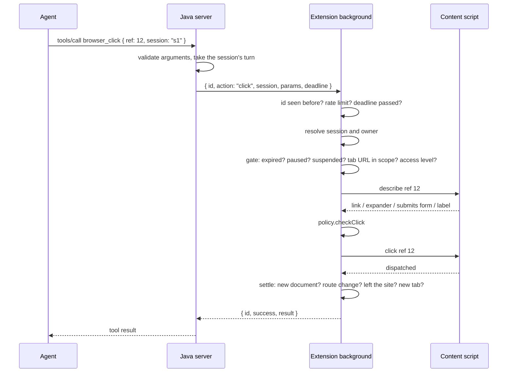
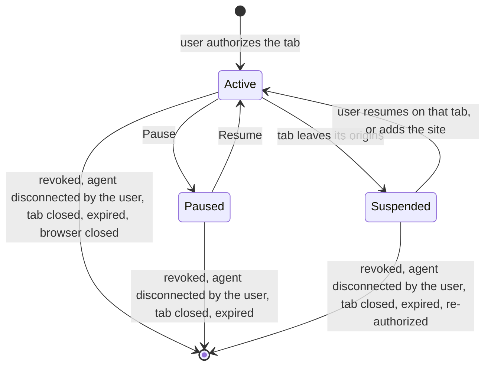
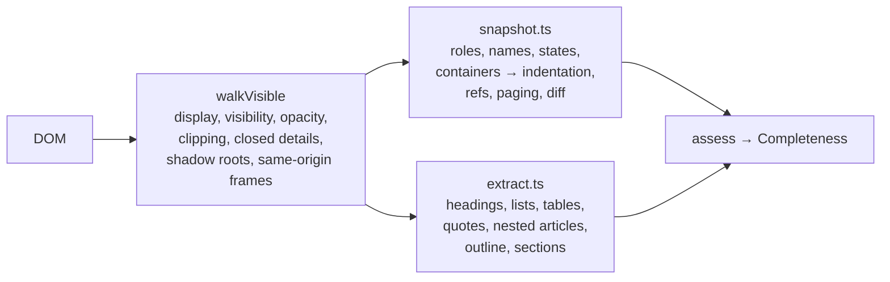
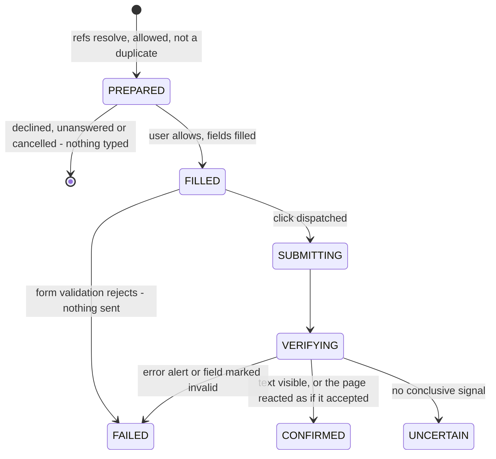

# Architecture

TabGoblin has three parts, and one rule that shapes all of them: **the agent understands websites;
TabGoblin only provides generic browser primitives and enforces what the user allowed.** There is
no site-specific code, selector, parser or workflow anywhere.

## Components



| Part | Responsibility | Does not |
|---|---|---|
| Agent | Understand the site, plan, summarise | Touch the browser except through tools |
| Java server | Expose tools, validate arguments, bind calls to sessions, time out, cancel, remember submission ids, log | Know any website, summarise, hold page content |
| Extension background | Connect to all servers, own sessions, check every command, drive navigation and submissions, keep the activity feed | Trust the page, run agent code |
| Content script | Read the DOM into allowlisted text, perform one fixed operation per request | Persist anything, talk to anyone but the background |
| Popup | Show state, take the user's decisions | Decide anything itself |

## Processes and ports

Each MCP client starts its own server process over stdio. A server binds the first free port of
eight, counting up from `--port` (default 47821), on `127.0.0.1` only. The extension tries every
port of that range that has no live connection, so each agent is one WebSocket.



A server that offers no common protocol version is refused (close code 4406). Ten failed pairings
lock a server's port for a minute. A rotated token is checked at every heartbeat and before every
command, so stale pairings end at once.

## A command, end to end



Ordering: the server sends one command per session at a time; the extension queues per session as
well. Different sessions run in parallel. Nothing is retried, anywhere.

## Sessions

A session is one authorized tab bound to one agent.

| Field | Meaning |
|---|---|
| `sessionId` | `s1`, `s2`, … the handle agents use |
| `authorizationId` | Identity of the user's grant |
| `clientId`, `clientName` | The owning agent; empty until claimed |
| `tabId`, `frameId` | The tab, top frame |
| `origins` | Every origin the user authorized for it |
| `mode` | `read`, `explore`, `write` |
| `documentId`, `generation` | Identity of the current document and its snapshot count |
| `paused`, `suspended`, `expiresAt` | Lifecycle |



**Ownership.** A session belongs to the agent chosen at authorization, or to the first agent that
uses an unclaimed one. Every command is checked against the owner. If the owner's server is gone
and an agent with the same name connects, it inherits the session (an IDE restarting its server);
no other agent ever does.

**Disconnect.** When the user disconnects an agent in the popup, the sessions that are that
agent's end with it: those it owns, and those a former self of the same name left behind, which
it could have taken up with its next command (`sessionsOfAgent` in `policy.ts`). A session no
agent has taken up yet stays. So nothing waits for *Allow again*, and nothing is left for an
agent of the same name to inherit. An agent that goes away by itself keeps its sessions, as
above.

**Why "suspended" exists.** Chrome withdraws the `activeTab` grant whenever a tab changes origin,
and only a user click on the extension's icon gives it back. So after any cross-origin move the
extension cannot read the tab, whatever its own rules say. Keeping the session (owner, access
level, submission history) and requiring one click to resume is the most a session can survive.

**Persistence.** Sessions live in `chrome.storage.session`: they survive the service worker being
stopped and restarted, and are gone when the browser closes.

## Element refs

A snapshot gives listed elements a number. Three properties make refs safe to act on:

1. **Identity.** A ref is tied to one DOM element. The same element keeps its ref across
   snapshots; a replacement gets a new one.
2. **Staleness.** Before acting, the element must still be connected, visible, and carry the same
   role and name it had when listed. Otherwise the command fails with `STALE_REF`.
3. **No reuse.** Numbers are never handed out twice in a browser run, and every live session draws
   from its own block, so a ref from another document or another tab resolves to nothing.

## Reading a page

The content script walks what is actually rendered, in document order, and emits allowlisted
information only. Scripts, styles, hidden inputs and hidden content are never visited.



- **Snapshot** answers "what is here and what can I act on": an indented hierarchy with refs.
- **Extract** answers "what does it say": structured text, bounded, with an outline.
- **Completeness** is computed for every result: `TRUNCATED` (cut at the size limit), `BLOCKED`
  (a cross-origin frame), `PARTIAL` (one section, the viewport, or collapsed controls), `UNKNOWN`
  (not scrolled to the end), `COMPLETE`.

Frames of the same origin are read through `contentDocument` as part of the page. Frames of another
origin have no readable document from the page's origin and are reported as blocked.

## Navigation

| Kind | How | Outcome reported |
|---|---|---|
| URL | Destination resolved and checked against the session's origins, then `tabs.update` | `new-document`, `same-document`, `timeout`, `redirected` |
| Back / forward | In the page, to a specific entry of the Navigation API, which lists only this origin's entries | as above, or `NAVIGATION_BLOCKED` when there is none |
| Reload | `tabs.reload` | `new-document` |
| Click, key | After dispatch the tab is watched until it settles | `none`, `same-document`, `new-document`, `left-origin`, `openedNewTab` |

The browser's own back button is deliberately not used: it skips history entries that were opened
without a user gesture, which is every page an agent opened, and can jump straight out of the site.

## Submissions



Verification compares a baseline taken just before the click with what the page shows afterwards:
occurrences of the expected and submitted text outside the fields it was typed into, new
`role="alert"` messages, fields with `aria-invalid`, new `role="status"` messages, whether the
fields were cleared or the form is gone, and whether the URL or document changed. The verdict is a
pure function (`judgeSubmission`) of those signals.

A fingerprint of the content (a hash, computed in the page) recognises an identical repeat. The
server remembers every `submission_id` and never sends one twice; a timeout or lost connection is
recorded as `UNCERTAIN`.

## Cancellation

| Trigger | Effect |
|---|---|
| User pauses, revokes or lowers access | Running and queued operations of that session stop at their next safe point |
| MCP client sends `notifications/cancelled` | `StdinTap` interrupts the tool call; the server sends `cancel` to the extension, and sends no answer for that call |
| Server times out waiting | The server sends `cancel`, so the command cannot run later |
| Agent's server disconnects | Its operations are cancelled |
| User disconnects an agent | Its operations are cancelled, a question it has put to the user is withdrawn, and its sessions end |
| Tab closes or leaves its site | The session ends or is suspended; its operations stop |

A safe point is any moment before something is dispatched to the page. For a submission the last
one is immediately before the click. What was dispatched is never undone.

## A call that takes long

A submission can wait up to a minute and a half, most of it for the user's answer in the popup.
A client that sent a progress token with the call is told every three seconds that it is still
running, and for a submission that it may be waiting for the user. The server does not know how
far the call is: what it reports is the time the call has run.

## How a server ends

A server ends when its MCP client closes the input, on Ctrl+C, or on a signal to stop. Each time
the same happens, in this order, and within two seconds or the process ends anyway:

1. The MCP server is closed, so that nothing new is taken on.
2. The socket is stopped. The extension gets the close code for "going away" (1001) and drops
   that agent at once, instead of finding the connection gone.
3. The process exits with code 0.

A command line that is not understood starts nothing: the reason and the usage text go to
standard error, and the exit code is 2.

## The service worker

Manifest V3 stops an idle background worker. TabGoblin is built for that:

- All durable state is in `chrome.storage.session` (sessions, activity) and `chrome.storage.local`
  (token, settings); the worker can be killed at any time.
- While any agent is connected, the 20-second heartbeat keeps it alive.
- With no connection it sleeps; an alarm every 30 seconds, the popup, or switching tabs wakes it to
  look for servers.
- After a restart, operations that were mid-flight are gone, and submissions that had been
  dispatched are marked `UNCERTAIN`.

## Where things are

```text
java-server/src/main/java/browsercontext/
  McpMain.java             entry point, tool definitions, port selection
  StdinTap.java            end of input, client-side cancellation
  Timings.java             where the time of the last tool calls went
  BrowserService.java      tool arguments → commands → results, submission ids
  WebSocketBridge.java     localhost endpoint, origin check, pairing, lockout, limits
  ExtensionConnection.java correlation, deadlines, cancellation, per-session ordering
  Protocol.java            typed messages, error categories
  Pairing.java             token file, rotation, HMAC proofs
  Log.java                 diagnostics without content
chrome-extension/src/
  background.ts            connections, sessions, gate, navigation, submissions, activity
  policy.ts                every rule, as pure functions
  protocol.ts              typed messages and their validation
  content.ts               fixed set of page operations, in-page indicator
  snapshot.ts              rendered-DOM walk, roles, names, refs, hierarchy, completeness
  extract.ts               structured text, outline, sections
  interact.ts              click, fill, type, keys, scroll, wait
  editor.ts                text entry into rich-text and code editors
  submit.ts                baseline and signals around a submission
  popup.html / .ts / .css  the user's controls
  panels.ts                which panels of the popup fold, and what a folded one says
```
