# Developer guide

How to work with TabGoblin day to day, through the CLI or through MCP: connect an agent, authorize tabs, choose access levels,
manage sessions and workspaces, approve submissions, pause and revoke, restrict what agents
may do, and fix common problems.

What each tool takes and returns is in the [tool reference](tool-reference.md), and how an
agent runs the tools as commands in the [CLI guide](cli.md). What an
agent can and cannot reach, and why, is in the [security model](security-model.md).

The pictures of the popup are captures of the real one in its real size; where there is more
than fits, the popup scrolls.

## Install and connect an agent

The [installation guide](installation.md) has every step with what you should see. In short:

1. Unpack the download.
2. Connect your agent, by the interface that suits it ([which](installation.md#cli-or-mcp)):
   - **CLI,** for an agent that runs commands in a terminal: `tabgoblin --setup claude-code
     --mode cli` (or `codex`, or `copilot`). Nothing is registered; put the download's folder on
     your `PATH`. The agent runs `tabgoblin status --agent claude-code` and the like
     ([CLI guide](cli.md)).
   - **MCP,** for an agent that is an MCP client: `tabgoblin --setup claude-code`, then run the
     line that setup printed, which registers TabGoblin's server with the agent.
3. Load the `extension` folder in Chrome at `chrome://extensions` (Developer mode, **Load
   unpacked**).
4. Pair once: `tabgoblin --panel`, **Copy** next to *Pairing token*, paste into the popup,
   **Save and connect**.

Everything on this page holds for both interfaces: authorizing, access levels, sessions,
approvals, pausing and the policy are the same whether the agent runs commands or calls MCP
tools. Where this page names a tool, such as `browser_status`, a CLI agent runs the command of
that name, `tabgoblin status`.

**MCP in detail.** Any agent that starts an MCP server over stdio can be connected. It needs a command and
arguments:

```json
{
  "mcpServers": {
    "tabgoblin": {
      "command": "<folder>/tabgoblin/runtime/bin/java",
      "args": ["-jar", "<folder>/tabgoblin/browser-context-mcp.jar", "--agent", "my-ide"]
    }
  }
}
```

- **`--agent <name>`** gives the agent a key of its own, so it is the same agent at every
  start and its tabs are its own again after a restart. Use a different name for each agent.
  See [agents](#agents).
- **One server serves all your agents,** up to eight at once. The first agent that needs it
  starts it; it ends a few seconds after its last agent has gone.
- **Skills.** The server tells every agent in a few lines how to use the tools. For Claude
  Code, Codex and GitHub Copilot there is a longer [skill](../skills/README.md), which setup
  installs.

To check the chain, ask your agent: *"Call browser_status."*

The line under the name in the popup says how many agents are connected. *Disconnected* means
no server is reachable: none is running yet, because an agent starts it when it first needs
it, or its connection is switched off in [its window](#the-servers-panel). A paired extension
finds a new server within about 30 seconds, or at once when you open the popup.

## Authorize a tab

Open the website and sign in as you normally do. Then click the TabGoblin icon **on that tab**.

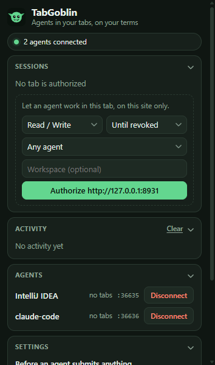

Choose:

- **the access level** (below),
- **how long** it lasts: until you revoke it, one hour, or eight hours,
- **which agent** gets the tab, when more than one is connected. *Any agent* gives it to
  whichever agent uses it first,
- optionally a **workspace** name ([workspaces](#workspaces)).

Press **Authorize**. The tab is now a session, such as `s1`. Only that tab and only that
website are covered; subdomains and other ports are different websites.

The click has to happen on the tab itself because Chrome gives the extension access to a tab
only when you click its icon there. That is the first of two independent checks; the
extension's own check of the tab's address before every command is the second.

### Access levels

| | Read | Explore | Read / Write |
|---|---|---|---|
| Read the page, search it, scroll, take screenshots, wait; read on while scrolling down | yes | yes | yes |
| Go to other pages of the site, back, forward, reload | no | yes | yes |
| Follow links and expand collapsed sections; go through a list page by page; hover so that a menu or tooltip opens | no | yes | yes |
| Press buttons, fill in and type into fields | no | no | yes |
| Submit forms, post, save, delete | no | no | yes, as a declared submission; by default you approve each one |

Start with the lowest level that does the job. You can change it at any time in the session's
dropdown; lowering it stops whatever needed the higher level.

- **Read** sends nothing to the website on the agent's behalf. It is enough for most reading
  tasks on a page you opened yourself: review comments, a log, a ticket.
- **Explore** lets the agent move around the site by itself. It makes the browser load pages,
  which on a few badly built sites has side effects (a "log out" link, for example).
- **Read / Write** is for tasks that end in the browser: a reply, a form.

## Sessions

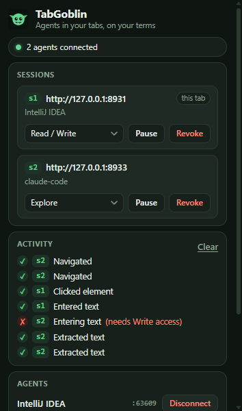

**Sessions** in the popup lists each authorized tab: its id, its website, its owner, and its
controls.

- The dropdown changes the access level.
- **Pause** stops the agent in that tab at once and refuses new commands until you resume.
- **Revoke** ends the session.
- Closing the tab ends its session. Closing the browser ends all of them.

**Activity** shows what is happening now and the six most recent operations per session, with
their outcome. It never shows page content or anything typed.

**Agents** lists every connected agent with its number of tabs and its port. *Disconnect* cuts
one off and ends its sessions; the number beside the button is what that will end. The agent
stays out until you press *Allow again*, and comes back without a tab.

**Settings** and the **Connection…** link come last. Each of the four panels folds to one line
that says what is inside. A confirmation prompt and the pairing form never fold. TabGoblin
follows your system's dark or light theme:

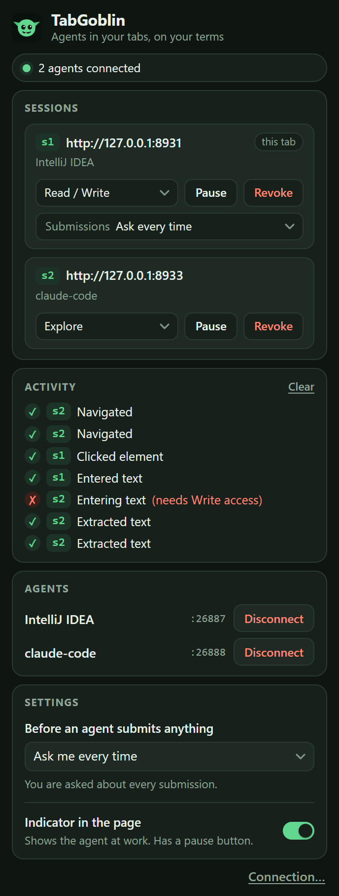 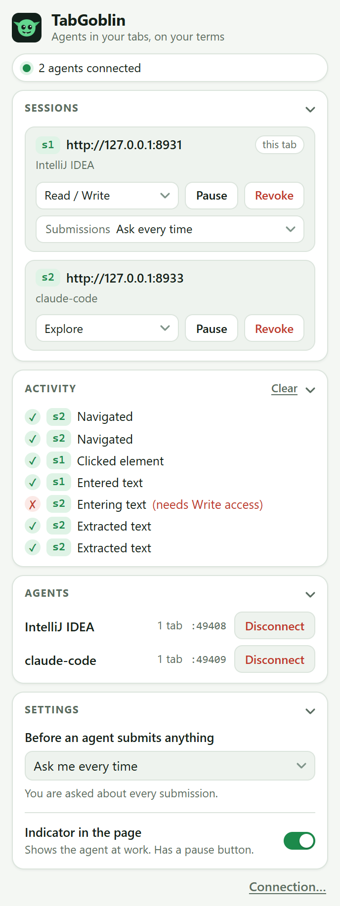

**The toolbar badge:**

| Badge | Meaning |
|---|---|
| `ON` | A connected agent may act in an authorized tab |
| `RUN` | An agent is acting |
| `II` | Paused |
| `?` | Your answer is needed |
| `OFF` | Tabs are authorized and no agent that may use them is connected |

**The notice in the page.** While an agent works in a tab, a small bar appears in the bottom
corner of the page, with a pill above it for each thing the agent just did.

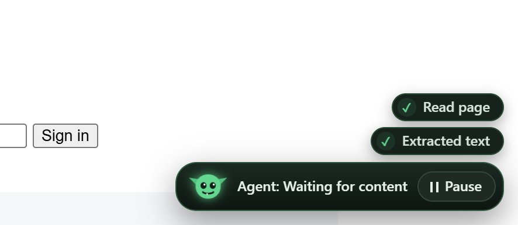

- The bar says what the agent is doing now, or that your answer is needed, and has a **Pause**
  button.
- **Answer** appears before Pause while a question waits for you in this tab's session. It
  brings the popup back; it allows nothing and declines nothing.
- The notice is not part of what the agent reads and is in none of its screenshots. Scripts of
  the page can neither read it nor press its buttons. It can be switched off under *Settings*.

### Workspaces

When several tabs belong to one task (the ticket, the pull request, the pipeline, the
documentation), give them one name: type it into *Workspace* when you authorize a tab, or in a
session's row later. The popup then lists those tabs together under the name, with **Pause
all** (or **Resume all**) and **Revoke all**.

A workspace is a name and nothing else. Every tab in it is still authorized by your click on
it, for its own agent, with its own access level and its own end. An agent is told the name
with its own tabs, and learns nothing about the others.

### When an agent asks for access

An agent that needs more than it has can ask (`browser_request_access`). The popup opens by
itself with the request, and the badge shows `?`.

- **A higher level on a tab it has:** *agent asks for Read / Write access in s1, on site*, with
  its reason in quotation marks. **Allow** gives that level; **Deny** leaves everything as it
  is.
- **A tab on another site:** this cannot be granted from the popup. Open the site in a tab and
  click the TabGoblin icon there: the popup says who asked, with the agent and the level
  already chosen. Change them to give less, then **Authorize**. Or press **Dismiss**.

Asking gives an agent nothing, and it is told nothing about a site before you authorize a tab
there. A request you declined is not put to you again for five minutes; one that is not
answered goes away after ten.

### When a tab leaves its website

If the tab goes to another website, through a link, a redirect to a sign-in page or your own
navigation, the session is **suspended**. The agent can read nothing until you decide.

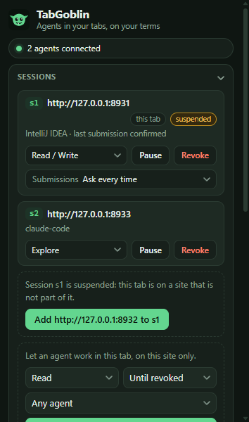

Click the TabGoblin icon on that tab:

- **Resume** when the tab is back on a website of the session.
- **Add … to s1** when the tab is on a new website that the session should cover too, such as
  a separate sign-in host.

Each time a tab changes website Chrome withdraws the extension's access, so moving between two
websites of one session takes one click from you each time. No redirect and no existing
sign-in ever widens what an agent can reach.

## Submissions

Anything that sends or changes data is a submission and is handled apart from reading and
filling in fields. The rules behind this are in the
[security model](security-model.md#submission-approval-and-replay-protection).

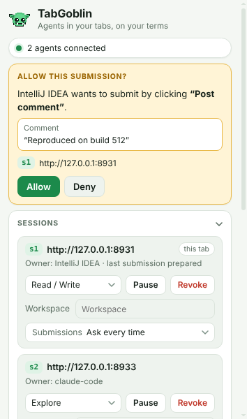 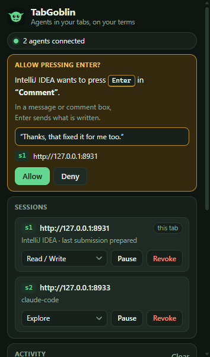

**Reviewing a prompt.** It says:

- **who** asks: the agent, by name;
- **what for**: the control or text box, as the page names it;
- **what would be sent**: the beginning of each text, never a password;
- **where**: the session and the website the tab is on.

For deleting, paying, publishing and the like the prompt is red instead of amber and says
which word in the name made it so. Pressing Enter in a text box counts as a submission too,
because in a comment or chat box it sends what is written; the prompt then reads **Allow
pressing Enter?**. Search boxes are left alone.

**Answering.**

- Nothing is typed or clicked until you press **Allow**. **Deny**, or no answer within a
  minute, means nothing happens.
- The prompt opens by itself and takes the keyboard from the page. It cannot be answered by
  accident: for its first moment the buttons are dim and take no answer, and from the keyboard
  Deny comes before Allow.
- If the content changed between the prompt and your answer, nothing is sent and the agent has
  to ask again.
- A no stands for five minutes: the agent cannot put the same request to you again in that
  time, and after three requests in a row that you declined or left unanswered, none at all.
  The session then says so, with **Let it ask again**.

  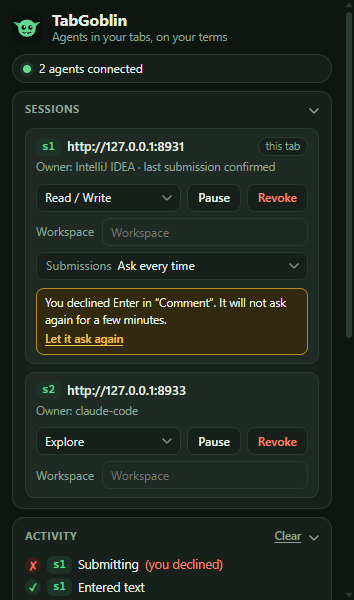

- Afterwards TabGoblin watches the page and tells the agent what it saw: confirmed, failed, or
  uncertain. Nothing is sent twice, and the same content is refused within two minutes unless
  the agent explicitly repeats it.

**How often you are asked** is set under **Before an agent submits anything** at the foot of
the popup, and per session next to **Submissions** in its row:

| Setting | You are asked |
|---|---|
| Ask me every time (the default) | About every submission |
| Ask me the first time (automatic) | The first time for each button or text box. What you allow then passes for 15 minutes |
| Do not ask me | Never, except as below |

- Under the [strict profile](#the-security-policy) you are asked about every submission, and
  the other two settings are disabled.
- Deleting, paying, publishing and similar actions always ask, whatever the setting. They are
  recognised by the control's label, in English: a control that does such a thing under
  another name is not recognised (best effort).
- In the automatic mode the prompt says before you answer what an Allow will reach: *Automatic
  is on: after Allow, this passes without asking for 15 minutes.* A control is known by its
  name on its website: after "Save" on one page, "Save" on another page of that website passes
  too. No more than five submissions pass unasked in a minute.
- A session in that mode lists what currently passes, with **Ask about it again** to end it.
  It also ends when you pause the session, change its access, when the tab leaves its website,
  and when Chrome restarts the extension.

  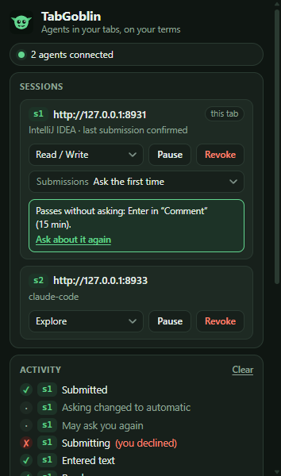

Keep *Ask me every time* wherever a wrong submission would do harm.

## Stopping

**Stop what an agent is doing,** in the popup or in the page:

| Control | Effect |
|---|---|
| **Pause** on a session, or in the notice in the page | Stops the agent in that tab at once; the session and its level are kept |
| **Revoke** | Ends the session |
| **Pause all** / **Revoke all** on a workspace | The same for every tab of that name |
| **Disconnect** next to an agent | Cuts the agent off and ends every session it has. *Allow again* restores the connection and no tab |

None of these stops the server, and none needs to.

**Take an agent away for good:** `tabgoblin --revoke-agent <name>` deletes its key; every tool
of that agent then answers that it was revoked. See [agents](#agents).

**Stop the server.** Normally there is nothing to stop: it ends by itself a few seconds after
its last agent has gone. An agent of the command line counts as there for ten minutes after
its last command. To stop it yourself, press **Stop server** in
[its window](#the-servers-panel). Every agent then has no TabGoblin tools until its program
connects again (in Claude Code, *Reconnect* under `/mcp`). Its tabs are kept.

**A server that hangs or is left over.** The agents' ports are 47821 to 47828, and the
server's own is 47829. (Where the system keeps those back, they begin at 37821 or 27821
instead: `browser_status` and the server's window say which.) To find the process:

```powershell
# Windows (PowerShell)
Get-NetTCPConnection -State Listen -LocalPort (47821..47829) -ErrorAction SilentlyContinue |
  Select-Object LocalPort, OwningProcess
Stop-Process -Id <OwningProcess>
```

```sh
# macOS and Linux
lsof -nP -iTCP:47821-47829 -sTCP:LISTEN
kill <PID>
```

Ending the process this way is not a stop: agents that are still running start the server
again at once, and a tool call that was running answers that its outcome is unknown.

If you run the server's command yourself without an option, it only waits for an agent's
messages and says so. Press Ctrl+C.

## Restricting what agents may do

The server's settings file, `tabgoblin.properties`, lies beside the pairing token (by default
in `.browser-context-mcp` in your home folder). **Edit** in the
[server's window](#the-servers-panel) opens it, and creates it if it is not there. A change is
in force as soon as the file is saved. Every line takes something away; none gives an agent
anything.

### Blocked sites

```properties
blocked.sites = example.org, intranet.example
```

- **An entry is a domain.** It blocks that domain with all its subdomains, on every port:
  `example.org` also blocks `mail.example.org`. Entries are separated by commas.
- **On a blocked site** the popup offers no authorization. A tab you authorized before stays
  in the list, marked *blocked*: the agent's tools answer there that the site is blocked, and
  work again when you take it off the list.
- **A mistake in the file blocks every site,** so that a slip does not leave open the site you
  meant. The server's window names the mistake, and the popup says that no agent can work in
  any tab.
- An agent is told that the site it tried is blocked, and never what else is on the list.

### The security policy

```properties
security.profile = strict
allowed.sites = example.org, ci.intranet.example
screenshots = off
access.max = explore
session.max.minutes = 240
session.idle.minutes = 20
audit.log = on
```

| Line | What it does |
|---|---|
| `security.profile = strict` | You are asked about every submission: *automatic* and *do not ask* are disabled. A click on anything but a link of the site or an expand/collapse control counts as a submission, which you approve. A tab is authorized for one agent you name; *Any agent* is not offered. Unless a line says otherwise: no screenshots, an authorization lasts 8 hours at most and ends after 30 minutes without a command |
| `allowed.sites` | Agents work on these domains and their subdomains only. The popup offers no authorization elsewhere |
| `screenshots` | `off`: no agent takes a picture of a tab. `on` allows it under the strict profile |
| `access.max` | `read` or `explore`: no session has more, whatever you give it |
| `session.max.minutes` | An authorization ends this many minutes after you gave it |
| `session.idle.minutes` | An authorization ends when no command came for this many minutes. `0` switches a limit off |
| `audit.log` | `on`: one line of JSON per command in `audit.jsonl` beside the file, with ids, actions, durations and outcomes, and nothing of a page |

The popup shows what is in force in a line above the sessions, and each session shows when it
ends. An agent is told what holds when it asks for its status. A value that cannot be read
blocks every site, as a mistake in the list of blocked sites does.

What these settings hold back and what they do not, in particular that the file is only as
protected as your home folder, is in the
[security model](security-model.md#the-security-policy).

### Agents

An agent that is named to the server with `--agent <name>` has a key of its own and is the
same agent each time it starts.

- **An agent without a name** works, and is known for one start only: after a restart its tabs
  have to be authorized again. Its status says so.
- **Use a different name for each agent.** Two agents that run at once under one name are not
  one agent: the second is known for its start only.
- **An agent of the CLI** has no process that stays, so it is its name and nothing
  else: every command gives `--agent <name>`, and the commands of one name are one agent with
  one set of tabs, whichever program runs them. A name that an agent connected through MCP
  holds is refused to a command. More in the
  [CLI guide](cli.md).
- **Point at an agent's name in the popup** to see its id and whether it has a key.
- `tabgoblin --list-agents` lists the names that have a key, each with its id, and the revoked ones. `--revoke-agent <name>` deletes a
  key; `--allow-agent <name>` allows the name again, as a new agent with no tab.

## The server's panel

The server has no window unless you ask for one. `tabgoblin --panel` brings up the window of
the running server, or starts a server with its window, which then stays until you stop it.
Adding `--panel` to the agent's registration shows it whenever that agent runs.

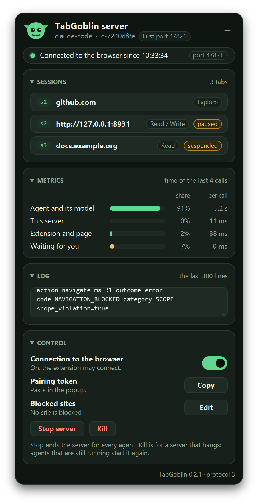

| Part | What it shows or does |
|---|---|
| The line under the title | Whose server it is, and its port. A click on a port, here or in an agent's row, copies the number to the clipboard |
| The line with the dot | Whether the extension is connected, and if not, why |
| Sessions | The tabs each agent has: site, access level, and *paused*, *suspended* or *blocked*. No page title or address. A click on a tab or an agent shows its metrics and log lines alone |
| Metrics | Where the time of the last tool calls went: the agent and its model, the server, the extension and the page, and your answers |
| Log | The server's last 300 lines: connections, and one line per tool call with its tab, action, duration and outcome. Nothing of a page |
| Connection to the browser | A switch. Off, the server closes its connection to the extension until you switch it on. The agent's tabs stay authorized |
| Pairing token | **Copy** puts the token on the clipboard without showing it. It leaves the clipboard after a minute |
| Blocked sites | The sites on your list and, while a policy is in force, a line *Policy: …*. **Edit** opens the settings file |
| Stop server, Kill | Stop ends the server in order, for every agent. Kill ends the process at once, for a server that hangs. Each takes two clicks |

One case brings the window up by itself: the browser came with a token that is not the
server's, because it was mistyped or replaced with `--rotate-token`. The window then says
*Pair the browser with this server*, with **Copy token**. `--no-panel` in an agent's
registration, or `BCMCP_PANEL=0`, prevents that for that agent.

| The line with the dot says | What to do |
|---|---|
| *Connected to the browser since …* | Nothing |
| *No agent connected* | Start your agent, or reconnect it |
| *Not connected: waiting for the extension* | Open the popup: a paired extension connects at once. To pair, **Copy** the token and paste it into the popup |
| *Not connected: disconnected in the extension's popup* | Press *Allow again* next to the agent in the popup |
| *Not paired: the browser has another token* | Press **Copy token** and paste it into the popup |
| *Not connected: the extension is of another version* | Update both parts to the same release and reload the extension |
| *Not connected: this server has no port to listen on* | See [installation problems](installation.md#problems) |
| *Switched off here: the extension is not let in* | Switch the connection on |

The panel grants nothing: authorizing a tab, changing a level and revoking stay in the popup.

| System | The window | Seen running |
|---|---|---|
| Windows | Without a system frame; its header moves it | On Java 21 and Java 26 |
| Linux (x64), macOS (Apple silicon) | The same panel in a window with the system's frame | On Ubuntu in the Linux subsystem of Windows, without pressing its buttons. Not on another Linux desktop, not on macOS |
| Any other system, or no display | None: the server says so in its log and runs as without the option | Without a display, on Linux |

**Edit** was tried on Windows, where it opens Notepad. On Linux it asks `xdg-open` and on
macOS `open -t`; neither was tried.

## Example prompts

Each of these uses only the generic tools. Authorize the relevant tab first, at the level
shown.

| Prompt | Level |
|---|---|
| *Read the unresolved review comments in this pull request, group them by priority and identify the changes required in my local codebase.* | Read |
| *Investigate the failed pipeline, extract the relevant errors and determine the root cause using the local source code.* | Read |
| *Search this build log for "ERROR" and show me each match with ten lines around it.* | Read |
| *Read the acceptance criteria of this ticket and check my current branch against each of them.* | Read |
| *Explore the authorized documentation and identify requirements relevant to the feature I am implementing.* | Explore |
| *Go through all pages of this list of findings and summarise them by rule and by file.* | Explore |
| *Open the architecture decision records linked from this page and tell me which of them constrain the change I am making.* | Explore |
| *Draft a reply to the second review comment that explains the fix, and submit it when I have approved it.* | Read / Write |
| *If you need more access than you have, ask me for it and tell me why.* | any |

Tips:

- Open the page yourself and authorize it with Read where that is enough. The agent then needs
  no navigation at all.
- For a task that spans several tabs, authorize each and file them under one
  [workspace](#workspaces). The agent sees its sessions in `browser_status` and names the one
  it works in.
- Long pages: agents read by outline and section, or search, rather than reading everything.
  The [skills](../skills/README.md) teach this.
- What the agent reads goes to its model provider. Do not authorize a tab that shows something
  you would not paste into the agent yourself.

## Settings

| Setting | Where | Default |
|---|---|---|
| When to ask before a submission | *Before an agent submits anything* in the popup; per session next to *Submissions* | Ask me every time |
| Notice in the page | Switch under *Settings* in the popup | on |
| First port | *Connection…* in the popup; `--port` on the server. Set both or neither | 47821, and by itself 37821 or 27821 where the system keeps the ports before back |
| Blocked sites, security policy, audit record | The settings file: [restricting what agents may do](#restricting-what-agents-may-do) | none, no restriction, off |

Options of the server go after the jar's path (or after `tabgoblin` in a download). The
variable is set in the environment the server is started in; the option wins.

| Option | Variable | Default | What it sets |
|---|---|---|---|
| `--agent <name>` | `BCMCP_AGENT` | none | The name of the agent that starts the server ([agents](#agents)) |
| `--port` | `BCMCP_PORT` | `47821`, else `37821`, else `27821` | The first of the eight agents' ports. Without it the server takes the first of the three whose range the system gives out, and the extension finds it. With it, only that port is tried, and the popup's *First port* has to say the same |
| `--token-file` | `BCMCP_TOKEN_FILE` | `~/.browser-context-mcp/pairing-token` | Where the pairing token is kept |
| `--settings` | `BCMCP_SETTINGS` | `tabgoblin.properties` beside the token file | Where the settings file is |
| `--panel`, `--no-panel` | `BCMCP_PANEL=1`, `=0` | neither | The server's window: there from the start, or never by itself |
| `--extension-origin` | `BCMCP_EXTENSION_ORIGIN` | this extension's id | Which extension may connect; `any` if you changed the id |
| none | `BCMCP_LOG` | `info` | How much the server logs: `debug`, `info`, `warn` or `off` |
| none | `BCMCP_COMMAND_IDLE_SECONDS` | `600` | How long the server keeps an agent of the [command line](cli.md) after its last command. Read by the server when it starts |

Commands you run yourself, each of which does its part and returns:

| Command | Does |
|---|---|
| `tabgoblin --setup <agent>` | Installs the agent's skill and prints how to register the server, load the extension and pair. `<agent>` is `claude-code`, `codex` or `copilot`. With `--mode cli` it installs the skill for the command line and prints the command the agent runs in its terminal instead, and nothing is registered; `--mode mcp` is the default |
| `tabgoblin --install-skill <agent>` | Installs the skill only: the one for MCP, or with `--mode cli` the one for the command line, which take each other's place. `--replace` overwrites one that is there and is neither |
| `tabgoblin --panel` | Brings up the server's window |
| `tabgoblin --show-token` | Prints the pairing token and the port |
| `tabgoblin --rotate-token` | Replaces the pairing token. Every pairing ends at once and the popup asks for the new token |
| `tabgoblin --list-agents`, `--revoke-agent <name>`, `--allow-agent <name>` | [Agents](#agents) |
| `tabgoblin --help` | Lists the options |

In a build from source, `java -jar java-server/target/browser-context-mcp.jar` stands for
`tabgoblin`.

Commands an agent runs through the CLI: `tabgoblin tools --json`,
`tabgoblin status --agent <name>` and one for each tool. They are described in the
[CLI guide](cli.md).

## Troubleshooting

| What you see | What it means | What to do |
|---|---|---|
| *Not paired* | No token stored | Paste the token: **Copy** in the server's window, or `--show-token` |
| *Paste the server's current token to connect* | A server refused the token the extension holds: it was mistyped, or replaced with `--rotate-token` | Paste the current token: **Copy token** in the server's window, which comes up by itself then |
| *Disconnected: is the MCP server running?* | No server found on the ports, or the connection is switched off in the server's window | Start your agent, or have it call any TabGoblin tool; check the *First port* under *Connection…*; switch the connection on |
| *Server and extension versions differ* | The server and the extension are from different releases | Update both and reload the extension |
| Agent says "not connected" right after starting | It asked before the extension found its server | It waits up to 10 seconds by itself; opening the popup connects at once |
| Agent has no tabs after a restart | It was registered without `--agent`, so it is a new agent each time | Add `--agent <name>` to its registration |
| A command answers `AGENT_IN_USE` | An agent of that name is connected through MCP. A name has one agent at a time | Use that agent's MCP tools, or set the command line up under another name. It is then another agent, and needs its tabs authorized |
| A command answers `NO_SERVER` | The server could not be reached or started: another program holds its port, or the command has another `--port` or `--token-file` than the server | Run `tabgoblin --panel`; give the commands the options the server has |
| A command says "not connected" after a pause | The agent had no command for ten minutes and was let go; the extension has to find it again | Run the command again in half a minute, or open the popup. `BCMCP_COMMAND_IDLE_SECONDS` sets a longer time |
| An agent of the command line stays listed in the popup after its work | The server keeps it for ten minutes after its last command | Nothing; **Disconnect** ends it at once |
| Agent says a ref is stale | The page changed since its snapshot | Nothing; the agent takes a new snapshot |
| Agent says the session is suspended | The tab left its website | Click the TabGoblin icon on that tab and resume |
| Agent says a site is blocked or not allowed | The settings file names it, or does not allow it | Change the file if you want the agent there |
| Agent says the settings file cannot be read; the popup says *No agent can work in any tab* | The file has a mistake, and until it is mended every site is refused | The server's window names the mistake. Press **Edit** there and mend the line |
| "This tab cannot be authorized" | Browser pages and the Web Store are off limits | Use a normal `http(s)` page |
| Screenshot refused | The tab is not the visible one in its window, a frame from another site is in view, or the policy disables screenshots | Bring the tab to the front, or scroll the frame out of view; the agent can read the page as text |
| The page stopped responding | A native `alert` or `confirm` dialog is open | Dismiss the dialog |
| Working through TabGoblin is slow | The time goes to the agent and its model, to the browser, or to waiting for you | Ask the agent to call `browser_status` with `diagnostics`: it says [where the time went](tool-reference.md#where-the-time-went) |
| `--panel` is set and no window appears | The server found no display, or runs on a system the jar has no window for | The server's log has a line `panel not shown reason=…` |
| *Could not listen on any of ports 47821-47828* | Eight agents are connected already, other programs hold the ports, or the system keeps all three ranges back | See [installation problems](installation.md#problems) |
