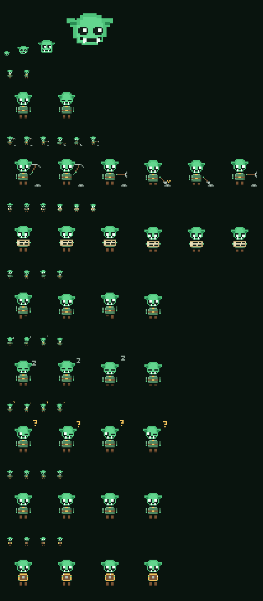

# Development

## Layout

```text
java-server/         the server, with its CLI and its MCP interface (Java 25, Maven)
chrome-extension/    the extension (TypeScript, Manifest V3, esbuild)
  src/               sources
  test/              unit tests (node:test, jsdom)
  icons/             the icon PNGs, written by art/mascot.ts
art/                 mascot.ts: the goblin, the one source of its icons and sprites
  dist/              build output: load this folder in Chrome
demo-site/           three local demo websites on three origins (test fixtures)
e2e/                 end-to-end suite and helper scripts (Puppeteer, your Chrome)
docs/                this documentation, screenshots, example outputs
```

## Build

```sh
mvn -f java-server/pom.xml package                    # tests + java-server/target/tabgoblin.jar
cd chrome-extension && npm install && npm run check   # type-check, unit tests, build to dist/
```

After rebuilding the extension, press the reload button on its card in `chrome://extensions`.

## Tests

| Command | What it covers |
|---|---|
| `node release/version.mjs` | Prints the version, or fails if the files that carry it disagree; with a version, changes it in all of them (runbook: "Change the version") |
| `bash release/bundle.sh` | Makes the download for the system it runs on, from both parts as they are built, into `release/out` |
| `mvn -f java-server/pom.xml test` | Pairing, origin check, version check, lockout, rotation, correlation, deadlines, cancellation, tool routing, submission ids, client cancel, the server's panel. The tests of the panel's window (`PanelTest`) need a display and are skipped without one |
| `mvn -f java-server/pom.xml verify` | The same, and then the built jar driven as an MCP client drives it: see [MCP conformance](mcp-conformance.md) |
| `cd chrome-extension && npm test` | Rules (`policy`), protocol validation, snapshot, extract, interactions, submission signals, the notice in the page, and the background worker against a fake Chrome |
| `cd e2e && npm test` | Everything together in your installed Chrome: one real server with two agents' processes and a command-line agent, a hand-made server for the protocol's protections, three demo sites |
| `cd e2e/editors && npm test` | Text entry into thirteen editor libraries and two plain controls, checked against each editor's own model |

How the end-to-end run works:

- It starts real server processes and speaks MCP to them over stdio, like an IDE does.
- It launches your installed Chrome with a temporary profile, installs the unmodified extension,
  and triggers its toolbar button the way a click does, so Chrome's real `activeTab` grant is used.
- It drives the popup through its real controls. Its servers are on ports of their own, which
  an extension does not look at, so it writes the port into the extension's storage through the
  debugging interface (`port`, a key no popup writes), and the worker takes it up at once.
- `HEADED=1 npm test` shows the browser; `TABGOBLIN_CHROME=<path>` picks another Chrome.

Other scripts in `e2e/`:

| Script | Purpose |
|---|---|
| `node live.mjs <url> …` | Read-only smoke check on real websites |
| `node agent.mjs` | Hands the tools to a real model (the `claude` CLI) with questions that need expanding, scrolling or loading more; prints the tool calls. Costs a few cents. |
| `HEADED=1 node screenshots.mjs` | Regenerates the pictures of the popup and of the notice in `docs/images`, and `docs/examples` |
| `node notice-pictures.mjs` | Pictures the notice in the page in every state, drawn by `notice.ts` in a plain page, to look at |

### About the diagrams

Six diagrams are SVG files in `docs/assets/diagrams/`. Each is one file that carries its own
ground and both sets of colours: it is light or dark by the reader's own setting, and readable
on any page. A page shows one with the plain Markdown form of an image, ``, which
GitHub and an editor's preview both understand; a `<picture>` element with two files, as they
had at first, did not show in IntelliJ's preview. They are drawn by one script, which holds
their common style (four colours, one meaning each: slate for what is not TabGoblin, such as
the agent and Chrome; green for TabGoblin and what runs with its leave, such as an authorized
tab, and the CLI and MCP interfaces, which are TabGoblin's code; amber for what waits for the
user's answer; red for what is denied or refused; rounded boxes, thin lines, dashed borders for
boundaries). Lines mean one thing each too: a solid line with a head is a request going that
way, whose answer comes back the same way; heads at both ends, in the data-flow picture only,
are data going both ways; dashed without a head is files read and written, or what is built from
a definition, where no request goes; red and dashed without a head is no path at all. A control
is named *enforced*, *configurable* or *best effort*, the words of the security model's summary
of controls. Each picture shows one idea: the README has the two simplest, and the detail is in
the pages that own it:

```sh
node docs/assets/diagrams/build.mjs
```

Change a diagram in that script, not in an SVG file, and open it afterwards, with the system
set to light and to dark. The sequence, state and flow diagrams are Mermaid in the pages
themselves, with the viewer's own theme and no colours of their own; an editor shows them only
if it draws Mermaid. They keep the same names as the pictures (*Coding agent*, *CLI process*,
*MCP link*, *TabGoblin server*, *TabGoblin extension*, or *Extension worker* and *Content
script* where the inside of the extension matters, *Popup*, *User*). A refusal, a cancellation
or an expiry is a `break` block, which ends the sequence there: nothing is drawn after it as if
the operation went on. A closed connection is an arrow that ends in a cross (`--x`). Inside a
Mermaid block a semicolon ends the statement, so a message's text uses commas. A note longer
than a line is broken with `<br/>`, and a note over one participant is kept short or spans two
(`Note over B,S`): Mermaid does not wrap a note, and a long one runs out of its box. Where
several outcomes end the same way, they lead to one named state (*Not submitted*) and not to
the end marker, whose lines otherwise cross the whole diagram. A legend in an SVG picture is
spaced by an estimate of each word's width (`textWidth` in the script), so its gaps are even.
`docs/agents/check-diagrams.mjs` renders each block with Mermaid in a headless Chrome and
reports the ones that do not parse ([runbook](agents/runbook.md#check-the-diagrams)); the pages
were last rendered with Mermaid 11.4.1.

### About the screenshots

The popup pictures are captures of the real popup window, taken through the browser's debugging
interface. Run the script with `HEADED=1`: a visible Chrome gives the popup its real size
(354 × 600), a headless one a different window. `popup-full.png` and `popup-full-light.png` are
the exception: they lay the popup's live content out at full length in an ordinary tab, to show
what is below the fold and what the light theme looks like. The popup itself cannot be captured
at full length: such a picture shows its header twice. Why, and what to do instead, is in the
[runbook](agents/runbook.md#regenerate-screenshots-and-examples).

The confirmation prompt has more cases than the documentation shows. `node screenshots.mjs prompts`
pictures all of them, in the dark and the light colour scheme, into `e2e/prompt-pictures/` (not in
git), and prints the text of each: a click, a click on a high-impact control, Enter in a text
box, with a long name, without a name, with a high-impact name, Enter in a field of a form; then a
session on which a no stands, the prompt in the automatic mode, a session in that mode with
one thing that passes and with two, the general setting with each of its three values, and the
panels folded to one line. Look at them after any change to the prompt. The end-to-end suite
reads the same texts, so wording cannot change unnoticed; how it looks, only eyes can tell.

The picture of the server's panel, `docs/images/server-panel.png`, is not a capture: a class
among the server's tests, `PanelPictures`, draws the panel in twenty states with the server's own
code, without a window. The command, and what to look at in the real window besides, is in the
[runbook](agents/runbook.md#look-at-the-servers-panel).

## Continuous integration

`.github/workflows/ci.yml` runs on every push to `main`, on every pull request, and when it is
started by hand:

| Job | Runs on | Does |
|---|---|---|
| Java server | Linux | `mvn verify`: compile, test, build the jar, check the jar against the protocol. Without a display: the tests of the panel's window are skipped |
| Chrome extension | Linux | `npm ci` and `npm run check`: type-check, unit tests, build |
| End to end | Windows | Builds both parts and runs the end-to-end suite in the runner's Chrome, headless |
| Editors | Windows | Builds both parts and runs the editor lab, tab in front |
| Documentation | Linux | Runs the tests of `docs/agents/check-personal.mjs` and `check-drift.mjs`, then both checks on the files, the link check, the diagram script against the committed SVG files, and the Mermaid check with a Mermaid installed outside the tree |
| One version | Linux | Runs the tests of `release/version.mjs` and then the script without a version, which fails if the files that carry the version disagree |
| Dependencies | Linux | `npm audit` for the extension and the test runner, which fails on an advisory of high severity; the same for the editor lab, listed only, because the editors under test are fixed versions of other people's libraries and are never shipped; and, on a pull request, GitHub's dependency review of what it changes, which covers the server's Maven libraries |

The end-to-end job runs on Windows because that is where the suite is developed.

### Releases

`.github/workflows/release.yml` makes a release. It is started by hand, on GitHub under
*Actions*, on the branch the release is from, with a version of three numbers, as `0.3.0`, and
a switch *publish*. From `main` the release is that version; from any other branch it is the
next beta of it, `0.3.0-beta.1` and then `.2`, numbered from the tags there are, and marked as a
pre-release. Without *publish* it does all but the last job: the downloads are kept with the
run, to be tried, and nothing is written. Nothing else starts it; a tag pushed by hand makes no
release. One release runs at a time.

A beta's version is written in the manifest as Chrome takes it, four numbers: `0.3.0-beta.1` is
`"version": "0.3.0.1"` and `"version_name": "0.3.0-beta.1"`, which is what `chrome://extensions`
shows. By those numbers a beta is above its release (`0.3.0.1` over `0.3.0`); that decides
nothing, because the extension is loaded unpacked and Chrome compares no versions for it.

| Job | Runs on | Does |
|---|---|---|
| The version | Linux | `node release/version.mjs --plan`: the version this run makes, from the version asked for, the branch and the tags. It refuses a version below the one in the tree, one that is released already, and a beta of a released version. `--previous` names the tag its list of changes starts from: for a release the release before it, for a beta the beta before it or else the release before |
| Suites | as in the table above | Every job of `ci.yml`, which the release calls with the version: each job that builds or tests sets it in the files first. Nothing is made if one fails. They run beside a CI run for the same branch, not in its place: the two are in groups of their own |
| Download, three times | Windows, Linux, macOS | Builds both parts and runs `release/bundle.sh`: a Java runtime with only the modules the jar uses (`jdeps`, `jlink`), with JavaFX's native files for its system in that runtime, the jar, the extension, the documentation (`docs/` with its pictures and diagrams, the README, CONTRIBUTING, SECURITY and the skills' README, as they are at that commit) and a command to start it by (on Windows also two files to double-click: `TabGoblin.exe` for the window, which `jpackage` makes with an icon that `art/mascot.ts` writes, and of which only the program and its settings are kept, the settings naming the jar where it lies; and a command file for the token), in one folder, packed. A runtime is made by the JDK of the system it is for, which is why there are three. The tree has the release's version set first. The script refuses a version in the files that is not the release's (`TABGOBLIN_RELEASE_VERSION`), and a server that does not start on the runtime made for it. A beta's download is named after its full version; the Windows program's own version is its first three numbers |
| Lists of components | Linux | Two files in the CycloneDX format: the libraries in the server's jar (`cyclonedx-maven-plugin`), and the tools the extension is built with (`npm sbom`), none of which is in the extension |
| Publish | Linux | Only with *publish*, after every other job passed. Writes `SHA256SUMS.txt` for the three downloads and the two lists and has GitHub attest where each was built; then commits the version onto the commit the run was started on, tags it `v` and the version, and pushes both in one push to the branch, which is refused if the branch moved on since the run started; then makes the release with `gh`, a beta as a pre-release: its notes are `release/notes.md` with the version filled in, followed by the list GitHub makes of the pull requests merged since that tag (`--generate-notes`). It is the only job that may write to the repository; the others read. If `main` has a rule that refuses pushes that are not from a pull request, the rule has to let this workflow through, or the push is refused |

What a download holds and how a person uses it is in the
[installation guide](installation.md#from-a-download); how a release is made is in the
[runbook](agents/runbook.md#make-a-release). The downloads are not signed: that takes
certificates, which cost money every year, and is the owner's to decide.

## The editor lab

`e2e/editors` holds one page per editor library (Monaco, CodeMirror 5 and 6, Ace, TipTap, Lexical,
Slate, Quill, Draft.js, TinyMCE, CKEditor 5, Trix, Editor.js, plus a plain textarea and a plain
editable region as controls). The libraries are ordinary npm dependencies of that folder, bundled
on the fly, so nothing is downloaded at test time and the versions are pinned.

Each page exposes the editor's own model as `window.__lab.get()`. The run enters text through the
whole chain and compares the model with what was asked for: fifteen checks per editor.

```sh
cd e2e && npm install         # the test runner, shared with the end-to-end suite
cd editors && npm install     # the editors
npm test                      # tab in front
BACKGROUND=1 npm test         # tab in the background while the agent works
ONLY=monaco,quill npm test    # some editors
CHECKS=lines,indent npm test  # some checks
VERBOSE=1 npm test            # also print what the tool answered each time
node lab.mjs                  # just serve the pages, to look at them
node live.mjs                 # the same idea on public demo pages of the editors' makers
```

The run fails when a check ends as `SILENT`: the editor does not hold the text, but the tool
reported success. An honest `fail` does not fail the run; it is a documented limit. Results and
their meaning are in [Editors](editors.md).

To add an editor: a fixture in `fixtures/` that creates it in `#host` with the text
`Initial content` and calls `ready(get)`, and an entry in `FIXTURES` in `lab.mjs`. Nothing in
the extension may refer to it.

## The demo sites

Three fixtures, each on its own port and therefore its own origin. Nothing in the extension or the
server knows about them.

| Site | Port | What it exercises |
|---|---|---|
| A, classic HTML | 8931 | Forms, a search form, a server-side form post, validation, collapsed sections, dynamic content, a password field, a redirect to another origin, a link that opens a new tab, a build log of four thousand lines, a feed that loads on scrolling, a list that draws only the rows in view, a menu that opens on hovering, a list in pages |
| B, single-page app | 8932 | `div`-based controls with ARIA roles, client-side routing, contenteditable, a custom checkbox, shadow DOM, a list that loads more on scroll, an inner scrolling area |
| C, documentation | 8933 | Nested headings, lists, a data table, a nested discussion, a same-origin frame, a frame from another origin, a "load more" button, text addressed to AI agents |

Run them by hand with `node demo-site/server.mjs`.

## Conventions

- **No website-specific code.** If a change needs a selector, hostname or product name, it does
  not belong here.
- **No library-specific code either.** An editor or widget is recognised by what it is in the DOM
  (an editing host, an EditContext, a role), never by a library's name, class names or attributes.
  The editor lab names libraries; the product does not, and a test (`agnostic.test.ts`) keeps it so.
- **Rules are pure.** Anything that decides whether something is allowed goes into `policy.ts` as
  a function without `chrome.*` or DOM access, with a test.
- **DOM code is pure too.** `snapshot`, `extract`, `interact`, `editor`, `submit` and `notice`
  take a document and run under jsdom.
- **Fail closed.** An unknown tab address, an unparseable message or a missing owner means no.
- **Nothing is retried.** A command is sent once; unknown outcomes are reported as unknown.
- **Only allowlisted information leaves the page.** New output fields need a reason and a test
  that hidden content and credentials stay out.
- **Errors are for the agent.** Each has a stable code and says what to do next.
- **The server's panel gives an agent nothing,** and shows nothing of a page and no secret. The
  rules are in the [security model](security-model.md#the-servers-panel); what it shows is decided in
  `PanelModel`, without a window, so that a test can hold them.
- **What is shown says what is so now.** The badge, the popup and the panel are set from the
  state as it is, not from what was true when something last changed: the badge says `ON` only
  while an agent that may act is connected, and a server is called connected only while it
  answers.
- **Nothing personal in the repository.** No home directory, no mail address outside the example
  domains, no link to an agent's session, in a file or in a commit message. A path in an example
  is written with a placeholder (`<folder>`). A check keeps the files so
  ([runbook](agents/runbook.md#check-that-nothing-personal-is-in-the-files)); pictures and commit
  messages it does not read.

## Documentation


Each fact has one page; every other page links to it. Before writing something down, find the
page that owns it:

| Page | Owns |
|---|---|
| [README](../README.md) | What TabGoblin is and why, how it works, the controls in one table, the quick start, the list of pages. It sums up and links; no comparisons or workflows |
| [Installation](installation.md) | Setting it up from a download or from source, verifying a download, and what goes wrong while doing that |
| [Developer guide](developer-guide.md) | What the user sees and does: authorizing, access levels, sessions, workspaces, submissions, stopping, the settings file, the server's panel, options and commands, troubleshooting |
| [CLI guide](cli.md) | The CLI: commands and arguments, discovery, what a command prints, exit codes, how many commands are one agent, instructions for an agent without a skill |
| [Tool reference](tool-reference.md) | What each tool takes and returns, for both interfaces: every text an agent reads, every limit, every error code. `ToolReferenceTest` holds it to the server's tool definitions |
| [Architecture](architecture.md) | Components, the two interfaces with what they share and where they differ, connections, flows, the session lifecycle, trust boundaries, where things are |
| [Security model](security-model.md) | The threat model and every rule: what is enforced where, where it stops, what is tested, what remains a risk |
| [Corporate assessment](corporate-assessment.md) | A summary of the above for an organisation's review. It states facts and links; a rule is changed in the security model first |
| [Editors](editors.md) | Which editors can be filled, how, and what was measured |
| [MCP conformance](mcp-conformance.md) | Which revision of MCP the server speaks, and how that is checked |
| [Skills](../skills/README.md) | What an agent is told beyond the server's own instructions, once for each of three agents. `SkillsTest` holds them to the server's tools, to the tool reference's codes and to each other |
| Development, this page | Build, tests, CI, releases, conventions, implementation notes, the messages between server and extension |
| [CONTRIBUTING](../CONTRIBUTING.md), [SECURITY](../SECURITY.md) | The short entry for contributors, and how to report a vulnerability |
| [Runbook](agents/runbook.md) | Commands by outcome, each with what success looks like |
| [State](agents/state.md), [validation log](agents/validation-log.md), [TODO](../TODO.md) | Records: what is open, what was run and when, what is planned |

- A page for users names what they see, not the code's classes and functions.
- How something came about, and what a run measured on a given day, goes into the validation
  log and into git, not into a page that explains.
- A number that a run produces (a count of tests, a size) goes stale: state it where a command
  beside it checks it, and nowhere else.
- After an edit, run the checks under [the documentation review](#the-documentation-review).

### Documentation is part of a change

A change is done when the pages say what the code does now. These rules hold for every change
and every contributor, agent or person:

- **The pages are part of the implementation,** not a task after it. A change is not complete
  until its impact on the documentation has been assessed and what is affected has been updated.
- **The implementation and its tests decide what may be claimed.** A page describes the behaviour
  as it is and as a test or a run has shown it. Where that disagrees with the intended design or
  with a security requirement, the disagreement is a fault to look into and to say, not a sentence
  to adjust until it fits.
- **Each fact has one page**, the table above. Another page may sum it up in a sentence and link
  to it; it does not say it again in its own words.
- **What is gone is taken out.** A removed component, a changed default, a dropped option leaves
  no description behind. Nothing is added beside an old sentence to correct it.
- **Nothing planned, assumed or unverified is written as implemented.** A page says what is.
  A plan goes into [TODO.md](../TODO.md), marked as one; what was goes into git and the records;
  what a run showed into the [validation log](agents/validation-log.md), with what it did not
  show. Where a page keeps a word on the past, it says so (*the release before*).
- **One behaviour, said alike for every way in.** What the CLI and MCP share is written once and
  holds for both; a page about one interface names what is shared and any actual difference, and
  the six skills say the same of it.
- **Plain, short, consistent, easy to find.** The names of the [vocabulary](architecture.md) and
  of the diagrams, the same in every page; no detail a reader of that page does not need.

### The impact review

For every change, whatever files it touched, look at the pages the row names. It is an
assessment: a page is changed where it says something that is no longer so, and left alone
where it does not.

| The change touches | Assess |
|---|---|
| Architecture, components, transport or protocol | [Architecture](architecture.md) with its diagrams, the [protocol reference](#protocol-reference), the [security model](security-model.md), the [corporate assessment](corporate-assessment.md) |
| Authentication, authorization, permissions or policy | Security model, corporate assessment, architecture, [developer guide](developer-guide.md), [README](../README.md) |
| Tools, their arguments, answers or errors | [Tool reference](tool-reference.md), [CLI guide](cli.md), the server instructions in `McpMain.java`, the examples in `docs/examples`, the six [skills](../skills/README.md) |
| Installation, configuration or startup | [Installation](installation.md), README, developer guide, CLI guide, the skills |
| The popup, the window, the notice, or how the user is asked | The pictures, the developer guide, the README, the flows that show the interaction (architecture, installation) |
| Dependencies, the build or a release | This page, installation, [CONTRIBUTING](../CONTRIBUTING.md), the [runbook](agents/runbook.md) |
| Tests, what is possible, or where something stops | The reference it belongs to, the security model's [table of what is verified](security-model.md#what-is-verified-by-tests), the validation log |

Then search the whole repository, not the files already open, for the words of the change: the
names of what was removed, the old default, the old number, the old message. Comments, tests,
the skills, examples, tables and the diagrams' sources carry them as pages do. The drift check
below finds the names that were retired before; a new removal adds its names to that list.

### Diagrams and pictures

A diagram is documentation under the same contract: it shows the implementation as it is.
There are the six SVG pictures (the README's overview and security boundary, the architecture's
components, the security model's command checks, the assessment's data flow, this section's
own), the Mermaid
diagrams in the pages (the connections, a command end to end, submissions, the session's
lifecycle, the command line's identity, the first use) and the pictures of the popup, the window
and the notice. When a flow, a component, a responsibility, an interface or a security boundary
changes, assess every diagram that shows it, and the alt text and the paragraph beside it.

- Keep the visual language: the four colours and what each means, the line kinds, the names of
  the participants, the layout ([about the diagrams](#about-the-diagrams)). One idea a diagram.
- Change an SVG picture in `docs/assets/diagrams/build.mjs` and run it; never edit an SVG file.
- Check that the Mermaid blocks parse ([runbook](agents/runbook.md#check-the-diagrams)), and open
  a changed diagram with the system set to light and to dark. Check it against the code: the
  participants, the arrows and their direction, the order of the steps, the labels, the
  boundaries. Look for a participant that no longer exists, a path that cannot happen, a step out
  of order, a label that runs out of its box, a boundary drawn where the code does not enforce
  one; and that the picture renders and can be read at the size the page shows it.
- Regenerate a picture with its script only ([about the screenshots](#about-the-screenshots)),
  and open it before it is used.

### Security claims

The security model, the assessment, the architecture, the README and the security pictures say
the same thing in four grades, and a change keeps the grade: a boundary that is **enforced**
always and by TabGoblin; a control the user's settings **configure**, enforced once set; a
protection that is **best effort** and has holes; and a **limitation** or residual risk. A claim
is never made stronger than the implementation and a test show; a weaker one is said as such.
The CLI and MCP share one set of controls ([security model](security-model.md#cli-and-mcp-one-set-of-controls)):
a page that describes one interface says what is shared and names any actual difference, and
says no difference where there is none.

### Checks before a change is done

Verify against the tree and a run, not from memory: component names, file paths and links;
commands, settings keys, defaults, ports and protocol versions; tool names, arguments, answers,
error codes and access levels; the examples; the pictures against the interface as it is; and
that nothing removed is still described as there. The checks that exist do part of it, and run
before a change is done:

| Check | Holds |
|---|---|
| `ToolReferenceTest` | The tool reference to the server's tool definitions: every tool and argument |
| `SkillsTest` | The six skills to the tools, to the reference's codes and to each other |
| `node docs/agents/check-links.mjs` | Every relative link and heading anchor |
| `node docs/agents/check-personal.mjs` | Nothing personal in the files |
| `node docs/agents/check-drift.mjs` | No retired name anywhere; the protocol version, the link version and the server's ports the same in both parts and in every page, skill, example and diagram source that quotes them; every code file and every `TABGOBLIN_*` variable a page names is in the tree |
| `node docs/agents/check-diagrams.mjs` | Every Mermaid block parses ([runbook](agents/runbook.md#check-the-diagrams)) |
| `node docs/assets/diagrams/build.mjs` | The SVG pictures are what the script draws; CI fails where a committed file differs |
| `node release/version.mjs` | One version in every file that carries it |

A check is extended where a drift has happened and a machine can tell it apart; a small,
deterministic rule, not a framework, no match on prose and no new dependency. The checks
complement the impact review and do not stand in for it: what they cannot tell apart, a reader
does. A change to code alone asks for no edit of a page: the review is of the impact, and its
result may be that nothing is affected.

### The documentation review

Every completed task ends with a short summary of its documentation review, in the last message
of a session and in a pull request's description, and nowhere in a page:

- Documentation updated: which pages.
- Diagrams updated, or verified as unaffected.
- Pictures updated, or verified as unaffected.
- Skills updated, or verified as unaffected.
- Validation performed: which checks and tests ran.
- Outstanding: what could not be checked, and why.

Where no documentation changes were needed, the summary says that the impact was assessed and
why nothing was affected. The [state file](agents/state.md) and the
[validation log](agents/validation-log.md) are kept as before; they record, and repeat no page.

## Implementation notes

How two parts are built that the [architecture](architecture.md) only outlines.

### The goblin

Every picture of the goblin comes from one drawing, [`art/goblin.ts`](../art/goblin.ts): a
palette, parts drawn as grids of letters (one letter a pixel), and the frames of each animation
put together from those parts at whole offsets. Nothing is smoothed or scaled by a fraction.
[`art/mascot.ts`](../art/mascot.ts) writes the pictures; run it from the repository's root after
a change:

```sh
node art/mascot.ts
```

It writes the extension's icons (`chrome-extension/icons/icon16.png` to `icon128.png`), the
panel's sprite sheet (`java-server/src/main/resources/tabgoblin/mascot.png`) with the rows
of its animations (`mascot.properties`), the README's logo (`docs/images/logo.png`, the 32-pixel
face trimmed to its edges at three times, shown at its own size), and the picture below
(`docs/images/mascot.png`). It
needs Node 22.18 or newer and nothing installed. `chrome-extension/test/mascot.test.ts` fails
when a file in the tree is not what the script draws, and holds the palette, the sizes, the frame
counts and the symmetry of the faces.



From the top: the icons at 16, 32, 48 and 128 pixels. The 32-pixel face is the owner's drawing,
and 128 is it at four times. The 16 and the 24-pixel faces are drawn again rather than shrunk; 48
is the 24 at two times. Then one band for each animation, in the order of the sheet's rows:
*idle*, *working* (mining), *reading* (a parchment), *walking*, *sleeping*, *confused*, *waiting*
and *guarding* (a shield). Each frame is at its own size, a cell of 32 by 32 pixels in which the
goblin stands 22 pixels high, and below at three times that. What a frame holds, and what rises
over it, stays inside the cell.

The panel shows a frame in its header, each pixel a square of two (`Panel.Mascot`). Which
animation plays is the model's (`PanelModel.mood`), from what the server knows, the first that
holds of:

1. *sleeping* while the connection is switched off;
2. *confused* while the server has a problem;
3. *waiting* while the browser is not connected to every agent, or there is no agent;
4. a tool call that is running now (`ExtensionConnection` knows the action of each command it
   waits on): *reading* for a snapshot, an extract, a collect or a screenshot, *walking* for a
   navigation, *working* for any other;
5. for three seconds after a call ended, as the log has it: *guarding* where the rules refused it
   (an authorization or a scope: that is TabGoblin working, not a fault), *confused* where it
   failed otherwise, and as in 4 where it went through;
6. *idle*.

How it moves, so that it says something and does not tire the eye: at rest it holds still and
blinks now and then, 8 to 15 seconds apart. Any other animation goes round, and a new one waits
until it has come round once, so that a burst of calls shows whole motions and not a frame of
each. A refresh with the same mood goes on where it is. It runs only while the window is on the
screen, and where the system asks for less motion it holds its first frame. The window's icon
does not move.

The popup's header shows the 32-pixel icon, and the notice in the page draws the 16-pixel face
from the same grid ([below](#the-notice-in-the-page)).

### The server's panel

What the window shows is in the [developer guide](developer-guide.md#the-servers-panel), and what it
may and may not do in the [security model](security-model.md#the-servers-panel). The window's
code is loaded when a window is first shown: for `--panel` (or `TABGOBLIN_PANEL=1`), or when the
browser has to be paired. How it is built:

- **A model, a window, five commands.** Once a second the window asks for a `PanelModel`: a
  record made from what the status tool also reads of each agent (`WebSocketBridge`, `Timings`)
  and from the lines `Log` has kept. With one agent it is that agent, as the panel always
  showed it; with several, each has a heading over its tabs; with none, it says that the server
  waits for one. It is plain data and is tested without a display. `Panel` draws it and
  sends back one of five commands, a sealed type: the connection on or off, stop, kill, open the settings file, and
  copy the pairing token. `McpMain` carries them out (`carryOut`).
- **The pairing token goes to the clipboard and nowhere else.** It is read when the button is
  pressed and handed to the clipboard. It is not in `PanelModel`, so the window has nothing of
  it to show, and the log says only that it was copied. `Panel.Secret` takes it off the
  clipboard again after a minute, and at Stop, if it is still what the clipboard holds.
- **The controls are always in view.** The header above and the controls below are fixed; the
  sessions, the time and the log lie in one part between them that scrolls where a screen is
  too low. The window is as high as the screen allows, up to 824 pixels. Every session is in
  the list, three show at a time, and the list scrolls (`Panel.TABS_IN_VIEW`). A list as long
  as the tabs once pushed the controls out of the window.
- **One tab's or one agent's metrics and log, on a click.** A session's row is a button, and so
  is an agent's heading where there are several. What is chosen is the window's own affair
  (`Panel.View.choose`): it is in no model and reaches the server by no command. The model has
  the metrics and the log for everything, for each agent and for each tab alone, and the window
  shows the part that is chosen. A line of the log carries the agent it belongs to
  (`Log.Scope`). For that a call's times and a
  command's log line carry the session the command ran in (`Timings.Call`, `Log.Line`). A
  command may name none and be given the agent's only session, so the extension says in each
  answer which session it was ([protocol](#protocol-reference)). The report the
  agent gets has no session in it, as before.
- **It comes up by itself for a pairing.** When a tool of an agent finds no browser on that
  agent's connection, the agent's service asks the server what it knows (`Hub.unpaired`). If
  the browser is paired with no agent of the server and came to one with a token that is not
  the server's, the server shows its window, once until something is paired, and the tool's
  answer says that the token is copied there. While it is so, the window has the step at its
  top, with a button that copies the token (`PanelModel.pairingWanted`). Not for an agent whose
  link said `quiet` (`--no-panel`), and not while the switch below is off. Where no browser
  has come, no window comes up: an extension that is paired finds the server by itself. A
  window that came up this way does not make the server stay.
- **Stop and Kill.** Stop runs the steps under "How a server ends". Kill halts the process with
  exit code 1 and runs none of them: the extension finds the connection gone instead of being
  told.
- **The switch holds the connection off.** The server closes the extension's connection with
  the code for "going away" and refuses every handshake after it, before any pairing proof is
  looked at, until it is switched on. A refused handshake is not a failed pairing and counts
  nothing towards the lockout. The extension is not told why. It goes on looking for the server
  every half minute, as for a server it cannot reach, so switching on needs nothing in the
  popup. Meanwhile a tool call is answered [`NOT_CONNECTED`](tool-reference.md#errors), with words that
  say where the connection was switched off.
- **The log is kept for the window, which may come up at any time:** the last 300 lines, in
  memory, from the server's first line on. They are the lines written to standard error at the level `TABGOBLIN_LOG`
  sets, with two additions: info and warning lines are kept even where `TABGOBLIN_LOG` silences
  them, and so is the line of each tool call that went through, which standard error has only
  at the level `debug`. Without that the window's log has the calls that failed and none that
  worked, and it is where the user looks for what the agent did (`Log.command`). In
  the window the log follows its last line unless the user reads in it. Where the last line
  is, is known only after new lines were laid out, so the view is brought down each time their
  height changes.
- **No display, no panel.** Where there is no display, or JavaFX cannot start, the server logs
  `panel not shown reason=…` and runs as it does without the option. A JavaFX that cannot
  start prints a trace of its own to standard error first.
- **Three kinds of window.** On Windows the window has the system's frame around a header of its
  own (`StageStyle.EXTENDED`, which JavaFX has since 25): the system draws the edge, the corners
  and the shadow, moves the window by the panel's header (a `HeaderBar`) and makes it higher or
  lower by its edges. The system's own buttons are switched off there (their height is set to 0)
  and the header's two stand in for the ones that put a window away and close it; there is none
  to fill the screen, and a request to do so is undone. Where JavaFX says the system cannot do
  that, Windows gets the window it had before: no frame, a rounded body with its own shadow,
  see-through around it, moved by its header and made higher by its lower edge. Everywhere else
  the body fills a window with the system's whole frame, because on Linux the see-through window
  was there for the system and drew nothing (`Panel.ownsItsHeader` and `Panel.floats`, held by
  tests). In all of them a request to close the window hides it and ends nothing: the server ends
  by its button, or by its agent, and `--panel` shows the window again (`Panel.raise`).
- **The window's icon is the extension's.** The build takes `chrome-extension/icons` into the
  jar (`pom.xml`), and `Panel.icons` reads them with smoothing off; 64 and 256 are 32 and 128
  made larger in whole squares. A window takes an icon only as a picture that holds its pixels
  as bytes, or it keeps Java's icon on the taskbar without a word; a PNG that is read is such a
  picture, and a test holds that.
- **JavaFX 27 is in the jar,** and it needs Java 25, which is why the server does. Each JavaFX is compiled for a Java of its time: 23 for Java 21, 27 for Java 25. It tells the window whether the system is set to light or dark, and whether the user asked the system for less motion, which JavaFX has said since 24. It also has a window style with the system's own frame around a header of one's own (`StageStyle.EXTENDED`), which the panel uses on Windows. JavaFX is there with its native part for Windows on x64, Linux on x64 and macOS
  on Apple silicon; that took the jar from 7.1 MB to 17.6 MB when it was added. A jar holds one
  set of native files per system, because those for Intel and for ARM have the same names.
  Run from a jar alone, JavaFX unpacks them into
  `.openjfx` in the home folder and loads them from there. A download does not let it: it holds
  them in its runtime (`runtime/tabgoblin-javafx`, put there by `release/bundle.sh`), and before
  JavaFX starts the server names that folder in `javafx.cachedir` (`McpMain.nativeFilesFromDownload`),
  where JavaFX finds each file the same as its own and writes nothing. A virus scanner on Windows
  quarantined the download's `TabGoblin.exe` as `Drop.Win64.UserProfileSelfRun` while JavaFX still
  wrote 54 DLLs into the user's profile and ran them. JavaFX also writes to standard error: one warning at the start, that
  it was loaded from the class path, and on Java 26 four lines of Java's own, that a method
  JavaFX draws with is to be removed. The jar is 19.2 MB with JavaFX 27.

A drawing of the panel can be right where the window is not: how to look at the window after a
change is in the [runbook](agents/runbook.md#look-at-the-servers-panel), and what was run on
which system in the [validation log](agents/validation-log.md).

### The notice in the page

In the bottom corner of an authorized tab a bar says what the agent does there, and above it a
pill for each thing it just did. The worker tells the page two things and nothing else
(`setNotice` in `background.ts`):

| Sent | When | Carries |
|---|---|---|
| A state | A command starts (`working`), the user is asked about a submission or for a higher level in that tab's session (`asking`), a session is paused or resumed (`paused`, `idle`). When a command ends while a question still waits, the state is `asking` again (`noticeAtRest` in `policy.ts`) | For `working`, what runs, in the words of the activity list |
| A line | A command ends | The activity list's words for it, and for one that did not run through the short note for its error code (`endedLine` in `policy.ts`) |
| `off` | The session ends or is suspended, a screenshot is about to be taken, or the setting is switched off | Nothing |

A screenshot waits for the page's answer to `off`, and the page gives it when the notice is out
of the picture and not only out of the page (`whenDrawn` in `notice.ts`): after it has begun
three frames, since the browser draws a changed page a moment later, later still while the page
is busy, and a capture takes what was drawn last. A page that is not shown draws nothing and
answers at once; one that has not drawn after a second and a half answers then. In both the
picture is taken as the browser has it, and neither was tried: a window that is covered or
minimized, and a page that hangs.

The page keeps the time (`notice.ts`): a line stays four seconds and fades for one, three lines
at most, and the notice leaves the page with its last line when nothing runs. The worker sets
no timer for it, since it may be asleep by the time a line has to go. Sending is best effort:
it never injects the content script and never holds up a command. The notice is drawn in a
closed shadow root, and only its two buttons take the pointer; a click on either counts only
when the browser marks it as the user's (`byTheUser` in `notice.ts`).

**The way back to a question.** The popup comes up by itself for a question and is gone at a
click elsewhere. While the state is `asking`, the bar has a second button, *Answer* with an arrow before the word, before
Pause. Its click sends the worker one fixed message, which names nothing; the worker brings the
popup up if a question waits for the session of the tab the message came from, and does
nothing otherwise (`indicator-show` in `background.ts`). It answers nothing: the answer is given
in the popup, which shows what is asked and holds its buttons for a moment. What the page is
told for it is the state alone, as before: nothing of the question, of what would be sent, or
of an agent's reason.

It is two panes. The bar holds the goblin, the words, Pause, and while an answer is needed the
way to the popup; it is one row high whatever
happens, and it is what stays in the corner. The pills float above it, each as wide as its
words, with nothing drawn around the two. So what stays is small, and what passes covers no
more of the page than its own text.

The look is the popup's: its colours and its round marks, and the goblin of the icons drawn with
nothing fetched: the 16-pixel face of [`art/goblin.ts`](#the-goblin), as paths of whole pixels
with crisp edges, at two times. The goblin stands bare on the bar, with no
tile and no edge of its own. It shows the state through one class alone (its outline glows green
while working and amber when the user is asked, and its eyes are closed when paused); it learns
nothing about what the agent does beyond that. What each action looks like is not shown; that
is WP-12.

## Adding a tool

1. Add the action to `ACTIONS` and its minimum access level to `REQUIRED` in `policy.ts`.
2. Implement the page operation in `interact.ts` (or a new pure module) and route it in `content.ts`.
3. Route the action in `runCommand` in `background.ts`.
4. Add the tool in `BrowserService.java` (argument validation) and `McpMain.java` (definition).
   The command line has it from there by itself: its commands and their arguments are the
   tools' definitions (`Cli.java`).
5. Test at each level: rule, DOM, routing, end to end.

## Protocol reference

Version 1. Typed in `Protocol.java` and `protocol.ts`; independent of MCP. A peer of another
version is refused. It is counted from the release with one connection for every agent of the
server, 0.3.0; the release before it (0.2.0, which called its protocol version 3) had a
connection and a port for each agent, and a server or an extension of that release is refused
and told to update.

```json
{ "type": "challenge", "nonce": "…", "version": 1 }
{ "type": "auth", "nonce": "…", "proof": "…", "version": 1 }
{ "type": "auth_ok", "proof": "…", "version": 1, "agents": [{ "id": "a-1a2b3c4d5e6f", "name": "IntelliJ IDEA" }] }
{ "type": "agents", "agents": [{ "id": "a-1a2b3c4d5e6f", "name": "IntelliJ IDEA" }, { "id": "c-7f3a9b2c", "name": "" }] }
{ "type": "agents_refused", "agents": ["c-7f3a9b2c"] }

{ "id": "17", "agent": "a-1a2b3c4d5e6f", "action": "click", "session": "s2", "params": { "ref": 12 }, "deadline": 1700000000000 }
{ "id": "17", "success": true, "result": {}, "timing": { "ran": 132, "queued": 0, "asked": 0 }, "session": "s2" }
{ "id": "17", "success": false, "error": { "code": "NOT_AUTHORIZED", "message": "…" } }

{ "type": "cancel", "id": "17" }
{ "type": "policy", "blocked": ["example.org"], "unreadable": false, "strict": false, "allowed": [], "screenshots": true,
  "maxAccess": "write", "sessionMaxMinutes": 0, "sessionIdleMinutes": 0 }
{ "type": "event", "event": "sessions", "agent": "a-1a2b3c4d5e6f", "data": { "sessions": [] } }
{ "type": "event", "event": "activity", "agent": "a-1a2b3c4d5e6f", "data": { "id": "17", "session": "s2", "action": "click", "ms": 132, "code": "ok" } }
{ "type": "ping" }   { "type": "pong" }
```

One connection carries every agent of the server. The server names its agents in `auth_ok`, and
again as `agents` whenever one comes, goes or says its name; a command names its agent; an event
names the agent it is for, and so does a `sessions` event, which the extension sends for each
agent. An agent's `id` is who it is: `a-` and twelve hexadecimal digits for an agent with a key
of its own, the same at every start; anything else is an id for one start
([architecture](architecture.md#browser-session-authorization)). The `name` is what the user is
shown; an agent names itself when it opens its connection to the server (`initialize`), so the
name may be empty at first and come with a later `agents`. The name decides nothing.

On a connection the server sends `auth_ok` before anything else, and may send a command right
behind it. Taking the connection for its paired one and sending `auth_ok` are one step for the
server's other threads (`ExtensionServer`): an extension that holds `auth_ok` is connected for
every tool call of every agent from then on, and none is told `NOT_CONNECTED`. The extension
keeps per agent what is an agent's: its sessions, bound to its id; the rate limit; the command
ids it has seen. What is the server's it keeps once: the pairing, the blocked sites and the
policy, the heartbeat.

`agents_refused` is the extension's answer to the server's list, each time it gets one: those of
the named agents the user disconnected in the popup. No command of such an agent runs, however
often the server names it, and the server tells that agent that it has no browser until the
user allows it again, when the next `agents_refused` no longer names it. A command whose
`agent` the server did not name is answered with `NOT_CONNECTED` and runs nowhere. Nothing is
granted by any of this: a tab is still the user's click in the popup, on an agent the server
has proven by its key.

`policy` is the user's list of [blocked sites](security-model.md#blocked-sites), as the server's settings
have it: the domains, in lower case and in their encoded form; `unreadable` is true while the
settings file cannot be read and every site is refused. The extension takes the list whole or not
at all. The server sends it when the extension has said its first word as a paired one, which it
does at once with its agents refused and its sessions, and again when the list has changed. What an
entry blocks is decided in two places, `BlockedSites.java` and `blockedBy` in `policy.ts`; both are
held to one list of cases, `java-server/src/test/resources/tabgoblin/blocked-sites-cases.json`.
The same message carries the rest of the user's [security policy](security-model.md#the-security-policy):
`strict`, `allowed` (domains, matched as blocked ones are), `screenshots`, `maxAccess`, and the
two times in minutes, 0 for none. A field that is missing restricts nothing; one that is there
and cannot be read makes the message no message. The server's side is `Limits` in
`BlockedSites.java`, the extension's `Limits` and `checkLimits` in `policy.ts`.

A command's `action` is one of `ACTIONS` in `policy.ts`. Two of them need no session and are
answered before one is looked for: `status`, and `request_access`, an agent's request to the
user, which may be for a site it has no session on.

The extension takes the messages of a connection in the order they came. One that arrives while
it still checks the proof in `auth_ok` waits for that, and is then a message like any other.
Without a valid `auth_ok` before it, any other message is a failed pairing (4401).

`timing` comes with every answer, failed ones too, in milliseconds: how long the command ran in
the extension, how long it waited before that for its turn in the tab's queue, and how much of
the running was waiting for the user's answer. The server cannot see inside the round trip; with
these it says where the time of a tool call went (`Timings.java`,
[tool-reference.md](tool-reference.md#where-the-time-went)).

`session` comes with the answer of every command that ran in a session, failed ones too: the
id of that session. A command may name none and be given the agent's only one, and the
server's panel shows the times and the calls of one tab
([architecture](architecture.md#the-servers-panel)). The status and a command that was refused
before a session was looked for have none.

Between the process an agent starts and the one server there is a second, smaller protocol, on
the same port: a WebSocket connection on the path `/link`, each message a text frame
(`Link.java`, `Hub.java`). One message each way proves the pairing token, then the agent's
messages follow: MCP as it is for an MCP client's process, or the command line's own three
messages for a command. Its version is 3 (2 had a line of JSON on a plain TCP connection, on a
port of its own; 1 had MCP for both).

```json
{ "type": "hello", "nonce": "…", "link": 3 }
{ "type": "attach", "nonce": "…", "proof": "…", "link": 3, "panel": false, "quiet": false, "agent": "claude-code", "agentProof": "…" }
{ "type": "attached", "proof": "…" }      { "type": "refused", "reason": "proof" }

{ "tabgoblin": "log", "text": "serving client=a-1a2b3c4d5e6f port=47821" }
{ "tabgoblin": "stopping" }
```

`panel` asks for the server's window at once; `quiet` says that the window is not to come up
by itself for this agent when the browser has to be paired (`--no-panel`). Both are optional.
`agent` and `agentProof` are sent by a process that was started with `--agent`: the name, and
the proof that it holds that name's key (`AgentKeys.proof`). Without them, or with a proof that
does not hold, the agent gets an id for this start only.
A process that runs one command of the [command line](cli.md) adds
`"cli": true` to its `attach`. The server then serves the agent of that key without ending it
when the connection closes, and takes further such connections of the same key as the same
agent; `refused` with the reason `agent_in_use` says that the key's agent is connected in the
other way. What follows the `attached` is the command line's own (`Commands.java`), one call
for each connection, and nothing of MCP:

```json
{ "type": "call", "tool": "browser_snapshot", "arguments": { "session": "s1" } }
{ "type": "cancel" }
{ "type": "result", "tool": "browser_snapshot", "isError": false, "code": null, "text": "…", "structured": null, "image": null }
{ "type": "error", "message": "One call for each connection: this connection has had its call." }
```

`cancel` is sent when the command's process is ended while its call runs: the call is
interrupted, which stops the command in the browser at its next safe point, and gets no
`result`. A connection that ends under a call does the same. `code` is the error's code, as
the tool reference lists it, where `isError` is true; `structured` is the object of a tool
that returns one; `image` has `mimeType` and `base64`.
`refused` with the reason `interface_not_allowed` says that the settings file has this
interface off (`interfaces`); `not_a_tabgoblin_server` is the link's own word for a port on
which something answers that does not greet as the server does. A `turned_away` in the place
of `attach`, with the same proof, tells a running server that an MCP start found MCP off before
it came; it is answered with `counted`, and the server's window counts it.
`show` in the place of `attach` asks for the server's window and is answered with `shown`. The
two messages that begin with `tabgoblin` are the server's to the link itself and never reach the
agent: a line of the agent's log, and the word that the user stopped the server, without which
a link takes the server's end for a loss and starts it anew
([architecture](architecture.md#how-a-server-ends)).

| Close code | Meaning |
|---|---|
| 4401 | Pairing failed, timed out, or the token was rotated |
| 4403 | Not a close code since version 1: the user's disconnecting of one agent is said as `agents_refused`, and that agent is told so. The number is kept in both parts for the agent's state |
| 4406 | Another protocol version |
| 4408 | The server left two heartbeats in a row unanswered; the extension takes it for gone and looks for it again |
| 4409 | Replaced by a newer connection |
| 4429 | Too many messages |

Two codes of the WebSocket standard are used as well: 1001 ("going away") when a server ends in
order, or when its connection is switched off in [its panel](architecture.md#the-servers-panel);
1009 when a message is larger than the receiver takes.

Proofs are `HMAC-SHA256(token, "client:" + serverNonce + ":" + clientNonce)` and the same with
`"server:"`, hex-encoded. A shared test vector is asserted in both `PairingTest.java` and
`pairing.test.ts`.

## Names

The product is TabGoblin, and so is every technical name: the jar and MCP server name
(`tabgoblin`), the Java package (`tabgoblin`), the token directory (`~/.tabgoblin`), the
`TABGOBLIN_*` environment variables, and the notice's element in the page (`tabgoblin-notice`).
Until 2026-11-27 these were `browser-context-mcp`, `browsercontext`, `~/.browser-context-mcp`,
`BCMCP_*` and `bcmcp-indicator`, from before the product had its name; they were renamed in one
commit while there were no users to migrate, and a setup from before it has to be run again.

The Java package and the Maven group, both `tabgoblin`, do not follow the convention of a
reversed domain name. That is left as it is, decided on 2026-11-21:

- Nothing outside this repository sees either name. The jar is run by its path. Since 2026-11-23
  it is also inside a download, as `tabgoblin.jar`, in a folder and beside a command that are
  both called `tabgoblin`.
- A conventional name needs a domain or an account name, which is the owner's to choose.
- The change touches every Java file and the jar's entry point, for no change in behaviour.

If the jar is ever published by itself, to a repository of libraries for one, rename then, in
one commit that does nothing else.
