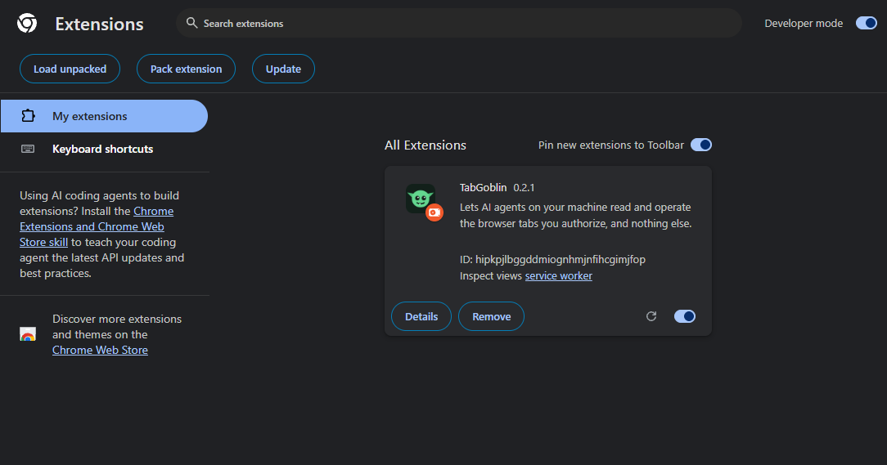
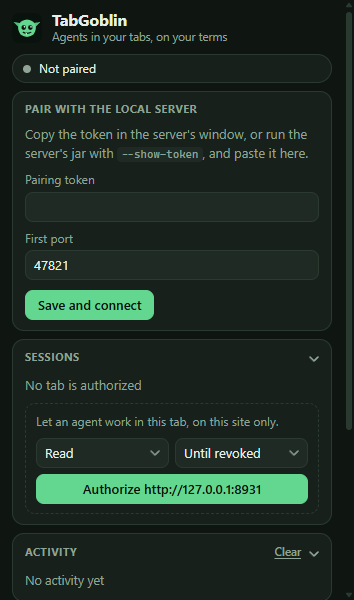
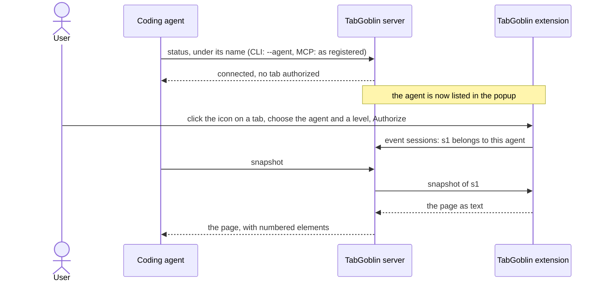

# Installation

There are two ways to get TabGoblin:

- **A download** with everything inside. Nothing is installed first and nothing is built. That
  is the next section.
- **A build from source**, for those who work on TabGoblin, or want to build what they run. That
  is the rest of the page.

Either way three things get set up: TabGoblin's server, a local Java program that starts by
itself when your agent needs it; the browser extension, TabGoblin in Chrome; and the two
connections, from your agent to the server (by the CLI or by MCP) and from the server to the
extension (a pairing token).

## CLI or MCP

Your agent reaches TabGoblin through one of two equal integration interfaces: the **CLI**, for
an agent that runs commands in a terminal (nothing is registered), or **MCP**, for an agent
that is an MCP client (one line registers the server). Both give the same tools, go through the
same server and extension, and are held to the same checks. Choose one per agent; both can be
in use on one machine, for different agents. How they differ in detail is in the
[architecture](architecture.md#integration-interfaces-cli-and-mcp).

## From a download

You need Google Chrome 120 or newer, and an agent that can run local commands or that speaks
MCP. The Java TabGoblin runs on is in the download.

1. **Download** the file for your system from the [latest release](https://github.com/LaughingManCommits/TabGoblin/releases/latest),
   and unpack it where it can stay: your agent is told its place. It is one folder, `tabgoblin`,
   with this documentation inside it as it was for that version (`docs/`), to read offline.

   | System | File |
   |---|---|
   | Windows, x64 | `tabgoblin-<version>-windows-x64.zip` |
   | Linux, x64 | `tabgoblin-<version>-linux-x64.tar.gz` |
   | macOS, Apple silicon | `tabgoblin-<version>-macos-arm64.tar.gz` |

2. **Connect your agent,** through the [CLI](#cli) or through [MCP](#mcp), below. Either is
   one setup command in a terminal in that folder. Setup installs the agent's
   [skill](../skills/README.md) and prints what is left, with your folder's own paths. It runs
   no other program and writes nothing else.

3. **Load the extension in Chrome**, as in [step 4](#4-load-the-extension-in-chrome), with the
   folder `extension` of the download.

4. **Pair**, once. `tabgoblin --panel` opens the server's window. Press **Copy** next to
   *Pairing token* there, click the goblin in Chrome's toolbar, paste the token into **Pairing
   token** and press **Save and connect**. More in
   [step 6](#6-pair-the-extension-with-the-server).

5. **Check that it works**, as in [step 7](#7-check-that-it-works).

On Linux and macOS the command is `./tabgoblin` while you are in the folder. On Windows the
folder also has two files to double-click. `TabGoblin.exe`, with the goblin as its icon, is
`tabgoblin --panel` without a console: it opens the server's window, starts the server if none
runs, and says in a small window why if it could not. `tabgoblin-token.cmd` is
`tabgoblin --show-token`, which prints the token and starts nothing. Neither is signed (see below).

### CLI

For an agent that runs commands in a terminal. The agent is one of `claude-code`, `codex` and
`copilot`:

```sh
tabgoblin --setup claude-code --mode cli
```

Setup installs the agent's skill for the CLI and prints the command the agent runs, with your
folder's path:

```text
"<folder>\tabgoblin\tabgoblin.cmd" status --agent claude-code
```

Nothing is registered with the agent. Two things are yours to do:

- **Let the agent find the command.** Put the download's folder on your `PATH`, so that
  `tabgoblin` works in the agent's terminal; or tell the agent the full line once, for
  instance in its instructions file.
- **Run the status once,** yourself or through the agent, before you authorize a tab: an
  agent of the CLI is known to TabGoblin from its first command on, and appears in the popup
  then.

An agent that setup does not know needs no skill: a few lines of instructions are enough, and
it learns the commands from `tabgoblin tools --json`. The lines are in the
[CLI guide](cli.md#agents-and-ides-without-mcp), with everything else about the commands.

### MCP

For an agent that is an MCP client:

```sh
tabgoblin --setup claude-code
```

Setup installs the agent's skill for MCP and prints one line that registers TabGoblin's server
with the agent. Run it. It is the agent's own command for adding a server, and looks like this
for Claude Code:

```text
claude mcp add --scope user tabgoblin -- "<folder>\tabgoblin\runtime\bin\java.exe" -jar "<folder>\tabgoblin\tabgoblin.jar" --agent claude-code
```

An agent that setup does not know takes the same command in its MCP settings:
[step 5](#5-connect-your-agent) has the forms. `--mode mcp` says the same as no mode.

Setting an agent up again the other way puts the other skill in the first one's place; the
two take each other's place, so an agent has the one for the interface it uses.

Where another page names `java -jar java-server/target/tabgoblin.jar`, a download
has `tabgoblin` in its place: `tabgoblin --panel`, `tabgoblin --show-token`, `tabgoblin --help`.

**To update,** unpack a newer download over the same folder, press the reload arrow on
TabGoblin's card at `chrome://extensions`, and start your agent anew. The paths are the same,
so nothing is set up again. The server and the extension have to be of the same release.

**To check a download:** each release has a file `SHA256SUMS.txt` with the SHA-256 of every
download, and GitHub attests that each was built by this repository's release workflow. The
commit that the attestation names is the one before the release's tag: the workflow sets the
version, builds, and only then commits the version and tags it.

A release whose name ends in `-beta.` and a number is a beta: it is marked as a pre-release on
GitHub and is made to try what comes next. Keep the latest release that is not a beta.

To check one:

```sh
gh attestation verify tabgoblin-<version>-windows-x64.zip --repo LaughingManCommits/TabGoblin
```

**Not signed.** The downloads are not code-signed for Windows or macOS: either system may warn
before it runs what is in a download, and a machine that runs signed programs only refuses it.
A virus scanner may also hold back `TabGoblin.exe`. One did so with a download that let JavaFX
unpack its DLLs into the user's profile (`.openjfx`) and run them from there; a download now has
them in its runtime. If a scanner still quarantines a file of a download, check the download
against `SHA256SUMS.txt` and its attestation as above, and report it to the scanner's maker as a
false detection.

## From source

Allow about ten minutes. Every command below is run from the folder you cloned the project into,
and each is on its own line so it works the same in PowerShell, Command Prompt and bash.

## Before you start

| You need | Version | Check with | Get it from |
|---|---|---|---|
| Java (JDK) | 25 or newer | `java -version` | [adoptium.net](https://adoptium.net) |
| Maven | 3.8 or newer | `mvn -v` | [maven.apache.org](https://maven.apache.org/download.cgi) |
| Node.js | 24 or newer | `node -v` | [nodejs.org](https://nodejs.org) |
| Google Chrome | 120 or newer | `chrome://version` | – |
| Git | any | `git --version` | [git-scm.com](https://git-scm.com) |

`mvn -v` also prints which Java it uses. It has to be 25 or newer too.

## 1. Get the code

```sh
git clone https://github.com/LaughingManCommits/TabGoblin.git
cd TabGoblin
```

## 2. Build the server

```sh
mvn -f java-server/pom.xml package
```

This compiles the server, runs its tests and packages everything into one file. The first run
downloads libraries and takes a minute or two. It is done when you see:

```text
[INFO] BUILD SUCCESS
```

The result is **`java-server/target/tabgoblin.jar`**. To skip the tests, add
`-DskipTests`.

## 3. Build the extension

```sh
cd chrome-extension
npm install
npm run build
cd ..
```

It is done when you see the three bundles listed, each with its size: `dist\content.js`,
`dist\background.js` and `dist\popup.js`.

The result is the folder **`chrome-extension/dist`**. That folder, not `chrome-extension` itself,
is what Chrome loads.

`npm install` may warn that an install script of `esbuild` was blocked. The build works without it.

## 4. Load the extension in Chrome

1. Open a new tab and go to `chrome://extensions`.
2. Switch on **Developer mode** (top right).
3. Click **Load unpacked** (top left).
4. Choose the folder `chrome-extension/dist` inside the project and confirm.

TabGoblin now appears in the list:



Check two things on its card:

- **The ID is `hipkpjlbggddmiognhmjnfihcgimjfop`.** The server only accepts connections from this
  extension, and the ID is fixed by the project, so it is the same on every machine.
- **There is no red *Errors* button.** If there is, see [Problems](#problems).

Then pin it: click the puzzle-piece icon in Chrome's toolbar and press the pin next to TabGoblin,
so the goblin is always visible. You will click it on every tab you want an agent to work in.

## 5. Connect your agent

Through MCP or through the CLI ([which](#cli-or-mcp)). In the examples, `<folder>` stands for
the folder you cloned the project into; write yours in its place (`D:/code`, for example).

### Through MCP

Your agent starts TabGoblin's server itself; you only tell it how. Use the **absolute path** of
the jar, with forward slashes, also on Windows. Most MCP clients take this JSON:

```json
{
  "mcpServers": {
    "tabgoblin": {
      "command": "java",
      "args": ["-jar", "<folder>/TabGoblin/java-server/target/tabgoblin.jar", "--agent", "my-ide"]
    }
  }
}
```

| Agent | Where it goes |
|---|---|
| IntelliJ IDEA, AI Assistant | *Settings → Tools → AI Assistant → Model Context Protocol (MCP) → Add*, paste the JSON. The menu names vary a little between versions. |
| Claude Code | `claude mcp add --scope user tabgoblin -- java -jar <folder>/TabGoblin/java-server/target/tabgoblin.jar --agent claude-code` |
| Anything else that speaks MCP over stdio | Command `java`, arguments `-jar`, the path, `--agent` and a name |

Restart the agent, or reload its MCP servers, so it picks the server up.

### Through the CLI

Nothing is registered. The agent runs the jar with a command's name behind it:

```sh
java -jar <folder>/TabGoblin/java-server/target/tabgoblin.jar tools
java -jar <folder>/TabGoblin/java-server/target/tabgoblin.jar status --agent my-agent
```

A build from source has no `tabgoblin` command of its own. Tell the agent that line once, make
an alias or a small script named `tabgoblin` for it, or pack the build into
[a folder like a download](#a-folder-like-a-download), which has the command. The commands are
in the [CLI guide](cli.md).

### The agent's name

`--agent` names the agent to TabGoblin, with a short name of your choice, a different one for
each agent. By it the agent has a key of its own and is the same agent every time: its tabs
are its own again after a restart, and from one CLI command to the next. Through MCP it is
optional: without it everything works, and the tabs have to be authorized again after each
restart ([agents](developer-guide.md#agents)). A CLI command always needs it.

You can connect several agents, up to eight at once. Whichever of them needs TabGoblin first
starts the one server, and the others connect to it.

### The skill

TabGoblin tells an agent in a few lines how to use its tools. For Claude Code, Codex and GitHub
Copilot there is more, as a skill to put where the agent looks for skills: how to read a long
page, what to ask you for, what to do when a tool refuses. One command puts it in place, with
`claude-code`, `codex` or `copilot`; add `--mode cli` for the skill that speaks of commands:

```sh
java -jar <folder>/TabGoblin/java-server/target/tabgoblin.jar --install-skill claude-code
java -jar <folder>/TabGoblin/java-server/target/tabgoblin.jar --install-skill claude-code --mode cli
```

What the skills say, and where each agent keeps them, is in [skills](../skills/README.md).

A server has no window. With `--panel` as a further argument it shows a small one, with its
sessions, its log and a button to stop it: see
[the server's panel](developer-guide.md#the-servers-panel).

## 6. Pair the extension with the server

The extension only talks to servers that know a secret token. Print it:

```sh
java -jar java-server/target/tabgoblin.jar --show-token
```

```text
Pairing token: 3f9c…  (64 characters)
Port:          47821
```

Click the goblin in Chrome's toolbar, paste the token into **Pairing token** and press **Save and
connect**. There is no port to set: the extension finds the server by itself.

A server that shows [its panel](developer-guide.md#the-servers-panel) saves you the command: its
**Copy** button puts the token on the clipboard.



The token is created on first use and kept in `.tabgoblin/pairing-token` in your home
folder. You pair once; it stays valid until you rotate it.

## 7. Check that it works

What happens the first time, with either interface:



1. Make sure TabGoblin's server is up: through MCP, start your agent; through the CLI, run
   `tabgoblin status --agent <name>` once. The line under *TabGoblin* in the popup should read
   **1 agent connected**.
2. Open any website, click the goblin on that tab, choose **Read**, and press **Authorize**.
3. Ask your agent for the browser status: *"Call browser_status"*, or through the CLI *"Run
   tabgoblin status"*. It should answer along these lines (a CLI command has this as the `text`
   of its JSON answer):

   ```text
   Extension: connected (protocol 1)
   This agent: a-1a2b3c4d5e6f …
   Submissions need user confirmation: …
   Sessions: 1
   Session s1
     Authorized origin: https://example.com
     Access: read only
     Paused: no
   ```

4. Ask it: *"Take a snapshot of the page and tell me what is on it."*

That is the whole chain working. The [developer guide](developer-guide.md) takes it from here.

## A folder like a download

A build can be packed into the folder a download has: the server with a Java runtime of its own,
the extension, and the `tabgoblin` command. After steps 2 and 3, in bash (on Windows, Git Bash),
with a JDK 25 or newer on the path:

```sh
bash release/bundle.sh
```

It writes `release/out/tabgoblin-<version>-<system>-<machine>`, a `.zip` on Windows and a
`.tar.gz` elsewhere, for the system it runs on. Unpack it where it can stay and go on from
step 2 of [From a download](#from-a-download).

## Updating

After pulling a new version:

```sh
mvn -f java-server/pom.xml package
cd chrome-extension
npm install
npm run build
cd ..
```

Then press the **reload** arrow on TabGoblin's card at `chrome://extensions`, and restart your
agent so it starts the new server. A server that still runs is not replaced by a new build:
stop it first ([stopping](developer-guide.md#stopping)). Server and extension must come from the same version; if they
do not, the popup says *Server and extension versions differ*. The pairing survives an update.

## Uninstalling

1. At `chrome://extensions`, press **Remove** on TabGoblin's card.
2. Remove the `tabgoblin` entry from your agent's MCP settings, if it has one, and the folder
   `tabgoblin` from where your agent keeps its skills ([where](../skills/README.md)).
3. Delete the folder `.tabgoblin` in your home folder (it holds the token and your settings).
4. Delete the project folder.

## Problems

| What happens | Why | What to do |
|---|---|---|
| `mvn` reports *release version 25 not supported* | Maven runs on an older Java | Point `JAVA_HOME` at a JDK 25 or newer; check with `mvn -v` |
| `java -jar` reports *UnsupportedClassVersionError … class file version 69.0* | The jar is started with a Java older than 25. Since the server needs Java 25, an agent's registration that names an older `java` no longer starts it | Name a Java 25 or newer in the command that starts the server; check with `java -version`. A download has its own runtime and is not affected |
| `mvn` or `java` *is not recognized* | Not installed or not on the `PATH` | Install it and open a new terminal |
| `npm run build` cannot find `esbuild` | `npm install` did not finish | Run `npm install` again in `chrome-extension` |
| Chrome says *Manifest file is missing or unreadable* | The wrong folder was chosen | Choose `chrome-extension/dist`, and build first |
| **Load unpacked** is not there | Developer mode is off | Switch it on, top right |
| Developer mode or loading is blocked | A managed (work) browser forbids unpacked extensions | Ask your administrator, or use a personal Chrome profile |
| The extension's ID is different | The `key` in `chrome-extension/manifest.json` was changed or removed | Restore it; or start the server with `--extension-origin any` |
| Agent: *Could not listen on port 47821*, and the server's window says the same | The message says which. Another program that is not a TabGoblin server holds the port. Or the system does not give it out: Windows keeps ranges of ports back for its own networking where Hyper-V, WSL or Docker is used, and they move when those start anew (`netsh interface ipv4 show excludedportrange protocol=tcp` lists them). For that case the server tries 37821 and then 27821 by itself, and the extension finds it there; the message appears only when all three are kept back, or when a port was set with `--port` | Taken: close that program; the server does not step over a port another program holds. Kept back: free one of the three, which are the only ports the extension looks at |

What the popup and the agent say once everything is installed (*Disconnected*, *Paste the server's current token*,
"not connected") is in the developer guide's [troubleshooting](developer-guide.md#troubleshooting).

Chrome is the only browser this has been run in. Other Chromium browsers may work but are untested.
