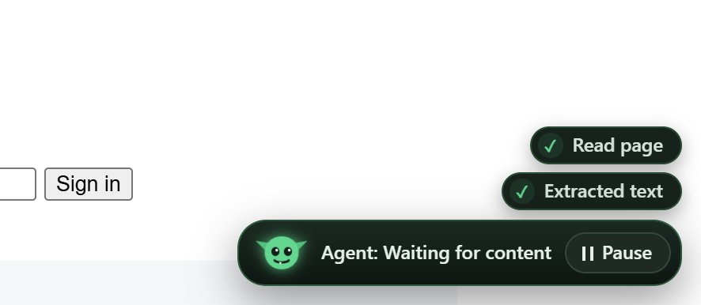
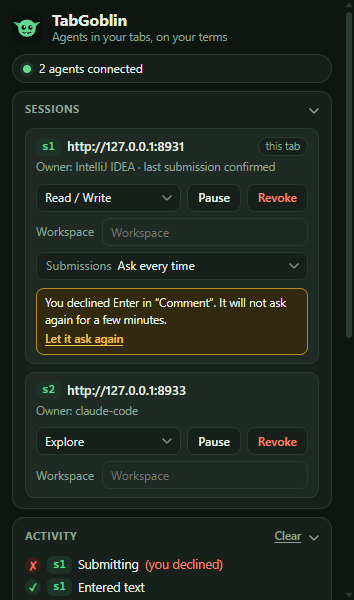
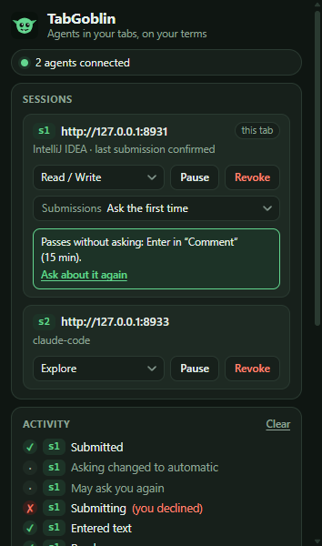

# User guide

How to work with TabGoblin once it is set up: authorizing tabs, what the popup shows and does,
submissions, and stopping. What an agent can and cannot reach is in the
[security model](security.md); what each tool does, in the [tool reference](tools.md).

The pictures of the popup are captures of the real one, in its real size; where there is more
than fits, the popup scrolls.

## 1. Install

The [installation guide](installation.md) has every step, with what you should see and what to
do when you do not: building the two parts, loading the extension in Chrome, and telling your
agent about the server. Every agent you set up starts its own server; up to eight can run at
once.

## 2. Pair

The extension only talks to servers that know a shared pairing token. You paste it into the
popup once: [step 6 of the installation guide](installation.md#6-pair-the-extension-with-the-server).

The line under the name in the popup says how many agents are connected. *Disconnected* means
that no server is reachable: none runs, because your agent starts one when it first needs it, or
you switched one off in [its panel](#9-the-servers-panel). A paired extension finds a new server
within about 30 seconds, or at once when you open the popup.

To invalidate a token, run the jar with `--rotate-token`. Every running server drops the old
pairing at once and the popup asks you to pair again with the new token.

## 3. Authorize a tab

Open the website and log in as you normally do. Then click the goblin **on that tab**.


Choose:

- **the access level** (see below),
- **how long** it lasts: until you revoke it, one hour, or eight hours,
- **which agent** gets the tab, when more than one is connected. *Any agent* gives it to whichever
  agent uses it first.

Press **Authorize**. The tab is now a session. Only that tab and only that website are covered;
subdomains and other ports are different websites.

Why the click has to happen on the tab itself: Chrome gives the extension access to a tab only when
you click its icon there. That is the first of two independent checks; the extension's own check of
the address before every command is the second.

### Access levels

| | Read | Explore | Read / Write |
|---|---|---|---|
| Read the page, scroll, take screenshots, wait | yes | yes | yes |
| Go to other pages of the site, back, forward, reload | no | yes | yes |
| Follow links, open tabs and expand collapsed sections | no | yes | yes |
| Press buttons, fill in and type into fields | no | no | yes |
| Submit forms, post, save, delete | no | no | yes, as a stated submission |

Start with the lowest level that does the job. You can change it at any time in the session's
dropdown; lowering it stops whatever needed the higher level.

**Read** sends nothing to the website on the agent's behalf. **Explore** makes the browser load
pages, which on a few badly built sites has side effects (a "log out" link, for example).

## 4. Working with sessions


The popup is ordered by how often you need it. From the top:

**Sessions** shows each authorized tab: its id, its website, its owner, and controls.

- The dropdown changes the access level.
- **Pause** stops the agent in that tab at once and refuses new commands until you resume.
- **Revoke** ends the session.
- Closing the tab ends its session. Closing the browser ends all of them.

**Activity** shows what is happening now and the six most recent operations, per session, with
their outcome. It never shows page content or anything typed.

**Agents** lists every connected agent with the number of tabs it has and its port. *Disconnect*
cuts one off and ends its sessions; the number beside the button is what that will end. The agent
stays out until you press *Allow again*, and comes back without a tab: each one needs your click
on it again.

**Settings** and the **Connection…** link come last. Scrolled out in full the popup looks like
this, in the dark and the light theme (TabGoblin follows your system setting):

 

Each of the four panels folds to one line: click its heading, and click it again to unfold it. A
folded panel says in that line what is inside: how many tabs are authorized and whether this one
is, the latest activity, the agents by name, the two settings. The popup opens the way you left
it. A confirmation prompt and the pairing form never fold.


The toolbar badge says `ON` (an agent may act), `RUN` (it is acting), `II` (paused) or `?` (it is
waiting for you). `OFF` means that tabs are authorized and no agent that may use them is
connected: nothing can act, and the tabs are still yours to revoke. The extension asks every
server every twenty seconds whether it is still there, so a server that hangs is shown as gone
within about a minute, and is found again by itself when it answers.

While an agent is working in a tab, a notice appears in the bottom corner of the page itself: a
small bar, and above it a pill for each thing the agent just did.



- **The bar** says what the agent is doing now ("Agent: Reading page"), that it is idle or
  paused, or that your answer is needed in the popup. It has a **Pause** button. The bar is
  always the same height and stays in its place.
- **The goblin** in the bar shows the same at a glance: it glows green, softly and in pulses,
  while the agent works, amber when you are asked, and has its eyes closed when the session is
  paused.
- **The pills** float above the bar, up to three, the newest at the bottom: ✓ for what ran
  through, ✗ with a short reason for what was refused or failed. Each covers no more of the
  page than its own words.
- A pill stays four seconds and then fades. When nothing runs any more, the bar goes with the
  last pill. A tab that is only authorized, or paused, has no notice.

The notice is not part of what the agent reads and is in none of its screenshots. Scripts of the
page can neither read it nor press its button. A click on it anywhere but on **Pause** goes to the
page underneath. It says what the activity list says, never anything of the page or of what was
typed. Where your system asks for less motion, nothing in it moves, pulses or fades: a pill is
there and then it is not. You can switch the notice off under *Settings*.

## 5. Submissions

Anything that sends or changes data is a submission, and is treated differently from reading and
filling in fields. This section says what you see and decide; the rules behind it, in full, are
in the [security model](security.md#submissions).

 

- The agent has to declare it. A click that would submit is refused otherwise.
- Pressing Enter in a text box counts as well: in a chat or comment box it sends what is written.
  The prompt then reads **Allow pressing Enter?** (the picture on the right). Search boxes are
  left alone.
- The prompt says who asks (the agent, by name), what for (the control or text box, as the page
  names it), what would be sent (the beginning of each text, never a password), and where (the
  session and the website the tab is on). For deleting, paying, publishing and the like it is red
  instead of amber, and says which word in the name made it so.
- A no stands for five minutes: the agent cannot put the same request to you again in that
  time, and after three requests in a row that you declined or left unanswered, none at all. The
  session then says so in the list, with **Let it ask again** if you change your mind.

  

- The prompt comes up by itself, and takes the keyboard from the page while it is there. It
  cannot be answered by accident: for its first moment the buttons are dim and take no answer,
  and from the keyboard Deny comes before Allow.
- Nothing is typed or clicked until you press **Allow**; **Deny**, or no answer within a minute,
  means nothing happens.
- How often you are asked is yours to set, under **Before an agent submits anything** at the foot
  of the popup:

  | Setting | You are asked |
  |---|---|
  | Ask me every time (the default) | About every submission |
  | Ask me the first time (automatic) | The first time for each button or text box. What you allow then passes for 15 minutes. |
  | Do not ask me | Never, except as below |

- Deleting, paying, publishing and similar actions always ask, whatever the setting.
- A session with Read / Write access has the same choice of its own, next to **Submissions** in
  its row: a chat can be on automatic while everything else asks every time. Choosing at the foot
  of the popup sets all sessions.
- In the automatic mode the prompt tells you what an Allow reaches, before you answer: *Automatic
  is on: after Allow, this passes without asking for 15 minutes.* Where that line is missing, the
  Allow is for this once. That is so for anything that deletes, pays or publishes, and for a
  control without a name, which could not be told from another one.
- A control is known by its name on its website. After you allowed "Save" on one page, "Save" on
  another page of that website passes too, for the rest of the 15 minutes.
- In the automatic mode a session shows what currently passes without a question, such as
  *Enter in “Comment”* or *clicking “Post comment”*, and for how long. **Ask about it again**
  ends it; with several in the list the button reads **Ask about them again** and ends them all. It also ends when you pause the session, change
  its access, when the tab leaves its website, and when Chrome restarts the extension. No more
  than five submissions pass unasked in a minute; the next one asks.

  

- Afterwards TabGoblin watches the page and tells the agent what it saw: confirmed (the text
  appeared, or the page reacted as if it accepted), failed (an error appeared), or uncertain.
- Nothing is ever sent twice automatically, and the same content is refused within two minutes
  unless the agent explicitly repeats it.

## 6. When a tab leaves its website

If the tab goes to another website, through a link, a redirect to a login page, or because you
navigated there, the session is **suspended**. The agent can read nothing until you decide.


Click the goblin on that tab. You get one of two buttons:

- **Resume** when the tab is back on a website of the session. The session continues where it was.
- **Add … to s1** when the tab is on a new website and you want the session to cover it too, for
  example a separate login host.

Or ignore both and authorize the tab as a fresh session. Each time a tab changes website Chrome
withdraws the extension's access, so moving between two websites of one session takes one click
from you each time. That is by design: no redirect and no existing login ever widens what an agent
can reach.

## 7. Troubleshooting

| What you see | What it means | What to do |
|---|---|---|
| *Not paired* | No token stored | Paste the token from `--show-token` |
| *Pairing failed: check the token* | A server refused the token | Paste the current token; it changes with `--rotate-token` |
| *Disconnected: is the MCP server running?* | No server found on the ports, or the one there has its connection switched off in [its panel](#9-the-servers-panel) | Start your agent, or have it call any TabGoblin tool; check the *First port* under *Connection…*; switch the connection on in the panel |
| *Server and extension versions differ* | Jar and extension are from different builds | Rebuild both and reload the extension |
| Agent says "not connected" right after starting | It asked before the extension found its server | It waits up to 10 seconds by itself; opening the popup connects at once |
| Agent says a ref is stale | The page changed since its snapshot | Nothing; the agent takes a new snapshot |
| Agent says the session is suspended | The tab left its website | Click the goblin on that tab and resume |
| "This tab cannot be authorized" | Browser pages and the Web Store are off limits | Use a normal `http(s)` page |
| Screenshot refused | The tab is not the visible one in its window | Bring the tab to the front |
| The page stopped responding | A native `alert` or `confirm` dialog is open | Dismiss the dialog |
| Working through TabGoblin is slow | The time goes to the agent and its model, to the browser, or to waiting for you | Ask the agent to call `browser_status` with `diagnostics`: it says [where the time went](tools.md#where-the-time-went) |
| The jar "hangs" in a terminal | Run without `--show-token` it starts a server and waits | Press Ctrl+C; see [Stopping](#8-stopping) |
| After `--panel` was added, the agent has no TabGoblin tools | The jar is from before the panel: it answers *Unknown option: --panel* and does not start | Rebuild the server ([Updating](installation.md#updating)) and restart the agent, or take the option out |
| `--panel` is set, the tools work, and no window appears | The server found no display, or runs on a system the jar has no window for. Its log, which your agent keeps, has a line `panel not shown reason=…` | See [where the panel works](#9-the-servers-panel) |

## 8. Stopping

**Stopping what an agent is doing.** In the popup: **Pause** on a session stops the agent in that
tab at once, **Revoke** ends the session, and **Disconnect** next to an agent cuts that agent off
and ends every session it has. *Allow again* gives the agent its connection back and none of its
tabs. To stop an agent for a while and keep what you gave it, pause its sessions instead. None of
these stop the server; they do not need to.

**Stopping a server.** A server belongs to the agent that started it and exits by itself when
that agent closes or disconnects from it. Normally there is nothing to stop: close the IDE or end
the CLI session, and its server is gone a moment later.

**A server you started by hand.** If you run the jar in a terminal without `--show-token` or
`--rotate-token`, it starts a server and waits for an agent to talk to it through that terminal.
It says so, and how to stop it:

```text
TabGoblin MCP server, running on 127.0.0.1:47821.
It is normally started by your agent (IDE or CLI), which talks to it through this input and output. …
Press Ctrl+C to stop it. Other uses: --show-token, --rotate-token, --help.
```

Press **Ctrl+C**. `--show-token`, `--rotate-token` and `--help` print and return on their own;
there is nothing to stop.

**A server that is left over.** If a port stays taken after its agent is gone, or Ctrl+C does
nothing because the terminal does not pass it on (some IDE terminals do not), find the server and
end it:

```powershell
# Windows (PowerShell): list the servers with their ports, then stop one by its process id
Get-NetTCPConnection -State Listen -LocalPort (47821..47828) -ErrorAction SilentlyContinue |
  Select-Object LocalPort, OwningProcess
Stop-Process -Id <OwningProcess>
```

```sh
# macOS and Linux
lsof -nP -iTCP:47821-47828 -sTCP:LISTEN
kill <PID>
```

Each line is one agent's server; the popup shows the same ports next to the agents. Stopping a
server only disconnects its agent: sessions, the pairing and the token are kept, and the agent
starts a new server the next time it needs one. That server has the agent's tabs again as soon
as the extension has found it: they come back to it by the agent's name.

A server that shows its panel can be stopped from there; see the next section.

## 9. The server's panel

A server has no window unless you ask for one. With the option `--panel` it shows a small one.

**To see it at once,** run this in the project's folder:

```sh
java -jar java-server/target/browser-context-mcp.jar --panel
```

That starts a server by hand, with its window. No agent talks to it, so the window and the
popup call it *Started by hand*; your extension pairs with it and lists it. **Stop server** in
the window ends it, and so does Ctrl+C in the terminal. Started again the same way, it has the
tabs you authorized for it as before.

**To have it on your agent's server,** add `--panel` after the jar's path where you told your
agent about the server
([step 5 of the installation guide](installation.md#5-tell-your-agent-about-the-server)), and
restart the agent. In settings that are JSON:

```json
"args": ["-jar", "<folder>/TabGoblin/java-server/target/browser-context-mcp.jar", "--panel"]
```

In Claude Code the server is added anew with the option; `claude mcp get tabgoblin` shows the
command that removes the entry it has:

```sh
claude mcp add tabgoblin -- java -jar <folder>/TabGoblin/java-server/target/browser-context-mcp.jar --panel
```

`BCMCP_PANEL=1` in the environment the agent starts the server in does the same as the option.
Take it out again, and the server runs without a window as before.

**Rebuild the server first** if your jar is from before the panel
([Updating](installation.md#updating)). An older jar does not know the option and does not
start at all: the agent then has no TabGoblin tools until the jar is rebuilt or the option is
taken out.

Each server shows one small window, for the one agent that started it, from the moment that
agent starts it. With several agents there are several windows, each a step down and to the
left of the one before; the line under the title says whose it is. On the taskbar a window has
the goblin for its icon; the name there is Java's. A window takes the keyboard when it appears,
as a new window does. No button in it has the keyboard then, so a key that was on its way
elsewhere presses nothing.


- **Under the title:** the agent's name, the id it has in the popup, and its port. An agent
  says its name when it starts the server; a server you started yourself is called *Started by
  hand*.
- **The line with the dot** says whether the extension is connected to this server and since
  when, or why it is not; the table below has each of its sentences. An amber box under it is
  a problem the server had when it started, such as that no port was free.
- **Sessions** are the tabs this agent has: the site, the access level, and *paused* or
  *suspended* where that applies. The page's title and address are not shown. Three are
  listed; where the agent has more, a line says how many, and the popup lists them all.
- **Where the time went** divides the time of the last tool calls into four shares: the agent
  and its model between calls, this server, the extension and the page, and what you took to
  answer a question. The agent gets the same in more detail
  ([tool reference](tools.md#where-the-time-went)).
- **Log** has the server's last 300 lines, with the newest in view. A line that begins with `!`
  is a warning. Lines can be marked and copied. While you read in it, with some of it marked or
  scrolled up, nothing new is written; back at its last line, it goes on.
- **Connection to the browser** is a switch. Off, the server closes its connection to the
  extension and lets it in no more until you switch it on. The agent's tools then answer that
  you switched it off, and where; the popup says *Disconnected*. Switched on, the extension
  finds the server by itself within half a minute, and the agent has its tabs as before.
- **Pairing token** has a **Copy** button. It puts the pairing token on the clipboard, for the
  *Pairing token* field of the extension's popup, without showing it. The token leaves the
  clipboard again after a minute, and when you stop the server from the panel, unless you have
  copied something else since. A clipboard history that your system keeps is not emptied.
- **Stop server** ends it in order, as when the agent closes it. **Kill** ends the process at
  once, for a server that hangs; what it was doing in the browser then has an unknown outcome.
  Each takes two clicks: after the first the button says *Click again*, and goes back by itself
  after four seconds.
- **The dash** at the top right puts the window away. The server keeps running, and the window
  comes back from the taskbar. Nothing closes the window for good while the server runs: Alt+F4,
  or the close button of a frame, puts it away as well.

| The line with the dot says | Because | What to do |
|---|---|---|
| *Connected to the browser since …* | The extension is connected to this server | Nothing |
| *Not connected: waiting for the extension* | Chrome is not running, the extension is not paired, or it has not found this server yet | Open the popup: a paired extension connects at once, and by itself within half a minute. To pair, **Copy** the token here and paste it into the popup |
| *Not connected: disconnected in the extension's popup* | You pressed *Disconnect* next to this agent | Press *Allow again* there |
| *Not connected: the pairing has ended* | The token was rotated, or the pairing failed | Pair again: **Copy** the token here and paste it into the popup ([step 6 of the installation guide](installation.md#6-pair-the-extension-with-the-server)) |
| *Not connected: the extension is of another version* | Jar and extension are from different builds | Rebuild both and reload the extension |
| *Switched off here: the extension is not let in* | The switch in this window is off | Switch it on |

The header and the controls are always in view. On a low screen the part between them scrolls.

The panel gives an agent nothing. Authorizing a tab, changing an access level, revoking a tab
and turning an agent away for good stay in the popup, and the panel shows one agent's server
and knows nothing of the others. Switching the connection off, or stopping the server, leaves
the agent's tabs authorized. What it hands out, it hands to you: the pairing token, which is
also in a file in your home folder. The rules, and where they stop, are in the
[security model](security.md#the-servers-panel).

| System | The window | Seen running |
|---|---|---|
| Windows | Without a frame of the system's; its header moves it | On Java 21 and Java 26 |
| Linux (x64), macOS (Apple silicon) | The same panel in a window with the system's frame | On Ubuntu in the Linux subsystem of Windows, without pressing its buttons. Not on another Linux desktop, not on macOS |
| Any other system, or no display | None: the server says so in its log and runs as it does without the option | Without a display, on Linux |

The window is drawn with JavaFX, which unpacks about 3 MB into the folder `.openjfx` in your
home folder the first time and writes a few lines of its own into the server's log. How the
panel is built is in the [architecture](architecture.md#the-servers-panel).

## 10. Settings

| Setting | Where | Default |
|---|---|---|
| When to ask before a submission | *Before an agent submits anything* in the popup; per session next to *Submissions* | Ask me every time |
| Indicator in the page | Switch under *Settings* in the popup | on |
| The server's panel | `--panel` / `BCMCP_PANEL` = `1` on the server | off |
| First port | *Connection…* in the popup; `--port` on the server | 47821 |
| Token file | `--token-file` / `BCMCP_TOKEN_FILE` | `~/.browser-context-mcp/pairing-token` |
| Log level | `BCMCP_LOG` = `debug`, `info`, `warn`, `off` | `info` |
