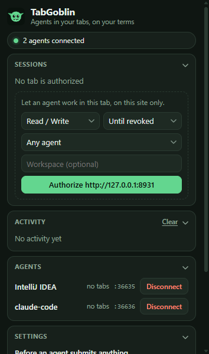
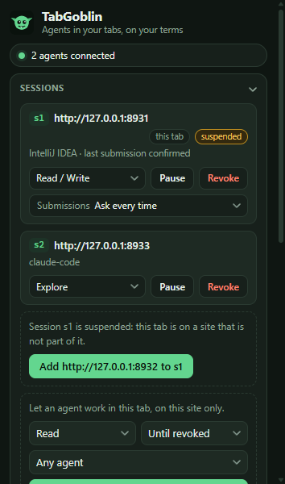

# User guide

The popup pictures here are captures of the real popup window in Chrome (354 × 600 pixels); when
there is more than fits, the popup scrolls. They are regenerated by `e2e/screenshots.mjs` from the
running extension against the demo sites, so they show what the current build does.

## 1. Install

The [installation guide](installation.md) covers this step by step, with checks and fixes for
common problems. In short: you need Java 21 or newer, Node 24 or newer, Maven, and Chrome 120 or
newer.

```sh
mvn -f java-server/pom.xml package                    # builds java-server/target/browser-context-mcp.jar
cd chrome-extension && npm install && npm run build   # builds chrome-extension/dist
```

**Load the extension.** Open `chrome://extensions`, switch on *Developer mode*, click *Load unpacked*
and choose the folder `chrome-extension/dist`. Pin the goblin to the toolbar.

**Tell your agent about the server.** In your IDE's or CLI's MCP settings, add a stdio server that
runs the jar. Use the absolute path:

```json
{
  "mcpServers": {
    "tabgoblin": {
      "command": "java",
      "args": ["-jar", "C:/projects/TabGoblin/java-server/target/browser-context-mcp.jar"]
    }
  }
}
```

Every agent you configure this way starts its own server. Up to eight can run at once.

## 2. Pair

The extension only talks to servers that know a shared pairing token. Print it once:

```sh
java -jar java-server/target/browser-context-mcp.jar --show-token
```

Click the goblin, paste the token, and press **Save and connect**.


The line under the name shows how many agents are connected. If it says *Disconnected*, no server is
running: your agent starts one when it first needs it. A paired extension finds a new server within
about 30 seconds, or immediately when you open the popup.

To invalidate a token, run the jar with `--rotate-token`. Every running server drops the old
pairing at once and the popup asks you to pair again with the new token.

## 3. Authorize a tab

Open the website and log in as you normally do. Then click the goblin **on that tab**.



Choose:

- **the access level** (see below),
- **how long** it lasts: until you revoke it, one hour, or eight hours,
- **which agent** gets the tab, when more than one is connected. *Any agent* gives it to whichever
  agent uses it first.

Press **Authorize**. The tab is now a session. Only that tab and only that website are covered;
subdomains and other ports are different websites.

Why the click has to happen on the tab itself: Chrome gives the extension access to a tab only when
you click its icon there. That is the first of two independent checks; the extension's own check of
the address before every command is the second.

### Access levels

| | Read | Explore | Read / Write |
|---|---|---|---|
| Read the page, scroll, take screenshots, wait | yes | yes | yes |
| Go to other pages of the site, back, forward, reload | no | yes | yes |
| Follow links, open tabs and expand collapsed sections | no | yes | yes |
| Press buttons, fill in and type into fields | no | no | yes |
| Submit forms, post, save, delete | no | no | yes, as a stated submission |

Start with the lowest level that does the job. You can change it at any time in the session's
dropdown; lowering it stops whatever needed the higher level.

**Read** sends nothing to the website on the agent's behalf. **Explore** makes the browser load
pages, which on a few badly built sites has side effects (a "log out" link, for example).

## 4. Working with sessions


The popup is ordered by how often you need it. From the top:

**Sessions** shows each authorized tab: its id, its website, its owner, and controls.

- The dropdown changes the access level.
- **Pause** stops the agent in that tab at once and refuses new commands until you resume.
- **Revoke** ends the session.
- Closing the tab ends its session. Closing the browser ends all of them.

**Activity** shows what is happening now and the six most recent operations, per session, with
their outcome. It never shows page content or anything typed.

**Agents** lists every connected agent and its port. *Disconnect* cuts one off; it stays out until
you press *Allow again*.

Two **switches** and the **Connection…** link close the popup. Scrolled out in full it looks like
this, in the dark and the light theme (TabGoblin follows your system setting):

 

The toolbar badge says `ON` (an agent may act), `RUN` (it is acting), `II` (paused) or `?` (it is
waiting for you).

While an agent is acting, a small pill appears in the page itself, with a **Pause** button. It is
not part of what the agent reads, scripts of the page cannot press it, and you can switch it off
with the second toggle.


## 5. Submissions

Anything that sends or changes data is a submission, and is treated differently from reading and
filling in fields.

 

- The agent has to declare it. A click that would submit is refused otherwise.
- Pressing Enter in a text box counts as well: in a chat or comment box it sends what is written.
  The prompt then reads **Allow pressing Enter?** (the picture on the right). Search boxes are
  left alone.
- The prompt names the control or text box as the page names it, and below that the session and
  its website. For deleting, paying, publishing and the like it is red instead of amber.
- A no stands for five minutes: the agent cannot put the same request to you again in that
  time, and after three requests in a row that you declined or left unanswered, none at all. The
  session then says so in the list, with **Let it ask again** if you change your mind.
- The prompt comes up by itself, and takes the keyboard from the page while it is there. It
  cannot be answered by accident: for its first moment the buttons are dim and take no answer,
  and from the keyboard Deny comes before Allow.
- With **Ask me before the agent submits anything** on (the default), you get this prompt. Nothing
  is typed or clicked until you press **Allow**; **Deny**, or no answer within a minute, means
  nothing happens.
- Deleting, paying, publishing and similar actions always ask, even with the toggle off.
- Afterwards TabGoblin watches the page and tells the agent what it saw: confirmed (the text
  appeared, or the page reacted as if it accepted), failed (an error appeared), or uncertain.
- Nothing is ever sent twice automatically, and the same content is refused within two minutes
  unless the agent explicitly repeats it.

## 6. When a tab leaves its website

If the tab goes to another website, through a link, a redirect to a login page, or because you
navigated there, the session is **suspended**. The agent can read nothing until you decide.



Click the goblin on that tab. You get one of two buttons:

- **Resume** when the tab is back on a website of the session. The session continues where it was.
- **Add … to s1** when the tab is on a new website and you want the session to cover it too, for
  example a separate login host.

Or ignore both and authorize the tab as a fresh session. Each time a tab changes website Chrome
withdraws the extension's access, so moving between two websites of one session takes one click
from you each time. That is by design: no redirect and no existing login ever widens what an agent
can reach.

## 7. Troubleshooting

| What you see | What it means | What to do |
|---|---|---|
| *Not paired* | No token stored | Paste the token from `--show-token` |
| *Pairing failed: check the token* | A server refused the token | Paste the current token; it changes with `--rotate-token` |
| *Disconnected: is the MCP server running?* | No server found on the ports | Start your agent, or check the *First port* under *Connection…* |
| *Server and extension versions differ* | Jar and extension are from different builds | Rebuild both and reload the extension |
| Agent says "not connected" right after starting | It asked before the extension found its server | It waits up to 10 seconds by itself; opening the popup connects at once |
| Agent says a ref is stale | The page changed since its snapshot | Nothing; the agent takes a new snapshot |
| Agent says the session is suspended | The tab left its website | Click the goblin on that tab and resume |
| "This tab cannot be authorized" | Browser pages and the Web Store are off limits | Use a normal `http(s)` page |
| Screenshot refused | The tab is not the visible one in its window | Bring the tab to the front |
| The page stopped responding | A native `alert` or `confirm` dialog is open | Dismiss the dialog |
| The jar "hangs" in a terminal | Run without `--show-token` it starts a server and waits | Press Ctrl+C; see [Stopping](#8-stopping) |

## 8. Stopping

**Stopping what an agent is doing.** In the popup: **Pause** on a session stops the agent in that
tab at once, **Revoke** ends the session, and **Disconnect** next to an agent cuts that agent off
from every tab until you allow it again. None of these stop the server; they do not need to.

**Stopping a server.** A server belongs to the agent that started it and exits by itself when
that agent closes or disconnects from it. Normally there is nothing to stop: close the IDE or end
the CLI session, and its server is gone a moment later.

**A server you started by hand.** If you run the jar in a terminal without `--show-token` or
`--rotate-token`, it starts a server and waits for an agent to talk to it through that terminal.
It says so, and how to stop it:

```text
TabGoblin MCP server, running on 127.0.0.1:47821.
It is normally started by your agent (IDE or CLI), which talks to it through this input and output. …
Press Ctrl+C to stop it. Other uses: --show-token, --rotate-token, --help.
```

Press **Ctrl+C**. `--show-token`, `--rotate-token` and `--help` print and return on their own;
there is nothing to stop.

**A server that is left over.** If a port stays taken after its agent is gone, or Ctrl+C does
nothing because the terminal does not pass it on (some IDE terminals do not), find the server and
end it:

```powershell
# Windows (PowerShell): list the servers with their ports, then stop one by its process id
Get-NetTCPConnection -State Listen -LocalPort (47821..47828) -ErrorAction SilentlyContinue |
  Select-Object LocalPort, OwningProcess
Stop-Process -Id <OwningProcess>
```

```sh
# macOS and Linux
lsof -nP -iTCP:47821-47828 -sTCP:LISTEN
kill <PID>
```

Each line is one agent's server; the popup shows the same ports next to the agents. Stopping a
server only disconnects its agent: sessions, the pairing and the token are kept, and the agent
starts a new server the next time it needs one.

## 9. Settings

| Setting | Where | Default |
|---|---|---|
| Ask before submissions | Toggle in the popup | on |
| In-page indicator | Toggle in the popup | on |
| First port | *Connection…* in the popup; `--port` on the server | 47821 |
| Token file | `--token-file` / `BCMCP_TOKEN_FILE` | `~/.browser-context-mcp/pairing-token` |
| Log level | `BCMCP_LOG` = `debug`, `info`, `warn`, `off` | `info` |
